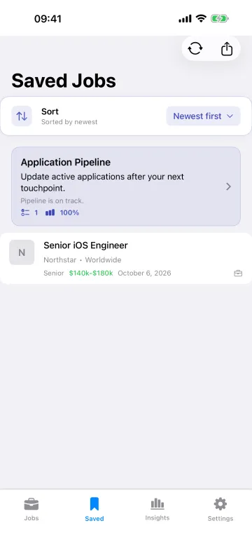
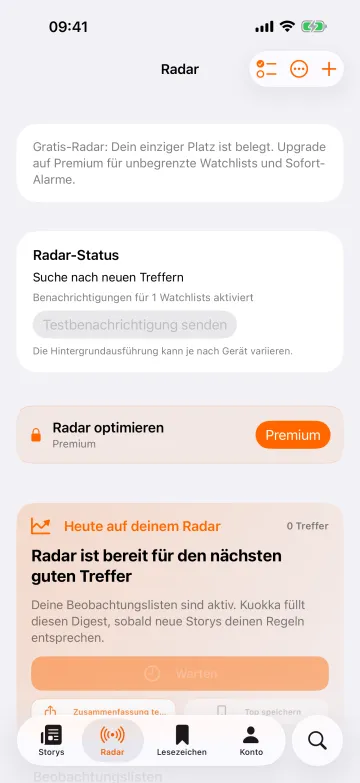
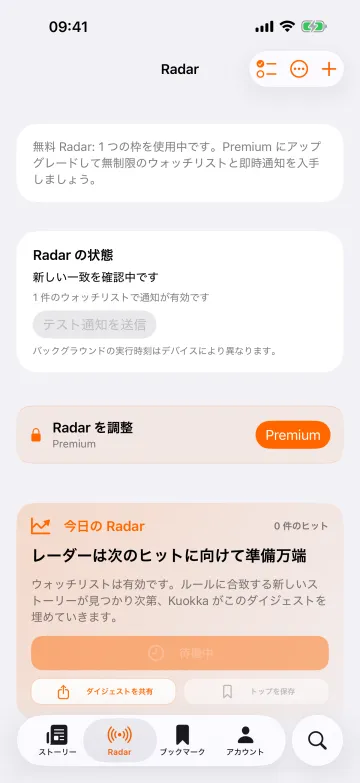
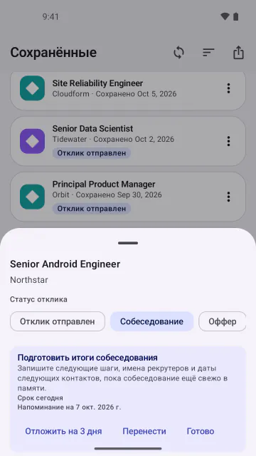

# shotfleet

Localized App Store and Google Play screenshots from **one English Maestro flow**. Every language your app ships, captured in parallel, checked for mistakes, and ready for fastlane.

[](LICENSE)
[](https://github.com/sponsors/noloman)

[Website](https://shotfleet.com) · [Guide](docs/guide.md) · [What's new](CHANGELOG.md) · [Sponsor](https://github.com/sponsors/noloman)

<p>
  
  
  
  
  
</p>

```
$ shotfleet run shotfleet.toml
capturing 18 locales on 4 simulators...
ok   ar       4/4 screenshots
ok   de       4/4 screenshots
...
captured 18/18 locales in 534s on 4 simulators
checked 72 screenshots in 18 languages: 0 problem(s)
```

## The problem

Localized store screenshots often end up as **the English set copied into every language folder**. The UI script that drives the app taps English buttons ("Next", "Settings"), so it can't run in German or Japanese without a separate copy per language. Nobody wants to maintain 18 copies, so the translated listing ships with an English app in it.

## What shotfleet does

- **One flow, every language.** It reads the translations compiled into your app and rewrites your [Maestro](https://maestro.mobile.dev) flow for each language: "Next" becomes "Weiter", "次へ" or "İleri".
- **Parallel.** Several simulators and emulators at once, iOS and Android from the same file.
- **It checks the result.** Wrong language, the same image in two languages, blank frames, missing screens, sizes and counts the stores reject. A bad screenshot never reaches a listing.
- **Ready for fastlane.** `export` writes the folders `deliver` and `supply` read. shotfleet never uploads anything and never sees your Apple or Google credentials.
- **Already use fastlane snapshot or screengrab?** `shotfleet check fastlane/` works on those screenshots, no Maestro needed.
- **Works with your agent.** An MCP server and agent skills for Claude Code, Cursor, Codex, Gemini CLI and Copilot.

Tried on real apps: native iOS and Android, Flutter (wger), Expo (the obytes template) and Compose Multiplatform (JetBrains' KotlinConf app).

## Install

Apple silicon Mac, macOS 13 or later:

```bash
curl -fsSL https://shotfleet.com/install.sh | sh   # signed and notarized; then open a new Terminal window
shotfleet doctor --fix                             # shows what is missing (Maestro, Java, SDKs), asks once, fetches it
cd path/to/MyApp                                   # build it once for the simulator (Debug) first
shotfleet init                                     # writes shotfleet.toml and flow.yaml
shotfleet run --locales en                         # try one language, then: shotfleet run
```

Prefer Homebrew? `brew install noloman/tap/shotfleet`. A double-click `.pkg` and a from-source install are in the [guide](docs/guide.md#quickstart-build-the-app-once-for-the-simulator-first).

## Free, and kept going by sponsors

shotfleet is **free and open source (MIT)**: every command, every language, no key, no account, no license server. It is built and maintained by one person.

If shotfleet saves you or your team time, please consider [sponsoring it on GitHub](https://github.com/sponsors/noloman). Sponsorship is what pays for the unglamorous work that keeps a tool like this usable:

- keeping up with new Xcode, Android, Maestro and macOS releases, which break things every year
- testing on real apps and more languages and scripts
- answering issues and fixing bugs quickly
- new features such as more frameworks, more device sizes and better checks

Companies that ship localized apps get the most from it. A sponsorship is a small cost next to a day of someone re-shooting screenshots by hand.

Not able to sponsor? A star, a bug report, or telling a colleague helps too.

## Documentation

The [guide](docs/guide.md) has the rest: what `check` looks for, every config key, [flow tips for every language](docs/guide.md#flow-tips-for-every-language), [CI](docs/guide.md#in-ci), [AI agents](docs/guide.md#with-ai-agents), [uploading](docs/guide.md#uploading) and [limits](docs/guide.md#limits). Also [Linux notes](docs/linux.md) and [CHANGELOG.md](CHANGELOG.md).

## Contributing

Contributions are welcome: see [CONTRIBUTING.md](CONTRIBUTING.md). Bug reports and ideas go in [GitHub issues](https://github.com/noloman/shotfleet/issues).

## License

[MIT](LICENSE).
