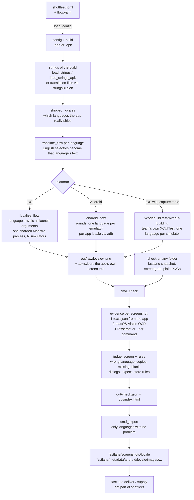

# shotfleet architecture guide

> **Update, 2026-11-11:** shotfleet is now free and open source (MIT), funded through GitHub Sponsors. The license check, `shotfleet activate`, the price, the free tier, refunds and the Gumroad product were removed (versions up to 0.1.10 were sold). Wherever this document describes them, it describes the paid period and no longer applies; `LICENSE`, `README.md` and `CHANGELOG.md` are current.

This is the entry point for engineers who will change shotfleet's code. It explains how the program works, why it is built the way it is, and
how to change it without breaking it. It describes the code, not the marketing. Where a doc disagrees with the code, the doc is wrong and the
mismatch is listed in [appendix: doc/code mismatches](architecture/13-mismatches.md).

**Snapshot.** Written against `origin/main` at `285e099` (0.1.6). The code has moved on: the live version is 0.1.9 (2026-10-11), and 0.1.7 to 0.1.9 added features this guide does not describe (see `CHANGELOG.md`). Also, the line numbers that this guide used to quote are gone: they drifted by up to about 560 lines. Function and constant names are the handle; grep for the name, or use the generated [function map](engineering/12-function-map.md) for line numbers. Where this guide and the code disagree, the code wins. Known gaps that are not fixed are listed as gaps, not as work in flight. The newer, more complete guide is [docs/engineering/](engineering/README.md).

## Contents

| # | File | What is in it |
|---|---|---|
| 1 | this file | What shotfleet is and is not, the commands, the end-to-end data flow |
| 2 | [01-code-layout.md](architecture/01-code-layout.md) | Why one file, how `shotfleet.py` is organised, conventions, exit codes, logging, `shotfleet.toml`, output folders |
| 3 | [02-capture.md](architecture/02-capture.md) | Reading strings from builds, rewriting flows, simulators and emulators, parallelism, locale setting, bring your own capture, retries, timeouts, locks |
| 4 | [03-check.md](architecture/03-check.md) | OCR, language detection, every check rule, unverified screens, `--strict`, `--json` |
| 5 | [04-export-and-store-rules.md](architecture/04-export-and-store-rules.md) | `export`, fastlane layouts, store size and count rules |
| 6 | [05-licensing.md](architecture/05-licensing.md) | Gumroad verification, activations, offline grace, CI key, free tier, update window, limits of client-side checks |
| 7 | [06-mcp-and-skills.md](architecture/06-mcp-and-skills.md) | The MCP server, its tools and safety gates, the agent skills |
| 8 | [07-packaging-and-release.md](architecture/07-packaging-and-release.md) | PyInstaller build, signing, notarization, `publish.sh`, the release gate |
| 9 | [08-website.md](architecture/08-website.md) | `site/`, the Cloudflare worker, CSP, the claims register, guides generator, flag files |
| 10 | [09-testing.md](architecture/09-testing.md) | Test layers, how to run everything locally, test doubles, flaky-test history |
| 11 | [10-making-changes.md](architecture/10-making-changes.md) | Recipes for common changes, release checklist, gotchas from history |
| 12 | [11-security-and-privacy.md](architecture/11-security-and-privacy.md) | What leaves the machine, trust boundaries |
| 13 | [12-glossary.md](architecture/12-glossary.md) | Terms |
| 14 | [13-mismatches.md](architecture/13-mismatches.md) | Appendix: where docs and code disagree |

If you read only three things: this file, [01-code-layout.md](architecture/01-code-layout.md) and
[10-making-changes.md](architecture/10-making-changes.md).

## 1. What shotfleet is, and what it is not

shotfleet is one command-line program (Python 3.11+, standard library only, plus one small Swift helper) that produces and verifies localized
App Store and Google Play screenshots.

- **Capture.** You write one English [Maestro](https://maestro.mobile.dev) flow (YAML) that taps buttons by their visible text. shotfleet reads the
  translations compiled into your app build, rewrites every text selector in the flow into each language the app ships, boots N iOS simulators or
  Android emulators, and runs one language per device in parallel.
- **Check.** Every screenshot is compared with the app's own strings: wrong language, copies across languages, missing screens, blank frames,
  system dialogs over the app, store size/count/alpha rules. `check` also works on screenshots made by other tools (fastlane snapshot,
  screengrab, a folder of PNGs), with no devices.
- **Export.** Screenshots whose language passed are copied into fastlane's `deliver` and `supply` folder layouts. fastlane uploads them.
- **Bring your own capture (iOS).** Instead of a Maestro flow, a `[capture]` table makes `run` build and run the team's own XCUITest screenshot
  tests on the same simulator pool, one language each.
- **Agents.** `shotfleet mcp` is an MCP server (tools `check`, `run`, `doctor`) and `shotfleet skill install` copies three agent skills.

It is not:

- Not an uploader. It stops at fastlane's folders (`export`). Nothing is ever sent to App Store Connect or Google Play.
- Not a screenshot designer (no frames, captions or marketing layouts). `check` reads captions only to explain a wrong-language verdict.
- Not a Windows or Intel Mac tool. The released build is macOS 13+ on Apple silicon; `check` also runs on Linux (Tesseract, Docker image). `run`
  needs a Mac for iOS, and has only been proven on Linux for Android with one emulator (docs/linux.md).
- Not a way to drive real devices. Simulators and emulators only (no physical iPhone or Android phone).
- Not a service. There is no shotfleet backend. The only servers it talks to are Gumroad (licence), shotfleet.com (latest version number for
  `doctor`, downloads), and the hosts `doctor --fix` fetches tools from. See [11-security-and-privacy.md](architecture/11-security-and-privacy.md).
- Not open source. The repo is private; the three agent skills are published separately at `noloman/shotfleet-skills`.

### The commands

`COMMANDS` and the parser built in `main()` are in `shotfleet.py`.

| Command | What it does | Needs licence? | Typical exit codes |
|---|---|---|---|
| `doctor [--fix] [--yes] [config]` | Checks Maestro, Java, Xcode, Android SDK, OCR; prints what is missing. `--fix` downloads Maestro, a JRE and the Android tools after one confirmation, never uses sudo. | no | 0 (one platform ready), 2 (neither), 1 (a `--fix` step failed) |
| `init [build...] [--dir D] [--capture]` | Writes `shotfleet.toml` and `flow.yaml` for a simulator `.app` and/or an `.apk`, finding the newest Debug build if none is given. Knows Flutter, React Native, Expo, Capacitor, MAUI, Kotlin Multiplatform projects. `--capture` writes a `[capture]` config. | no | 0, 2 |
| `run [config] [--platform] [--locales \| --retry-failed] [--parallel] [--json] [--no-hooks] [--no-build]` | Capture every language, then `check`. | free: 2 languages; paid: all | 0, 1, 2, 130 |
| `check <folder> [--app] [--strings] [--report] [--ocr-command] [--locale] [--content [config]] [--json] [--strict]` | Verifies screenshots from shotfleet, fastlane or anything. | no, never | 0, 1, 2, 130 |
| `export <out> --fastlane <dir> [--json] [--no-hooks]` | Copies passing languages into fastlane folders. | yes | 0, 1, 2 |
| `activate <key>` / `deactivate` | Stores or removes the Gumroad licence on this Mac. | n/a | 0, 2 |
| `mcp` | MCP server on stdin/stdout. | `run` over MCP has the same free-tier cap | n/a |
| `skill install [--project] [--dir D] [--force]` | Copies the agent skills into `~/.claude/skills` and `~/.agents/skills` (or the project's). | no | 0, 2 |
| `shotfleet foo` | If `foo` is not a built-in command and `shotfleet-foo` is on the PATH, `exec`s it (plugin mechanism like `git foo`). | n/a | the plugin's |

Exit codes mean the same everywhere (details in [01-code-layout.md](architecture/01-code-layout.md#exit-codes)): `0` fine, `1` the work ran and
found problems, `2` setup error with a one-line message, `130` interrupted.

## 2. The main data flow, end to end

The same flow as numbered steps, with the code that does each one:

1. **Parse and validate the config.** `read_doc` parses TOML and refuses unknown tables; `check_section` refuses
   unknown or mistyped keys; `load_config` validates the build (is it a simulator `.app`? an `.apk` whose package name can be read?) and fills
   defaults. Every mistake is a `Fail` with a sentence that says how to fix it.
2. **Read the app's strings.** iOS: every `*.lproj/*.strings`, `.stringsdict` and String Catalog inside the `.app` (`load_strings`). Android:
   `aapt2 dump resources` of the APK (`load_strings_apk`). Flutter, React Native, MAUI, Unity and translation-platform exports: source files named
   by `strings = "glob"` (`config_strings`; `read_translation_file`).
3. **Decide the languages.** `shipped_locales` separates the app's own strings from libraries' near-universal ones and keeps languages the app
   translates at least half-way. `locales` in the config or `--locales` override it. Without a licence the list is cut to two (`cap_locales`).
4. **Rewrite the flow per language.** `translate_flow` maps each English text selector to a regex that matches any of that language's
   translations of the same key, handles format strings (`Round %d of %d`), plurals, `.*` wildcards, system dialogs that stay English and
   `[overrides.<locale>]`. It returns the translated flow, the selectors it could not translate and the translation collisions.
5. **Make each flow self-contained.** `localize_flow` (iOS) adds the language as launch arguments (`AppleLanguages`, `AppleLocale`) because
   Maestro hands any flow to any simulator; `android_flow` does the Android equivalent. Screenshots are redirected into a per-locale folder.
6. **Boot devices and run.** `make_pool` (iOS) and `android_pool` create or reuse a pool named `shotfleet-<device>-N`. iOS runs
   one sharded Maestro process over all simulators (`ios_run_inner`); Android runs rounds of one language per emulator
   (`android_run_inner`). The `[capture]` path runs `xcodebuild test-without-building` per language instead.
7. **Collect text while the screenshot is on screen.** On iOS a background thread (`capture_texts`) reads the accessibility tree from the
   Maestro iOS driver the moment a PNG appears and writes `<shot>.texts.json`. On Android a marker step after each `takeScreenshot` makes Maestro save
   the hierarchy (`android_flow`, `hierarchy_texts`, `save_hierarchy_texts`). This is the app's own exact text, in every script.
8. **Retry once, device failures only.** Languages that failed with an infrastructure error (`INFRA_ERRORS`: a simulator that stopped answering, Maestro dying before it reported, an emulator that is offline or did not boot) are retried once on the devices that still answer (`retry_choice`, then `ios_run_inner`; Android `safe_round`). A failed flow or app is not retried. `run --retry-failed` reruns the languages that failed in `out/run.json` (`retry_setup`, `keep_earlier`).
9. **Check.** `cmd_check` finds the screenshots in whatever layout they are in, reads their text (app text first, then OCR), judges the
   language, finds copies and missing screens, applies the store rules and writes `check.json` and `index.html`.
10. **Export.** `cmd_export` copies the screenshots of every language with no problem into fastlane's folders, mapping app locales to
    store codes (`de` to `de-DE`).

`run` is capture plus check: both `ios_run_inner` and `android_run_inner` end by calling `cmd_check` and return the worse of the two exit codes.

## 3. Reading order for the code

1. `main()`, `main_cmd` and `main_dispatch` (how a command is routed, where exit codes are made).
2. `cmd_run`, `run_platform`, `capture_platform`, `ios_run_inner`.
3. `translate_flow` with its tests in `tests/test_shotfleet.py` (class `TranslateFlow`).
4. `cmd_check` and `judge_screen`.
5. `require_licence`, then `key_licence` and `mac_licence`.

Then read the research note behind whatever you are touching; [10-making-changes.md](architecture/10-making-changes.md) lists them per area.

## 4. Where to find the why

The repo keeps its reasoning in files, and the code cites them:

- `research/*.md`: dated notes. Each says what was measured (tags such as `[M]` measured, `INFERENCE`, `CONFIRMED`) and whether it was applied.
  `research/README.md` is the index.
- `CHANGELOG.md`: one bullet per user-visible change, written for buyers; usually the shortest description of why a behaviour exists.
- `STATUS.md`, `docs/handoff.md`: project state. Both lag the code (see the appendix); trust the code first.
- `tests/claims.json`: every public promise with the test or evidence that proves it ([08-website.md](architecture/08-website.md)).
- Comments in `shotfleet.py` that say `ponytail:` mark a deliberate simplification with a known ceiling and what to do when it is reached.
  grep for it before "fixing" something that looks naive.
