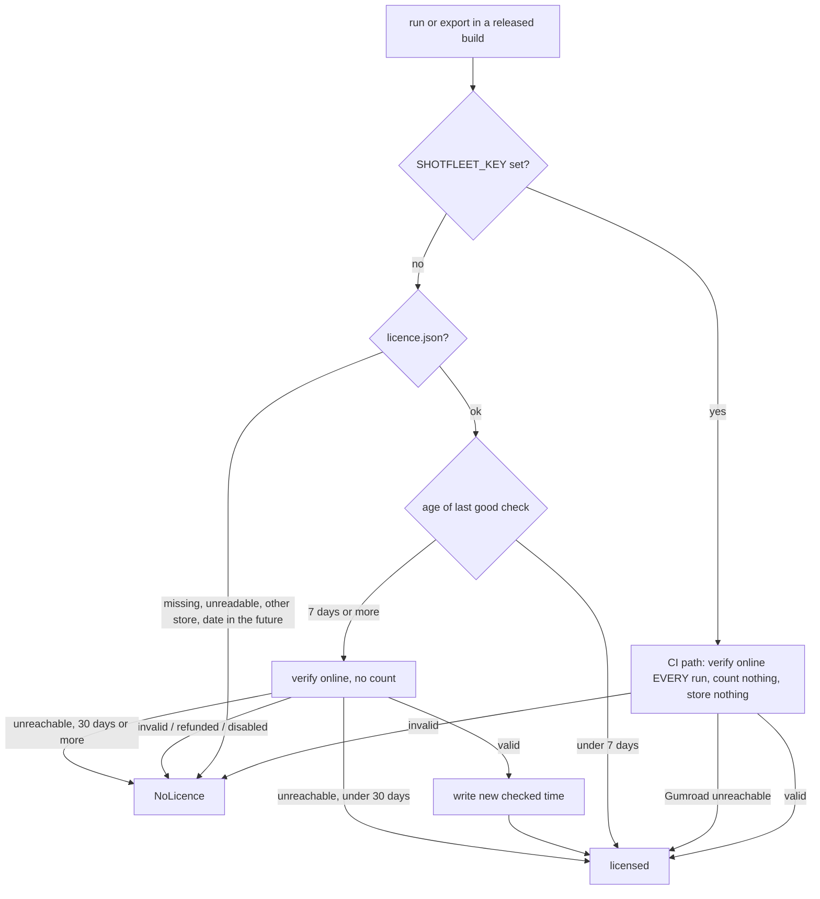

# 5. Licensing

Back to the [index](../ARCHITECTURE.md). Anchors are `shotfleet.py:LINE` at `c18473f` unless a section says it describes a branch.

The licence code is the last section of `shotfleet.py` (`:4891-5062`). It is small, deliberately simple, and an honesty system: it keeps honest
buyers honest and makes no attempt to stop a determined person (see [limits](#known-limits-of-client-side-checks)). Sold through Gumroad as one
product ($29 for the first 100 buyers through a Gumroad offer code, then $49, one payment, a year of updates, a 14-day refund; the site's terms page is the legal
text). Why Gumroad and not Polar or Lemon Squeezy: `research/gumroad-setup.md` (Polar's Stripe account needs a Dutch KvK number); the Polar and Lemon
Squeezy code was removed on 2026-10-03.

## What is free, what is paid

| Command | Without a licence | With one |
|---|---|---|
| `check`, `doctor`, `init`, `skill`, `mcp`, `activate`, `deactivate` | works; never touches the licence code | same |
| `run` (iOS, Android, `[capture]`, MCP `run`) | captures **2 languages** (`FREE_LANGUAGES`, `:4899`) | every language |
| `export` | refused, exit 2: "`export` and every language in `run` need a licence ..." | works |

The gate lives in `main_dispatch` (`:5113`): `export` calls `require_licence()` (a `NoLicence`, which is a `Fail`, so exit 2); `run` calls
`apply_free_tier()` (`:5044`), which turns a `NoLicence` into `LOCALE_CAP = 2` plus a stderr note instead of a refusal. `cap_locales` (`:4906`) then
cuts the language list inside `ios_run_inner` (`:1879`) and `android_run_inner` (`:2566`) to the **first two** of the list (the sorted default list, or
the two named with `--locales`) and prints a `free tier:` line saying why. The cap counts languages only: both platforms, every device size and every screen are included.
**The cap is per run**: two runs of two languages give four, and a pinned test (`FreeTierOnAFrozenBuild.test_the_cap_is_per_run_two_runs_of_two_languages_give_four` in `tests/test_claims_unit.py`)
documents this on purpose, and `TierReachesBothPlatformRuns` pins that the cap reaches both platform runs; the owner chose on 2026-10-06 to leave it. What is really paid is `export` and doing it in one run. Nothing ends the free
tier: no date, no version switch.

**The licence is enforced only in released (frozen) builds.** `require_licence` returns at once when `getattr(sys, "frozen", False)` is false
(`:4995`): a source checkout runs everything unlicensed. Tests therefore patch `sys.frozen`. This is also why the source file is private.

## The Gumroad call (`gumroad_verify`, `:4921`)

`POST https://api.gumroad.com/v2/licenses/verify` with form fields `product_id`, `license_key`, `increment_uses_count` ("true" or "false"). No token:
the verify endpoint is public, and a token that could free activations (`deactivate` would need one) cannot ship inside a program.
`GUMROAD_PRODUCT_ID` (`:4897`) is not secret and is written into the file by `packaging/go-live.sh`. TLS uses `tls_context()` (certifi's bundle
inside the release, or `SSL_CERT_FILE` and friends for corporate proxies that re-sign HTTPS).

It returns `(ok, uses, reason)`:

- `success` false: refused, with Gumroad's message, except that a "disabled" message becomes "the key was disabled, as Gumroad does after a full refund"
  (Gumroad's source disables the key itself on a full refund, a 404).
- `success` true: Gumroad **answers success even for a refunded or charged-back purchase** ("licence enforcement is up to the seller"), so the purchase
  flags are checked: `refunded`, `chargebacked`, `disputed` without `dispute_won` all refuse. A partial refund keeps working (`refunded` stays false).
- **Offline is not a verdict.** A 5xx, a connection error, a timeout, and a 200 that is not JSON (a hotel Wi-Fi login page) raise `OSError`. Callers treat
  `OSError` as "could not ask", never as "invalid".

`uses` is **one lifetime counter per key** that Gumroad increments on every call with `increment_uses_count=true`. It is not a count of Macs. There is
no per-Mac id and none is sent.

## Activation (`cmd_activate`, `:4953`)

1. `is_gumroad_key`: four groups of eight hex characters.
2. First call with `count_use=False`: refuses refused keys and reads `uses` without burning anything.
3. `known` = this Mac's `licence.json` already holds this exact key. A re-activation on the same Mac counts nothing.
4. If not known: `uses >= MAX_MACS` (3) refuses with "this key has used all 3 activations. Email hello@shotfleet.com and I'll reset the count";
   otherwise a second call with `count_use=True`. Two people activating at the same instant can pass the limit; a `ponytail:` comment accepts that and
   resets by hand.
5. Writes `licence.json`: `{"key", "store": "gumroad", "checked": <unix time>}`, plain text, unsigned, at
   `~/Library/Application Support/shotfleet/licence.json` (`LICENCE_FILE`, `:4893`). Treat the file like a password; the agent skills tell agents never to print it.

`deactivate` (`:4979`) deletes the file. It **cannot** give the activation back (Gumroad needs the seller's access token for that), so a new macOS
install, a new user account, or `deactivate` followed by `activate` consumes another one. The owner resets the count in the Gumroad dashboard
(`docs/refund-runbook.md`). A `licence.json` from a store the program no longer uses (`store != "gumroad"`) is refused with a message saying to
activate the Gumroad key.

## Checking a stored licence (`require_licence`, `:4992`)

- **Weekly re-check** (`LICENCE_RECHECK_DAYS = 7`): only when `run` or `export` is used, never counted.
- **Offline grace** (`LICENCE_OFFLINE_DAYS = 30`) after the last good check, for an activated Mac.
- **A date in the future** (`age < -1` days) is refused: a hand-edited file would otherwise never be re-checked.
- **A corrupt or half-written file never crashes a command** (`read_licence`, `:4971`, returns `None` for anything wrong, including a non-numeric
  `checked`); the message says to activate again.
- **`SHOTFLEET_KEY` (CI), on main:** checked online on every run, uses no activation slot, nothing stored, and it **fails open**: when Gumroad cannot
  be reached the run counts as licensed, with no time limit. This is an owner decision (2026-10-05) so a CI job never fails because Gumroad is down. The
  cost: an outage hides a refunded key until a run reaches Gumroad, and any well-formed key passes while the API is blocked. README, docs page, terms
  and the skills all say so in plain words. `SHOTFLEET_KEY` also works on a developer's Mac and skips the activation limit entirely.
- `SHOTFLEET_GUMROAD_API` (the API base) is honoured **in released builds on main** because the release tests need it
  (`tools/release-candidate.sh`, `tests/test_golive.py`). It is a known one-line bypass (point it at a dead host plus any well-formed key); the 0.1.6
  branch below closes it.

## The update window

"A year of updates" is on the site, in the terms and in the README. **On main nothing enforces it**: no code compares a release date with a
purchase date, downloads are public, and every buyer gets every future version. The in-flight 0.1.6 work adds the enforcement.

## 0.1.6 changes in flight: branches `claude/016-licence-fixes` and `claude/016-licence-harden`

Both branches currently point at the same single commit, `c78a124` ("0.1.6 licence: close two bypasses, 5 activations for 3 Macs, enforce ...") on
top of `c18473f`, 24 files, not merged. The description below is read from `git diff origin/main...claude/016-licence-fixes`; names and numbers may change
before merge.

| Change | What the code does |
|---|---|
| **5 activations for 3 Macs** | `MAX_MACS = 5`. The promise to buyers stays "3 of your Macs"; the other 2 are spare for reinstalls. Site, terms, README, docs, `llms.txt`, skills and `tools/release-candidate.sh` are updated ("five activations, then the sixth"). |
| **The API base can't be swapped in a released build** | `GUMROAD_API` becomes a constant; `gumroad_api()` honours `SHOTFLEET_GUMROAD_API` only from source or in a release-candidate test build (a frozen build whose product id starts with `RCTEST`). |
| **A year of updates, for real** | `UPDATE_DAYS = 365`. `packaging/build.sh` writes the build day (`date -u`) into `build/release-date` and bundles it (`--add-data`); `baked_release_date()` reads it from `sys._MEIPASS`. `gumroad_verify` now returns a fourth value, the sale time from `purchase.sale_timestamp`, saved in `licence.json` as `"sale"` (so it works offline). `check_update_window(sale)` raises `NoLicence` when the build's release date is later than sale + 365 days; the result is the free tier plus a message saying which versions the key covers, and older versions keep working (every version stays at `/download/<version>/`). It compares the build's date with Gumroad's sale date, never with the Mac's clock. No date (a source run, or Gumroad sent none) means no window. A pre-0.1.6 `licence.json` has no `sale`; it gets one at the next weekly check. |
| **CI keys no longer pass just because Gumroad is unreachable** | A `SHOTFLEET_KEY` is still checked online on every run and still uses no activation. When Gumroad is unreachable it counts only on a machine where that key passed a check in the last 30 days, recorded in `ci-checked.json` next to `licence.json` as a SHA-256 of the key plus the time and sale date (never the key); a `licence.json` holding the same key counts too. On a fresh runner during an outage the key is refused ("SHOTFLEET_KEY couldn't be checked ..."): `export` stops, `run` captures 2 languages. |

A read-only review of that commit (kept outside the repo, in `shotfleet-rc-build/code-review-2026-10-07/licence-fixes-branch.md`; its findings were
VERIFIED by the reviewer with a fake Gumroad server and a patched `sys.frozen`, not by the author of this guide) concluded none blocks a merge and lists:

- **N1 (medium):** during a Gumroad outage a hosted CI job (fresh runner, no `ci-checked.json`) silently drops to 2 languages while `run` still exits 0. Fix
  options: exit non-zero when `SHOTFLEET_KEY` is set and refused, or document caching the file between jobs.
- **N2 (medium):** the release date is a loose file inside the program folder (`_internal/release-date`); deleting or editing it turns the window off,
  and the code signature does not notice (a bare Mach-O signature seals only the executable). Fix: bake the date into code inside the PYZ archive.
- **N3 (low):** activating an out-of-window key spends an activation before the window is checked.
- **N4 (low):** `ci-checked.json` and `licence.json` can be written by hand for a made-up key.

## Known limits of client-side checks

Everything here follows from "the check runs on the buyer's Mac":

1. The licence file is plain text and unsigned. A hand-written file with a fresh `checked` passes for 7 days.
2. The program can be patched; the signature covers the executable, not `_internal/` data files.
3. `SHOTFLEET_KEY` skips the activation limit, so one key in a team's shell profile or CI secret serves any number of machines (main). On the 0.1.6
   branch it still skips the limit but is no longer accepted blindly offline.
4. Activations are a lifetime counter per key. They are not "3 Macs at a time", and only the owner can reset them.
5. Gumroad's verify endpoint says `success: true` for refunded purchases, so refusal depends on the flags above and on the weekly re-check; a refunded key
   stays valid for up to a week (or 30 days offline) on an activated Mac.
6. A refunded-key refusal has **never been proven against a real paid sale** (Gumroad lists test purchases nowhere in Sales and a $0 sale has no refund
   action); it is proven against a fake Gumroad built from Gumroad's docs and source. See `STATUS.md` gate 5 and `docs/refund-runbook.md`.
7. The repo is private, so "source runs unlicensed" only matters if the source leaks.

These are accepted trade-offs recorded in `research/review-2026-10-03.md` ("Defect 2", "Defect 3") and `research/refund-process-2026-10-05.md`. Do not "fix"
them by adding obfuscation or a server without the owner: the product promise is "no account, offline-first".

## Test doubles and how licensing is tested

- **Fake Gumroad server.** `tests/test_shotfleet.py` (classes `Licence` and `GumroadLicence`, a `BaseHTTPRequestHandler` around line 1364) and
  `tools/release-candidate.sh` (embedded Python `FakeGumroad` with control calls such as `outage=1`) answer the way `gumroad_verify` reads the real API:
  `success`, `uses` incrementing, purchase flags, 404 "disabled", 5xx, non-JSON 200. `tests/test_release_candidate.py` loads the script's handler and
  checks the fake behaves like the parser expects. Tests patch `sf.GUMROAD_API`, `sf.LICENCE_FILE`, `sf.GUMROAD_PRODUCT_ID`, `sys.frozen`.
- **The frozen program.** `tools/release-candidate.sh` (needs `SHOTFLEET_RC=1`, builds with PyInstaller into a temp copy with a TEST product id) runs the
  real frozen binary through free tier, activate, re-activate, refused key, the Mac limit, deactivate, weekly re-check, 503, dead server, 31 days offline,
  `SHOTFLEET_KEY`, TLS from the frozen build. Result recorded in `research/release-candidate.md` (92 checks).
- **The real API.** `tools/golive/storefront.sh` reads the live product page (published, licence keys on, product id matches, price, refund policy) and asks the real API
  to verify a made-up key. `tools/selftest.sh --licence-probe` does the same from a packaged build. Real activation, re-activation, refusal and
  `SHOTFLEET_KEY` were proven on the signed 0.1.2 release with the creator's test purchase (2026-10-05).

## Operating it

- `packaging/go-live.sh` sets `GUMROAD_PRODUCT_ID` and switches the site from waitlist to sale (used once, for 0.1.0).
- Refund or disabled key: `docs/refund-runbook.md`. Activation reset: Gumroad dashboard, by hand.
- Changing any licence behaviour means changing, together: `shotfleet.py`, the unit tests above, `tools/release-candidate.sh`, `site/public/terms.html`, `index.html`,
  `docs.html`, `llms.txt`, README, the skill `references/licence.md` and `ci.md`, and the claim rows that quote them. The 0.1.6 commit touched 24 files for exactly this reason.
