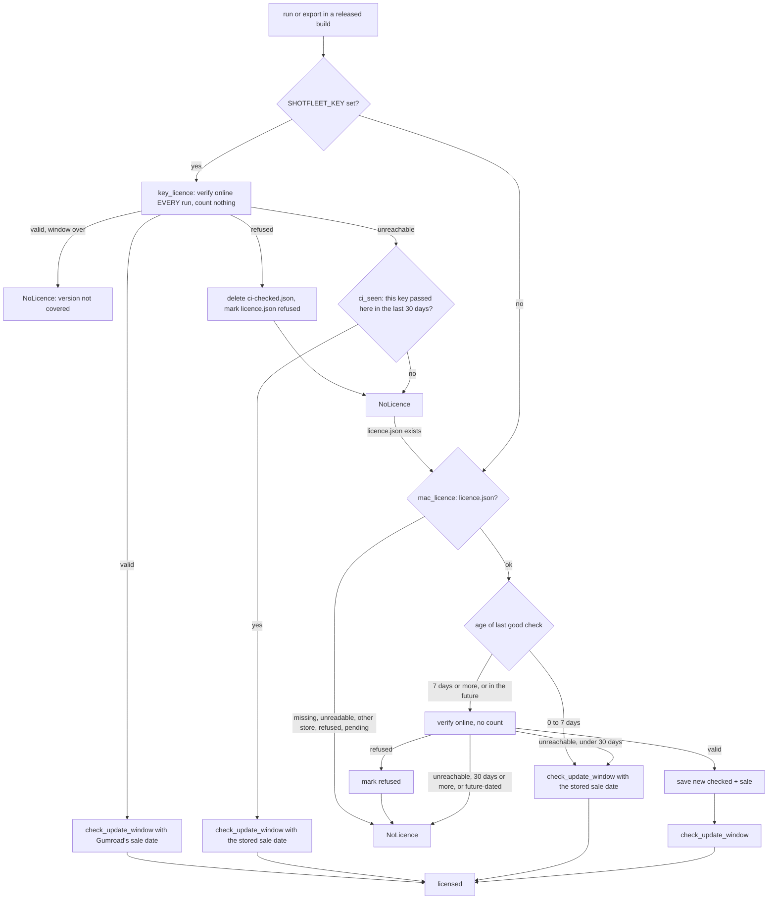

# 5. Licensing

Back to the [index](../ARCHITECTURE.md). Anchors are `shotfleet.py:LINE` at `origin/main` `285e099`. Everything below is code on main; the 0.1.6 licence fixes and hardening
(`claude/016-licence-fixes`, `claude/016-licence-harden`) are merged.

The licence code is the last big section of `shotfleet.py` (`:4979-5297`, then `main_cmd` and `main_dispatch`). It is small and deliberately simple, and it is an honesty system: it keeps honest
buyers honest and makes no attempt to stop a determined person (see [known limits](#known-limits-of-client-side-licensing)). Sold through Gumroad as one
product ($29 for the first 100 buyers through a Gumroad offer code, then $49, one payment, a year of updates, a 14-day refund; the site's terms page is the legal
text). Why Gumroad and not Polar or Lemon Squeezy: `research/gumroad-setup.md` (Polar's Stripe account needs a Dutch KvK number); the Polar and Lemon
Squeezy code was removed on 2026-10-03.

## What is free, what is paid

| Command | Without a licence | With one |
|---|---|---|
| `check`, `doctor`, `init`, `skill`, `mcp`, `activate`, `deactivate` | works; never touches the licence code | same |
| `run` (iOS, Android, `[capture]`, MCP `run`) | captures **2 languages** (`FREE_LANGUAGES`, `:4988`) | every language |
| `export` | refused, exit 2: "`export` and every language in `run` need a licence ..." | works |

The gate lives in `main_dispatch` (`:5357`): `export` calls `require_licence()` (a `NoLicence`, which is a `Fail`, so exit 2); `run` calls
`apply_free_tier()` (`:5286`), which turns a `NoLicence` into `LOCALE_CAP = 2` plus a stderr note instead of a refusal. `cap_locales` (`:4994`) then
cuts the language list inside `ios_run_inner` (`:1917`) and `android_run_inner` (`:2622`) to the **first two** of the list (the sorted default list, or
the two named with `--locales`) and prints a `free tier:` line saying why. The cap counts languages only: both platforms, every device size and every screen are included.
**The cap is per run**: two runs of two languages give four, and a pinned test (`FreeTierOnAFrozenBuild.test_the_cap_is_per_run_two_runs_of_two_languages_give_four` in `tests/test_claims_unit.py`)
documents this on purpose, and `TierReachesBothPlatformRuns` pins that the cap reaches both platform runs; the owner chose on 2026-10-06 to leave it. What is really paid is `export` and doing it in one run. Nothing ends the free
tier: no date, no version switch.

**There is one exception to "run falls back to the free tier": a set `SHOTFLEET_KEY`.** When it is set and refused or unverifiable, `apply_free_tier` raises a `Fail` (exit 2,
"`run` stops here instead of capturing only 2 languages ...") instead of capping. Why: a CI job that sets a key wants every language, and a green job that quietly checked 2 would be a lie
(review note N1: a Gumroad outage on a fresh hosted runner would otherwise have passed). Unsetting the variable gives the free tier back. `apply_free_tier` also resets `LOCALE_CAP = None` first, because
the MCP server calls it on every `run`: a key activated while the server is up lifts the cap on the next call (a stale cap was review finding F4).

**The licence is enforced only in released (frozen) builds.** `require_licence` returns at once when `getattr(sys, "frozen", False)` is false
(`:5257`): a source checkout runs everything unlicensed. Tests therefore patch `sys.frozen`. This is also why the source file is private.

## The Gumroad call (`gumroad_verify`, `:5109`)

`POST <API>/verify` with form fields `product_id`, `license_key`, `increment_uses_count` ("true" or "false"). No token:
the verify endpoint is public, and a token that could free activations (`deactivate` would need one) cannot ship inside a program.
`GUMROAD_PRODUCT_ID` (`:4986`) is not secret and is written into the file by `packaging/go-live.sh`. TLS uses `tls_context()` (`:3737`; certifi's bundle
inside the release, or `SSL_CERT_FILE` and friends for corporate proxies that re-sign HTTPS).

**The API base cannot be swapped in a released build.** `GUMROAD_API` (`:4985`) is a constant, and `gumroad_api()` (`:5006`) returns it for any frozen build, whatever
`SHOTFLEET_GUMROAD_API` says, unless the build's product id starts with `RCTEST` (only `tools/release-candidate.sh` writes that, into a temp copy of the file). From source the variable is
honoured, which is how the tests point the program at a fake server. Before 0.1.6 the variable worked in released builds, a one-line bypass (a dead host plus any well-formed key).

**Time limit.** `gumroad_fetch` (`:5091`) runs the request in a daemon thread and stops waiting after `GUMROAD_TOTAL_SECONDS = 20` (`:4983`); the socket timeout of 15 s alone does not cover DNS or a server that
sends one byte a second. Any failure to get an answer is an `OSError` ("can't reach the licence server ...").

`gumroad_verify` returns `(ok, uses, reason, sale)`, where `sale` is `purchase.sale_timestamp` as unix time (or None):

- `success` false: refused, with Gumroad's message, except that a "disabled" message becomes "the key was disabled, as Gumroad does after a full refund"
  (Gumroad's source disables the key itself on a full refund, a 404).
- `success` true: Gumroad **answers success even for a refunded or charged-back purchase** ("licence enforcement is up to the seller"), so the purchase
  flags are checked: `refunded`, `chargebacked`, `disputed` without `dispute_won` all refuse. A partial refund keeps working (`refunded` stays false).
- **Offline, and any odd reply, is not a verdict.** A 5xx, a connection error, a timeout, a cut-off body or a proxy's garbage status line, a 200 that is not JSON (a hotel Wi-Fi login page),
  and **any answer whose `success` is not a real true or false** (an empty 403 or 407, a 429, a login page) raise `OSError`. Callers treat `OSError` as "could not ask", never as "invalid".
  A reply with the wrong types (`purchase` not an object, `uses` not an integer) is read as empty rather than crashing.

`uses` is **one lifetime counter per key** that Gumroad increments on every call with `increment_uses_count=true`. It is not a count of Macs. There is
no per-Mac id and none is sent.

## Activation (`cmd_activate`, `:5145`)

1. `is_gumroad_key`: four groups of eight hex characters.
2. First call with `count_use=False`: refuses refused keys and reads `uses` and the sale date without burning anything.
3. **The update window is checked here, before anything is counted** (`check_update_window(sale)`): a key from 2020 on a 2026 build is refused with "nothing was activated and no
   activation was used". (Review note N3: before the fix the key spent an activation and then ran as the free tier.)
4. `known` = this Mac's `licence.json` already holds this exact key, **or** a file is there but unreadable. Either way it is a re-check and counts nothing.
5. If not known: `uses >= MAX_MACS` (`:4987`, **5**) refuses with "this key has used all 5 activations. Email hello@shotfleet.com and I'll reset the count". The promise to buyers is **3 of your Macs**;
   the other 2 are spare for reinstalls, because Gumroad's counter cannot be given back from the program. Terms, site, README and the skills all say "5 activations: 3 Macs and 2 spare".
6. **Save first, count second.** `licence.json` is written with `pending: true` (`save_licence`, `:5138`) *before* the counted call. A folder that cannot be written fails before anything is charged, and if the reply is lost after Gumroad
   counted, this Mac remembers and the retry finds the key and does not count again ("Gumroad may have counted this activation, and this Mac remembers it ..."). A `pending` file makes `run` and `export` say "activating on this
   Mac didn't finish".
7. If the counted call comes back refused, or `uses > MAX_MACS` (two people activated at the same instant and the other took the last slot), the previous file is restored (or removed) and the user is told; the count stays burned, which the owner resets by hand.
   The race itself is still accepted (a `ponytail:`-style limit): two simultaneous activations can pass the limit.
8. Success writes `{"key", "store": "gumroad", "checked": <unix time>, "sale": <sale time>}` at
   `~/Library/Application Support/shotfleet/licence.json` (`LICENCE_FILE`, `:4981`), plain text, unsigned. Treat the file like a password; the agent skills tell agents never to print it.

**Atomic state files.** Both licence files are written by `write_json_atomic` (`:5061`): a private (0600) temp file in the same folder, then `os.replace`, so a reader never sees half a file and two runs
cannot interleave. `read_licence` (`:5178`) returns `None` for anything wrong (not a dict, key not a non-empty string, `checked` not a believable time via `is_time`, `:5030`: finite, 0 to 1e11), and the message says to
activate again, which re-checks online and **does not spend another activation**.

`deactivate` (`:5186`) deletes the file. It **cannot** give the activation back (Gumroad needs the seller's access token for that), so a new macOS
install, a new user account, or `deactivate` followed by `activate` consumes another one. The owner resets the count in the Gumroad dashboard
(`docs/refund-runbook.md`). A `licence.json` from a store the program no longer uses (`store != "gumroad"`) is refused with a message saying to
activate the Gumroad key.

## Checking a licence (`require_licence`, `:5255`)

`require_licence` returns at once from source. With `SHOTFLEET_KEY` set it asks `key_licence` (`:5199`); if that refuses and a `licence.json` exists, `mac_licence` (`:5220`) gets a turn, so a stale key left in a
shell profile does not hide a licence activated on this Mac (a warning says so, and says to unset the variable). Without the variable only `mac_licence` runs.

- **Weekly re-check** (`LICENCE_RECHECK_DAYS = 7`, `:4982`): only when `run` or `export` is used, never counted.
- **Offline grace** (`LICENCE_OFFLINE_DAYS = 30`) after the last good check, for an activated Mac.
- **A date in the future is not trusted and not fatal.** A `checked` in the future (age below zero) is treated as due for a re-check: online, the file is rewritten with today's date (a clock that was fast heals itself, F9);
  offline, the message says the licence is dated in the future and to set the clock or connect once. A hand-edited future date therefore cannot keep a licence from ever being re-checked.
- **Refusals are remembered.** A refund, charge-back or disabled key found online writes `refused: <reason>` into `licence.json`, and `mac_licence` refuses from then on, offline included, until
  `shotfleet activate` checks again. For a CI key, `key_licence` deletes `ci-checked.json` and marks a `licence.json` holding the same key. Why: otherwise blocking Gumroad after a refund brought the licence
  back for up to a month (review findings F6 and N5).
- **`SHOTFLEET_KEY` (CI) is a gate, not a free pass.** Checked online on every run, it uses no activation. When Gumroad cannot be reached, it counts only on a machine where **that exact key passed a check in the last 30 days**:
  `key_licence` writes `ci-checked.json` next to `licence.json` with a SHA-256 of the key (never the key), the time and the sale date, and `ci_seen` (`:5076`) also accepts a `licence.json` holding the same key.
  On a fresh hosted runner during an outage the key is refused ("SHOTFLEET_KEY couldn't be checked ...") and `run` stops (above). The CI record tolerates a day of clock skew into the past (a record dated up to a day ahead still counts). Before 0.1.6 the
  CI path failed open with no time limit: any well-formed key passed while the API was blocked. The cost now: a hosted CI that starts clean every time gets no grace during an outage unless it caches that file
  (`~/Library/Application Support/shotfleet/ci-checked.json`, no secret in it). A read-only home only loses the grace (the write is best effort).
  `SHOTFLEET_KEY` also works on a developer's Mac and skips the activation limit entirely.

## The update window

"A year of updates" is on the site, in the terms and in the README, and **main enforces it**.

- **The release date is frozen into the program's code.** `packaging/build.sh` writes `build/_release.py` (`RELEASE_DATE = "YYYY-MM-DD"`, the build day in UTC, `date -u`) *after* `build/` is recreated and passes
  `--paths $PWD/build --hidden-import _release` to PyInstaller, so the module is compiled into the program's PYZ archive. `baked_release_date()` (`:5012`) imports it into `RELEASE_DATE` (`:5023`); from source there is
  no `_release`, so the value is None and no window applies. Why a module and not a data file: the first version shipped the date as a loose file in `_internal/`, and deleting it (one `rm`, no tools, and the code signature does
  not notice, since a bare Mach-O signature seals only the executable) turned the check off (review note N2). Now someone has to unpack and rewrite the archive. The date is the build day, not the publish day: a build
  is published days later, never earlier, so the window errs in the buyer's favour.
- **The comparison never uses the Mac's clock.** `check_update_window(sale)` (`:5042`) compares the build's `RELEASE_DATE` with the purchase date from Gumroad's `purchase.sale_timestamp`. `updates_until` (`:5033`)
  is the **same calendar date a year later** (29 February counts to 1 March; a sale on 2027-03-01 is covered to 2028-03-01, not to 2028-02-29), so "a year" and "365 days" can differ by a day: the code is the calendar year. A release
  on that last day is still covered. Moving the clock changes nothing.
- **What happens when the build is newer than the window.** `NoLicence` with a message that names the date the licence covers until, says this version "runs as the free tier", and says older versions keep working with the key
  (every version stays at `/download/<version>/`) and to email hello@shotfleet.com for a renewal (the renewal is not on sale yet). `export` stops with it; `run` falls back to 2 languages (or stops, with `SHOTFLEET_KEY`).
- **Where it is applied:** `cmd_activate` (before counting), `key_licence` (both the online and the offline branch), and every success path of `mac_licence`. The sale date is stored in `licence.json` / `ci-checked.json`
  and refreshed from Gumroad at each online check, so it works offline.
- **Fail-open and fail-closed cases.** No sale date (Gumroad sent none, or a pre-0.1.6 file that has not been re-checked yet: it gets one at the next weekly check) means no window, so existing buyers are not locked out. An unreadable sale
  (`1e20`, NaN, a negative, a year-9999 string) is None, via `is_time` and a `try` in `updates_until`; it neither crashes nor blocks. The one fail-closed case: a **released build with no usable release date and a known sale date** runs as the free
  tier, with a stderr warning from `baked_release_date` ("this build has no usable release date ..."). `tools/release-candidate.sh` checks the dated path on the frozen build (a purchase from 2020 does not cover it).

## What the 0.1.6 review found, and what became of it

Two read-only reviews (kept outside the repo in `shotfleet-rc-build/code-review-2026-10-07/`: `licence.md` on main before the fixes, `licence-fixes-branch.md` on the branch commit `c78a124`, `final-merged.md` on
`cb32bca`; their findings were verified by the reviewers with a fake Gumroad server and a patched `sys.frozen`, not by the author of this guide).

| Finding | Status on main |
|---|---|
| N1: Gumroad outage, hosted CI silently drops to 2 languages and stays green | fixed: `run` stops (exit 2) when `SHOTFLEET_KEY` is set and refused |
| N2: release date as a deletable file | fixed: frozen `_release` module |
| N3: an out-of-window key spends an activation | fixed: window checked before the counted call |
| N4: `ci-checked.json` / `licence.json` can be forged by hand | accepted, see the limits below |
| N5/F6: a refusal is forgotten | fixed: refusals remembered |
| N6: a different `SHOTFLEET_KEY` turns an outage on an activated Mac into a refusal | fixed: falls back to `mac_licence` (same fix as F13) |
| N7: tracebacks from odd sale dates | fixed: `is_time`, `updates_until` |
| N8: "365 days" versus a year | fixed: calendar year in code; the release commit `285e099` merged the two disagreeing CHANGELOG bullets into one |
| N9: "has none" message, skew mismatch | skew fixed; the refusal text is unchanged (it also covers an expired or future-dated record) |
| F1/F2: activation burned on a write failure or a lost reply | fixed: save first, count second |
| F3: licence file rewritten in place (torn file) | fixed: `write_json_atomic` |
| F4: MCP server keeps the free-tier cap after an activation | fixed: `apply_free_tier` resets the cap |
| F5: concurrent activations pass the limit | accepted; rolled back and told, but the count stays burned |
| F7, F10, F12: tracebacks on odd replies, a missing `success` counted as a verdict, no overall time limit | fixed: `gumroad_fetch`, the `success` type check |
| F11: a read-only `licence.json` stops `run` and `export` after a re-check | fixed: the save is best effort |
| F13: an invalid `SHOTFLEET_KEY` overrides a valid activation | fixed: `require_licence` falls back to `mac_licence` |
| F8: a proxy with its own CA can answer for Gumroad | accepted (a `ponytail:` comment at `:5003`) |
| Final review, low: an MCP `run` drops the free-tier cap note from its summary | open: the `languages` count shows it; an agent is not told why |
| Final review, note: a `[capture]` build is refused over MCP even if the test bundle is already built | by design; `--no-build` has no MCP argument |

## Known limits of client-side licensing

Everything here follows from "the check runs on the buyer's Mac, in a program the buyer owns". Closing these needs a small server of ours that checks with Gumroad and returns a **signed, machine-bound, short-lived licence**
that the program verifies with a public key; even then the attack only moves to patching the binary. The product promise today is "no account, offline-first", so none of this is a bug to fix without the owner.

1. **A hand-edited licence file.** `licence.json` and `ci-checked.json` are plain, unsigned text. `{"key_sha256": sha256(key), "checked": now}` in `ci-checked.json`, or `{"key": ..., "store": "gumroad", "checked": now}` in
   `licence.json`, makes a made-up key count for 7 to 30 days at a time (and a rewritten `checked` makes it forever, until the next online check overwrites it). The hash is unsalted and not bound to the machine, and a
   secret baked into the program to sign the file would only be obfuscation, because it can be read out of the PYZ. Signed licences from a server would be needed.
2. **A clock held still while offline.** The offline grace is measured against the Mac's clock (`time.time()`), so a Mac that never goes online and never moves its clock forward keeps its grace. The *update window* is immune
   (it compares two dates that are not the Mac's clock), but the 7-day and 30-day checks are not.
3. **`SHOTFLEET_KEY` on many laptops.** A CI key uses no activation, so one key in a shell profile or a team secret serves any number of machines and bypasses the 5-activation limit completely. The only brake is the online
   check on every run (a refunded key stops working).
4. **A proxy with its own CA.** `HTTPS_PROXY` plus `SSL_CERT_FILE` can answer for Gumroad with a forged "success" reply, and the program never checks that `purchase.product_id` in the reply matches. Buyers behind a corporate HTTPS proxy
   need their CA to work at all, so this stays.
5. **A patched binary.** The signature seals the executable, not `_internal/`; with the program owned and unpacked by the user, the check can be removed. After the `_release` fix, defeating the update window alone needs
   rewriting the frozen archive instead of deleting a file, which is the realistic ceiling.
6. Also: activations are a lifetime counter, not "3 Macs at a time", and only the owner can reset them; the activation race (two at once) can pass the limit; Gumroad's verify says `success: true` for refunded purchases, so refusal rests on
   the flags and on the weekly re-check (a refund takes up to 7 days, or 30 offline, to reach an activated Mac); a refused-key path has **never been proven against a real paid sale** (a $0 sale has no refund action), only against a fake
   Gumroad built from Gumroad's docs and source (`STATUS.md` gate 5, `docs/refund-runbook.md`); the repo is private, so "source runs unlicensed" only matters if the source leaks.

These are accepted trade-offs recorded in `research/review-2026-10-03.md` ("Defect 2", "Defect 3"), `research/refund-process-2026-10-05.md` and the review notes above. Do not "fix" them by adding obfuscation or a server without the owner.

## Test doubles and how licensing is tested

- **Fake Gumroad server.** `tests/test_shotfleet.py` (classes `Licence`, `GumroadLicence`, `LicenceHardening`, `UpdateWindow` and `CorruptLicenceFile`; a `BaseHTTPRequestHandler` inside `GumroadLicence`) and
  `tools/release-candidate.sh` (embedded Python `FakeGumroad` with control calls such as `outage=1`) answer the way `gumroad_verify` reads the real API:
  `success`, `uses` incrementing, purchase flags, `sale_timestamp` (the `sale=` control call), 404 "disabled", 5xx, non-JSON 200. `tests/test_release_candidate.py` loads the script's handler and
  checks the fake behaves like the parser expects. Tests patch `sf.GUMROAD_API` (honoured from source), `sf.LICENCE_FILE`, `sf.GUMROAD_PRODUCT_ID`, `sf.RELEASE_DATE` and `sys.frozen`.
- **The frozen program.** `tools/release-candidate.sh` (needs `SHOTFLEET_RC=1`, builds with PyInstaller into a temp copy with a TEST product id) runs the
  real frozen binary through free tier, activate, re-activate, refused key, five activations then the sixth (the sixth is refused and burns nothing), deactivate, weekly re-check, 503, dead server, 31 days offline,
  `SHOTFLEET_KEY` (including an outage on a machine where the key never passed a check, which must refuse), TLS from the frozen build, and **the baked release date**: with `sale=2020-01-01` the frozen build must answer
  "your licence covers every shotfleet version released until 2021-01-01", which only the dated path produces (a build without a date says it has none), so the check proves the date is really inside the binary. Result recorded in `research/release-candidate.md` (92 checks for the 0.1.5 run; the script has more since).
- **The real API.** `tools/golive/storefront.sh` reads the live product page (published, licence keys on, product id matches, price, refund policy) and asks the real API
  to verify a made-up key. `tools/selftest.sh --licence-probe` does the same from a packaged build. Real activation, re-activation, refusal and
  `SHOTFLEET_KEY` were proven on the signed 0.1.2 release with the creator's test purchase (2026-10-05).

## Operating it

- `packaging/go-live.sh` sets `GUMROAD_PRODUCT_ID` and switches the site from waitlist to sale (used once, for 0.1.0).
- Refund or disabled key: `docs/refund-runbook.md`. Activation reset: Gumroad dashboard, by hand.
- Changing any licence behaviour means changing, together: `shotfleet.py`, the unit tests above, `tools/release-candidate.sh`, `site/public/terms.html`, `index.html`,
  `docs.html`, `llms.txt`, README, the skill `references/licence.md` and `ci.md`, and the claim rows that quote them. The 0.1.6 licence commit touched 24 files for exactly this reason.
