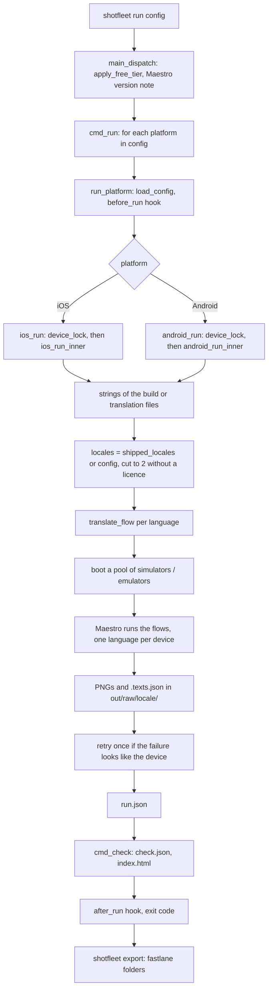

# 1. Runtime architecture

Scope: how the program `shotfleet.py` is built and how one command runs from the command line to the last file it writes. Written against `main` at `7e5176c` (`VERSION = "0.1.7"`, 5,705 lines, 398,850 bytes). Every `shotfleet.py:LINE` anchor is for that commit. Line numbers drift with every edit; function and constant names are the stable handle, so grep for the name when a line is off. Sibling chapters go deeper: [02 capture and devices](02-capture-and-devices.md), [03 check, OCR and export](03-check-ocr-export.md), [04 setup, MCP and skills](04-setup-mcp-skills.md), [05 licence](05-licence-and-money.md), [12 function map](12-function-map.md).

An older, longer treatment written at 0.1.6 exists in [../ARCHITECTURE.md](../ARCHITECTURE.md) and [../architecture/](../architecture/01-code-layout.md). It is still a good read; where it differs from this chapter, this chapter is checked against the 0.1.7 code (see the corrections list in the [README](README.md)).

## 1.1 What the program is

One Python file (3.11 or newer, standard library only, one optional import: `certifi` for TLS certificates, `shotfleet.py:3992`) plus one 56-line Swift helper, `ocr.swift`, that wraps macOS text recognition. The released product is that file frozen with PyInstaller into a folder (see [06](06-packaging-and-release.md)). There is no server of ours in the loop at run time: the program talks to Gumroad (licence), `shotfleet.com/download/VERSION` (update notice) and, for `doctor --fix`, to the hosts it downloads tools from.

Three things distinguish a source run from a released (frozen) run, and they are the main switches in the code:

| Switch | Source checkout | Released build |
|---|---|---|
| `getattr(sys, "frozen", False)` | false | true |
| Licence gate (`require_licence`, `shotfleet.py:5560`) | returns at once: the developer's own copy runs everything | enforced for `run` (free tier) and `export` |
| OCR helper (`ocr_tool`, `shotfleet.py:2877`) | compiled on demand with `swiftc` into `.build/ocr` | prebuilt, bundled at `sys._MEIPASS/ocr` |
| Gumroad API URL (`gumroad_api`, `shotfleet.py:5311`) | `SHOTFLEET_GUMROAD_API` honoured (tests use it) | ignored, unless the baked product id starts with `RCTEST` |
| Release date (`baked_release_date`, `shotfleet.py:5317`) | none (`_release` module absent) | the build day, frozen into the code |

## 1.2 Why one file

There is no written decision record. What the repo shows is a set of things that are easy because everything is one module:

- Tests `import shotfleet as sf` and patch module-level names (`sf.GUMROAD_API`, `sf.LICENCE_FILE`, `sf.USE_DEVICE_LOCK`, `sf.RELEASE_DATE`, `sys.frozen`). Almost every test module depends on that (see [08](08-testing.md)).
- Release scripts read and rewrite lines of the file with `sed` and regexes: `VERSION = "..."` is read by `packaging/build.sh`, `pkg.sh` and `publish.sh`; `packaging/go-live.sh` and `tools/release-candidate.sh` rewrite the `GUMROAD_PRODUCT_ID = ...` line (the latter in a temporary copy, never in the repo).
- PyInstaller freezes one entry script.
- Everything is imported at the top (`shotfleet.py:19-25`) on purpose: a Homebrew Python upgrade in the middle of a run deletes the old library folder, and a lazy import would then fail (comment at line 21, seen 2026-10-01). A few `import difflib` lines sit inside functions (`check_tables`, `check_capture`, `check_expect`, `check_section`, `cmd_check`); they are the exception, not the pattern, so put new imports at the top.
- The style is "the smallest thing that works, with a named ceiling". A comment starting with `ponytail:` marks a deliberate shortcut and what to do when its ceiling is reached. Grep for `ponytail:` before "fixing" something that looks naive.

The cost: very long functions with nested closures (`ios_run_inner` is lines 2010-2213, `cmd_check` is 3572-3816) and module-level mutable state (section 1.9). If you ever split the file, keep `import shotfleet` working and keep every name the tests patch.

## 1.3 Commands

`COMMANDS` (`shotfleet.py:5041`) has nine entries. The parser is built in `main()` (`shotfleet.py:5065`); routing and exit codes are in `main_dispatch` (`shotfleet.py:5675`). The module docstring at lines 4-8 lists only five of them (a known stale text, see the README corrections).

| Command | What it does | Licence | Handler |
|---|---|---|---|
| `doctor [--fix] [--yes] [config]` | Checks Maestro, Java, Xcode, Android SDK pieces, text recognition; prints what is missing. `--fix` downloads Maestro, a JRE and Android tools after one confirmation; never uses sudo | free | `cmd_doctor` `:4196`, plan in `fix_plan` `:4119` |
| `init [build...] [--dir D] [--capture]` | Writes `shotfleet.toml` and `flow.yaml`; finds the newest Debug build if none is given; `--capture` writes a `[capture]` (XCUITest) config | free | `cmd_init` `:4657`, `cmd_init_capture` `:4731` |
| `run [config] [--platform ios\|android] [--locales a,b \| --retry-failed] [--parallel N] [--json] [--no-hooks] [--no-build]` | Capture every language, then check | free for 2 languages; licence for all | `cmd_run` `:1856` |
| `check <folder> [--app] [--strings GLOB]... [--report D] [--ocr-command C] [--locale L] [--content [cfg]] [--json] [--strict] [--compare PREV]` | Verify screenshots from shotfleet, fastlane or anything | free, always | `check_any` `:5652` -> `cmd_check` `:3572` |
| `export <out> --fastlane <dir> [--print-upload] [--json] [--no-hooks]` | Copy passing languages into fastlane `deliver`/`supply` folders | licence | `export_with_hooks` `:5583` -> `cmd_export` `:4987` |
| `activate <key>` / `deactivate` | Store or remove the Gumroad licence on this Mac | n/a | `cmd_activate` `:5450`, `cmd_deactivate` `:5491` |
| `mcp` | MCP server on stdin/stdout (tools `check`, `run`, `doctor`) | `run` over MCP has the same free-tier cap | `cmd_mcp` `:5251` |
| `skill install [--project] [--dir D] [--force]` | Copy the three agent skills into agent skill folders | free | `cmd_skill` `:5043` |
| `shotfleet foo` | When `foo` is not a built-in and `shotfleet-foo` is on the PATH, `os.execv` it (the way `git foo` works) | n/a | `main` `:5068` |

Argument rules enforced before dispatch (`main`, `shotfleet.py:5121-5126`): `--locales` may not be empty, `--retry-failed` and `--locales` are mutually exclusive, `--parallel` must be 1 or more.

`--json` (on `run`, `check`, `export`): `main()` redirects stdout to stderr while the command runs, then prints one JSON object on stdout, `{"exit": code, ...}` (`shotfleet.py:5127-5131`). Progress text therefore never pollutes the JSON.

### Dispatch order inside `main_dispatch`

1. `doctor`, `mcp`, `skill`, `init` return immediately (no licence, no hooks).
2. `NO_HOOKS` and `NO_BUILD` are set from `--no-hooks` and `--no-build`.
3. In the `shotfleet-check` Docker image (`SHOTFLEET_IMAGE=check`, set by the `Dockerfile`), `run` and `export` are refused with a message.
4. `export` calls `require_licence()` (a refusal is a `NoLicence`, which is a `Fail`, so exit 2).
5. `run` calls `apply_free_tier()` (turns a `NoLicence` into a 2-language cap, unless `SHOTFLEET_KEY` is set), then reads the installed Maestro version and refuses it only if it is on `MAESTRO_BAD` (empty today); an untested version prints a `note:` and runs.
6. `activate`/`deactivate`/`run`/`check`/`export` are executed.
7. The shared `except` turns `Fail`, `RuntimeError`, `ValueError`, `OSError` and `subprocess.TimeoutExpired` into one line `shotfleet: <message>` on stderr and **exit 2** ("worded for people; never exit 1", `shotfleet.py:5698`). `KeyboardInterrupt` kills stale Maestro drivers and exits **130**.
8. `main_cmd` (`:5615`) wraps all of it: it turns SIGTERM and SIGHUP into `KeyboardInterrupt` (so CI cancellation cleans up) and always calls `shutdown_sims()`.

## 1.4 Exit codes

| Code | Meaning | Made by |
|---|---|---|
| 0 | Everything worked and nothing is wrong | return value of the `cmd_*` function |
| 1 | The work ran and found problems: check problems, a failed language in `run`, `--strict` with unverified screens, a failing `after_*` hook, an `export` that skipped a bad language, a failed `doctor --fix` step | `cmd_check` returns `1 if problems or (strict and not_verified) else 0` (`:3816`); `ios_run_inner` returns `max(cmd_check(...), 1 if failed else 0)` (`:2213`); `cmd_export` returns `0 if not bad else 1` (`:5039`) |
| 2 | Setup error: bad config or flag, missing tool, no licence for `export`, a `before_*` hook failed, device lock held, `SHOTFLEET_KEY` refused on `run`; also `doctor` when neither platform is ready | the shared `except` in `main_dispatch` |
| 130 | Interrupted | `KeyboardInterrupt` handler (`:5700`) |
| 124 | only inside `run_hook`: a hook timed out; becomes 2 for `before_*` or 1 for `after_*` | `run_hook` `:1883` |

## 1.5 Source layout: sections of `shotfleet.py`

The file is organised by feature, not by layer. Section banners are comments of the form `# ---------- name ----------`.

| Lines | Section | Contents |
|---|---|---|
| 1-72 | Header | usage docstring, Python 3.11 guard (`:15`), imports, `VERSION` (`:28`), `Fail` (`:30`), `SAFE_LOCALE` (`:35`), `inside()` path guard (`:52`), config schema constants `KEYS`, `REQUIRED`, `TABLES`, `HOOK_EVENTS`, `CAPTURE_KEYS` (`:60-71`) |
| 73-249 | Config validation | `check_tables` `:73`, `check_capture` `:99`, `check_expect` `:120`, `read_doc` `:137`, `check_section` `:161`, `load_config` `:197` |
| 250-311 | Locale tables | `APP_STORE` `:252`, `PLAY` `:255`, `PRIMARY`, `LANG_CANON`, `CANON`, `canon` `:267`, `store_code` `:272`, `SELECTOR_KEYS` `:297`, `sh` `:301`, `aapt2` `:304` |
| 312-481 | `strings` | `.strings` parser (so Linux needs no `plutil`) `:328`, `load_strings` `:394` (iOS bundle), `stringsdict_forms` `:428`, `add_cvr` `:459` (Compose Multiplatform), `android_locale` `:475` |
| 482-902 | `strings from source files` | `locale_from_path` `:486`, `parse_js_translations` `:558` (reads `.ts`/`.js` as data, never runs it), `read_translation_file` `:646`, `load_strings_apk` `:794`, `partly_translated` `:831`, `FRAMEWORKS` `:853`, `framework_hint` `:862`, `shipped_locales` `:885` |
| 903-1223 | Flow rewriting | `with_fallback` `:916`, `resolve_base` `:925`, `SYSTEM_BUTTONS` `:939`, `translate_flow` `:949`, `with_app_id` `:1066`, `localize_flow` `:1158`, `pause_after_screenshot` `:1217` |
| 1224-1346 | `simulators` | timeouts `:1226-1231`, `simctl_sh` `:1233`, `Sim` `:1240`, `healthy_installs` `:1253`, `mark_hung`/`replace_hung`, `run_setup` `:1297`, `make_pool` `:1312` |
| 1347-1510 | `host safety` | `ios_screen_texts` `:1360`, `capture_texts` `:1375`, `collect_shots` `:1411`, `run_guarded` `:1423`, `fit_parallel` `:1483`, `fit_emulators` `:1499` |
| 1511-1616 | `capacity planner` | `Reading`/`Plan`, `plan_capacity` `:1539` (pure), `read_capacity` `:1599` (impure) |
| 1617-1799 | `overload advisor` and failure details | `busy_reasons` `:1623`, `busy_warn` `:1639`, `capacity_warn` `:1647`, `INFRA_ERRORS` `:1658`, `retry_choice` `:1668`, `retry_setup` `:1679`, `keep_earlier` `:1689`, `failure_details` `:1780` |
| 1800-2214 | `run` | `cmd_run` `:1856`, `run_hook` `:1883`, `run_platform` `:1900`, `capture_platform` `:1924`, `device_lock` `:1980`, `ios_run_inner` `:2010` |
| 2215-2342 | `bring your own capture` | `xcresult_pngs` `:2222`, `fastlane_cache` `:2245`, `capture_build` `:2267`, `xctestrun_with_language` `:2301`, `capture_result` `:2328` |
| 2343-2863 | `android` | `find_sdk` `:2362`, `DEMO_MODE` `:2431`, `Emu` `:2446`, `ANDROID_DEVICES` `:2526`, `android_pool` `:2551`, `android_flow` `:2630`, `hierarchy_texts` `:2682`, `android_run_inner` `:2725` |
| 2864-3442 | `check` | OCR plumbing `:2877-3398`, `norm` `:2925`, `judge_screen` `:3004`, `find_screenshots` `:3125`, `content_rules`/`check_content` `:3399-3427`, `reports_json` `:3432` |
| 3443-3861 | `store coverage matrix and release diff` and `cmd_check` | `coverage_matrix` `:3448`, `compare_folders` `:3521`, `cmd_check` `:3572`, `write_gallery` `:3818` |
| 3862-3945 | `doctor / init / export` (start) | `latest_release` `:3864`, `find_java` `:3878`, `MAESTRO_INTERFACE` `:3902`, `MAESTRO_TESTED` `:3915`, `MAESTRO_BAD` `:3932` |
| 3946-4458 | `doctor --fix`, `cmd_doctor`, `init` helpers | `MAESTRO_PIN` `:3951`, `download` `:3967`, `fix_plan` `:4119`, `cmd_doctor` `:4196`, `unpack_build` `:4332` |
| 4459-4760 | `project detection` and `init` | `detect_project` `:4538`, `find_builds` `:4593`, `cmd_init` `:4657`, `cmd_init_capture` `:4731` |
| 4761-5040 | runtimes, store rules, export | `BAD_IOS_RUNTIMES` `:4764`, `latest_ios_runtime` `:4789`, `APPLE_SIZES` `:4805`, `png_alpha` `:4823`, `store_rules` `:4879`, `blank_screenshot` `:4939`, `device_runs` `:4974`, `cmd_export` `:4987` |
| 5041-5133 | Entry | `COMMANDS` `:5041`, `cmd_skill` `:5043`, `main` `:5065` |
| 5134-5280 | MCP | `MCP_TOOLS` `:5134`, `mcp_summary` `:5178`, `mcp_call` `:5200`, `cmd_mcp` `:5251` |
| 5281-5622 | `licence` and `upload_command` | constants `:5283-5292`, `gumroad_verify` `:5414`, `cmd_activate` `:5450`, `key_licence` `:5504`, `mac_licence` `:5525`, `require_licence` `:5560`, `upload_command` `:5573`, `apply_free_tier` `:5602` |
| 5612-5706 | Dispatch | `main_cmd` `:5615`, `check_build` `:5623`, `check_any` `:5652`, `main_dispatch` `:5675` |

The only classes are tiny: `Fail`, `Sim`, `Emu`, `Table`, `Reading`, `Plan`, `Project`, `OcrBusy`, `NoLicence`. A fuller alphabetical function list with line numbers is in [12-function-map.md](12-function-map.md).

## 1.6 The config file: `shotfleet.toml`

Parsed with `tomllib` in `read_doc` (`shotfleet.py:137`). The schema is enforced in code, so the code is the reference; the README "Config" section is the buyer-facing copy. Unknown or mistyped settings are refused early with a "did you mean ...?" (`difflib.get_close_matches`), because a typo such as `ipd = true` would otherwise cost a multi-minute run.

Top-level tables (`TABLES`, `:64`): `ios`, `android`, `hooks`, `overrides`, `inputs`, `expect`, `capture`.

`[ios]` and `[android]` keys (`KEYS`, `:60-62`), type-checked by `check_section` (`:161`):

| Key | Type | Platform | Meaning and default |
|---|---|---|---|
| `flow` | string | both | Maestro flow; default `flow.yaml`. Forbidden together with `[capture]` (`:210`) |
| `out` | string | both | Output folder; default `out`, or `out-ios` / `out-android` when the file has both platforms (`:216`) |
| `parallel` | int >= 1 | both | Devices at once; default 4 (`:2064`); `--parallel` overrides |
| `locales` | list of strings | both | Restrict languages. An empty list is refused (it would silently capture everything, `:188`) |
| `base_locale` | string | both | Language the flow is written in; default `en` |
| `strings` | string or list | both | Translation file glob(s), or one folder of `.lproj`, instead of reading the build |
| `timeout_s` | int >= 1 | both | Per Maestro batch; default 600; the process timeout is `timeout_s * ceil(languages / devices) + 300` (iOS, `:2098`) or `timeout_s + 300` per Android round (`:2794`) |
| `stall_s` | int >= 1 | both | No new screenshot for this long kills Maestro; default `STALL_S = 900` (`:1421`) |
| `capacity` | `"warn"` or `"off"` | both | The memory and overload warnings. `"adjust"` is refused as "not available yet" (`:177`) |
| `app`, `bundle_id`, `device_type`, `device_types`, `runtime`, `simctl` | string / list | iOS | Simulator `.app`; override of the id read from `Info.plist`; device type name or identifier; list of device types for iPhone and iPad sets from one flow; runtime identifier; list of `xcrun simctl` commands run once per simulator after boot (`$UDID` is replaced) |
| `apk`, `package`, `avd`, `avd_tablet`, `avd_tablet-7`, `system_image`, `devices`, `shell` | string / list | Android | APK; package override; emulator names; system image package id; `["phone", "tablet", "tablet-7"]`; list of `adb shell` commands run once per emulator after boot |

`load_config` (`:197`) adds internal keys the rest of the code reads: `_config` (path), `_hooks`, `_overrides`, `_inputs`, `_expect`, `_capture`; and at run time `sim_prefix`, `multi_device`, `device`, `_retry_failed`. It validates, in this order: tables, section keys and types, "`[capture]` needs `[ios]`", "flow and capture are exclusive", the flow file exists, the build (iOS: `Info.plist` readable, not a device build, `bundle_id` matches; Android: an `.apk` whose package name `aapt2 dump badging` can read, `package` matches), then "Maestro installed" (skipped for `[capture]`). The order decides which error a user sees first.

Other tables:

```toml
[hooks]                              # strings or lists of strings, run by /bin/sh in the config's folder
before_run = "make build-sim"        # events: before_run, after_run, before_export, after_export
hook_timeout_s = 1800                # default 600 per command

[overrides.tr]                       # per language: English text -> text to tap; "re:" prefix = regular expression
"Next" = "Ileri"

[inputs]                             # values for `inputText: ${name}`
name = "Alex"
[inputs.ja]
name = "Tanaka"

[expect.01_home]                     # a screenshot's name; keys any / all / not; optional [expect.<shot>.<locale>]
any = ["Senior iOS Engineer"]

[capture]                            # iOS only, instead of flow: the team's own XCUITest tests
build = "xcodebuild build-for-testing -scheme MyApp -destination 'generic/platform=iOS Simulator' -derivedDataPath .shotfleet/build"
xctestrun = ".shotfleet/build/Build/Products/*.xctestrun"
only_testing = ["MyAppUITests/ScreenshotTests"]
screenshots = "auto"                 # attachments | fastlane | auto
timeout = 900                        # seconds per language (CAPTURE_TIMEOUT_S)
```

Hooks (`run_hook`, `:1883`): each command runs as `/bin/sh -c`, `cwd` = the config's folder, stdout redirected to stderr (so `--json` keeps stdout clean), a per-command timeout, and `SHOTFLEET_EVENT`, `SHOTFLEET_VERSION`, `SHOTFLEET_CONFIG` on every event. `before_run`/`after_run` also get `SHOTFLEET_PLATFORM`, `SHOTFLEET_OUT`, `SHOTFLEET_BUNDLE_ID`, `SHOTFLEET_LOCALES`; `after_run` adds `SHOTFLEET_EXIT`, `SHOTFLEET_PROBLEMS`, `SHOTFLEET_REPORT`. Export hooks (`export_with_hooks`, `:5583`) get `SHOTFLEET_PLATFORM` (from `run.json`; written for iOS runs too since 0.1.7), `SHOTFLEET_OUT`, `SHOTFLEET_FASTLANE`, `SHOTFLEET_REPORT`, and `SHOTFLEET_EXIT` after. A failing `before_*` hook is a `Fail` (exit 2); a failing `after_*` hook prints a line and makes the exit code 1. `--no-hooks` skips all of them; over MCP they are skipped unless `hooks: true`.

## 1.7 How a `run` flows, end to end



Step by step for **iOS** (`ios_run_inner`, `shotfleet.py:2010-2213`):

1. `cmd_run` (`:1856`) validates `--locales`, asks `platforms_in` for the platforms in the file (`ios` then `android`), and calls `run_platform` for each (printing `=== ios ===` headers when there are two). Its exit code is the max of the platforms'.
2. `run_platform` (`:1900`): `load_config`; with `--retry-failed`, if nothing failed in the last `run.json`, it prints "nothing to retry" and returns 0 without a build, devices or hooks; runs the `before_run` hook; calls `capture_platform`; counts problems in `check.json` for the `after_run` hook.
3. `capture_platform` (`:1924`): for iOS with `[capture]`, runs the team's build (`capture_build`) unless `--no-build`; with `device_types = [...]` it loops over device types, giving each its own `out/<slug>/` folder and simulator prefix; afterwards `ipad_set_missing` fails the run if the app runs on iPad and no 13-inch iPad set exists.
4. `ios_run` (`:2005`) takes `device_lock("ios-<prefix>")` and always shuts the pool down in a `finally`.
5. In `ios_run_inner`: resolve `device_type` (`default_device_type`, `:1836`: iPhone 17 Pro Max, else the newest "iPhone N Pro Max" this Xcode lists) and `runtime` (`latest_ios_runtime`, `:4789`, skipping iOS 27.0, see [02](02-capture-and-devices.md)).
6. Read the strings: `config_strings` (translation files) or `load_strings` (the `.app`'s `.lproj`, String Catalogs, Compose resources). `framework_hint` prints one-time hints for Flutter, React Native, MAUI and Unity builds.
7. `resolve_base` picks the table the flow's language lives in (default `en`). `note_partly_translated` says which languages are skipped for being too little translated.
8. `locales = cap_locales(only or cfg.locales or shipped_locales(strings, base_locale))`. `cap_locales` (`:5297`) cuts to the first `FREE_LANGUAGES = 2` without a licence and prints a `free tier:` line.
9. Clean `.work/flows`, `.work/debug`, `.work/shots`; for every language: `translate_flow` (English selectors become that language's text) then `localize_flow` (adds the language as launch arguments, redirects screenshots) and write `.work/flows/<lp>.yaml`. Selector problems show before any simulator boots.
10. `want = min(parallel or cfg.parallel or 4, number of languages)`; `fit_parallel` halves under elevated memory pressure and refuses under critical pressure; `capacity_warn` prints the planner's or the overload advisor's warning.
11. `make_pool` (`:1312`) reuses or creates `shotfleet-N` simulators, boots them, overrides the status bar (9:41, full battery), runs the config's `simctl` commands. `kill_stale_drivers` kills Maestro iOS drivers left on shotfleet's simulators. `healthy_installs` uninstalls then installs the app on each simulator and drops (and remembers) any that stops answering.
12. `batch(lps, attempt)` runs one Maestro process over all simulators: `maestro --device <udids> test <flows dir> --shard-split k --format JUNIT --output junitN.xml --debug-output <debug>` under `run_guarded` (stall watchdog and `simctl diagnose` killer), while a thread (`capture_texts`) reads each screen's text from the app. Screenshots are moved into `raw/<locale>/` (`collect_shots`). A language passes only if JUnit says so and it produced exactly the expected number of screenshots and none is blank.
13. Failures whose error looks like the device (`INFRA_ERRORS`) are retried once on the simulators that still answer; others are not (`retry_choice`). Failed languages print the step, screenshot and on-screen texts (`failure_details`).
14. `run.json` is written, then `cmd_check(out, strings, ...)` runs on the output. The return value is `max(check exit, 1 if any language failed else 0)`.

**Android** (`android_run_inner`, `shotfleet.py:2725-2862`) differs in four ways: there is a single device lock, `android-emulators` (the emulators sit on fixed ports 5702, 5704, ...); the pool is read-only copies of one AVD booted from a saved snapshot; devices are not given flows by language but by **rounds** (each emulator gets its own language set with `cmd locale set-app-locales`, and the flow matches the round's languages as alternatives, because Maestro hands any flow to any emulator); and screen text comes from Maestro's saved screen hierarchy (Maestro 2.7.0 or newer) instead of the driver. Details in [02](02-capture-and-devices.md).

## 1.8 Output files

A run writes everything under the `out` folder (`out/`, or `out-ios/` and `out-android/` when the config has both platforms, or `out/<device-slug>/` for several device types):

```
out/
  run.json            what the run did; `check` reads it to find the build and translation files
  check.json          the check report
  index.html          the grid: a row per language, a column per screen, problems outlined and marked in words
  raw/<locale>/<shot>.png          the screenshots
  raw/<locale>/<shot>.texts.json   the app's own screen text for that shot (a JSON list of lines), when read
  maestro1.log, maestro2.log       iOS Maestro output of attempt 1 and the retry
  maestro_r1.log, maestro_retry1.log  Android: one per round / retry round
  junit1.xml ...      Maestro's JUnit reports (iOS junit<attempt>.xml, Android junit_<tag>.xml)
  build.log           [capture] only: output of the build command
  .work/              flows, Maestro debug output, staging; wiped per run, safe to delete
```

A multi-device run (`device_types` on iOS, `devices` on Android) writes `out/<device-slug>/` (for example `out/iphone-17-pro-max/`); `clear_single_run` (`:1851`) removes an older single-device `run.json` first, because `device_runs()` (`:4974`) decides "single or multi" by whether `out/run.json` exists. `check` and `export` accept the parent folder and loop over the sub-folders.

### `run.json`

Written at the end of `ios_run_inner` (`:2206`) and `android_run_inner` (`:2856`):

```json
{
 "locales": {"de": {"untranslated_selectors": [], "lproj": "de", "ok": true, "seconds": 41, "error": null, "screenshots": 4, "attempts": 1}},
 "config": "/abs/path/shotfleet.toml",
 "strings": ["/abs/glob"], "base_locale": "en",
 "wall_seconds": 534, "simulators": 4, "app": "/abs/My.app", "platform": "ios"
}
```

`strings` and `base_locale` appear only when the config used `strings`. Android reports `emulators`, `apk`, `platform: "android"`, `device`, `hierarchy_markers`, and per language `device`, `retried`, `hierarchy_texts`. `attempts` adds up across `--retry-failed` runs (`keep_earlier`, `:1689`). `platform` has been written for iOS runs only since 0.1.7 (before that, only Android runs wrote it, and export hooks saw an empty `SHOTFLEET_PLATFORM` on iOS).

### `check.json`

```json
{"screenshots": [{"file": "de/01_home.png", "src": "raw/de/01_home.png", "sha": "<12 hex>", "lang": "de", "chars": 812, "evidence": "hierarchy|ocr"}],
 "problems": ["de/01_home.png: shows en strings (7 lines) more than de (1)"],
 "notes": ["..."],
 "unverified": ["de/03_x.png"],
 "coverage": {"store": "App Store", "columns": [], "locales": {}, "summary": []},
 "compare": {"against": "...", "new_languages": [], "removed_languages": [], "locales": {}, "unchanged": 0}}
```

`problems` fail the check; `notes` never do; `unverified` lists screens nobody could read; `coverage` and `compare` appear only when present (0.1.7) and never change the exit code. `evidence: "hierarchy"` means "the app's own text" (`.texts.json`), for iOS as well as Android; the name is Android-shaped. Details in [03](03-check-ocr-export.md).

### `--json` bodies

| Command | Body |
|---|---|
| `run`, `check` | `{"exit": N, "screenshots": [...], "problems": [...], "notes": [...], "unverified": [...]}`; when several `check.json` files were written (device folders, both platforms) the lists are merged and `reports` has one `{report, problems, coverage?, compare?}` per file (`reports_json`, `:3432`) |
| `export` | `{"exit": N, "exported": [listing folders], "skipped": [languages]}` (`EXPORT_RESULT`) |
| MCP `check`/`run` | a short summary: `exit`, `screenshots`, `languages`, `problems_total`, `problems` (first 100, each cut to 300 chars), `notes_total`, `notes`, `reports` (absolute paths), optional `note` (the free-tier cut) and `more`; `full: true` returns the `--json` body instead (`mcp_summary`, `:5178`) |

## 1.9 Conventions

- **User-facing errors are `Fail`.** `raise Fail("one sentence that says how to fix it")`. Every message names the fix: a command to run, a config key to set. Tests check wording. Low-level helpers raise `RuntimeError` with a worded message; `main_dispatch` treats it the same.
- **Never a traceback for a known failure.** Tests assert "Traceback" is absent for the failure classes they cover. The MCP server catches any exception per call (`mcp_call`, `:5237`) so one bad call cannot kill the server.
- **Prefixes.** `note:` (informational), `warning:` (something to act on), `hint:` (what to add to the config), `skip <lp>:`; hints and warnings that must not break `--json` go to stderr. `framework_hint` deduplicates with the `HINTED` set.
- **Subprocesses are argv lists.** The only `/bin/sh -c` are the user's own `[hooks]` and `[capture] build` strings; the `ps`/`pgrep`/`simctl`/`adb` calls never pass user text through a shell.
- **Output goes to a file, not a pipe, when a child can outlive its parent** (`run_guarded`, `:1423`): a daemonised helper that inherited the pipe would block `communicate()` after the kill.
- **Timeouts wherever a device or the OS can hang.** Every `simctl` call has one (`Sim.run` `:1243`, `simctl_sh` `:1233`), every `adb` call (`Emu.adb` `:2448`), Maestro runs under a stall watchdog, text recognition under a budget.
- **Locales are folder names.** `SAFE_LOCALE` (letters, digits, `-`, `_`) is enforced everywhere a language code can enter (`check_locales`, `safe_strings`), and `inside()` refuses any path that escapes the output folder before a delete or write. A translation file can come from someone else's repo.
- **Locale spellings go through `canon()`** (`:267`): `zh-CN` is `zh-Hans`, `iw` is `he`. Always compare after `canon`.
- **Text is compared after `norm()`** (`:2925`): NFKD without accents, casefolded, bidi marks removed, native digits to ASCII, single spaces.
- **Pure core, impure edge.** `plan_capacity`, `translate_flow`, `judge_screen`, `store_rules`, `coverage_matrix`, the parsers: pure functions of their inputs, unit-tested with no devices. `read_capacity` is the impure counterpart of `plan_capacity`. Follow the pattern.
- **Wording.** No em dashes in any public text or in these docs (tests enforce it on the site, the skills and the docs page); no emoji; plain English.

### Global state

Module-level mutable state exists and tests reset it:

| Name | Purpose |
|---|---|
| `OUR_SIMS` (`:1802`) | UDIDs of simulators shotfleet booted, so cleanup and `kill_stale_drivers` never touch anyone else's |
| `NO_HOOKS`, `NO_BUILD`, `CONFIG_COMMANDS` (`:1865-1867`) | set from `--no-hooks`/`--no-build` or by MCP; `CONFIG_COMMANDS` is False during an MCP `run` without `hooks: true` |
| `USE_DEVICE_LOCK` (`:1977`) | tests that run a fake `run` set it False so two test suites never refuse each other |
| `LOCALE_CAP`, `FREE_TIER_NOTE` (`:5291-5292`) | the free-tier cap, reset to None by `apply_free_tier` on each call (the MCP server calls it per `run`) |
| `RELEASE_DATE` (`:5328`) | the build day from the frozen `_release` module, or None from source; read once at import |
| `REPORTS`, `LAST_REPORT` (`:3429-3430`) | every `check.json` this call wrote, for `--json` and MCP summaries |
| `OCR_DEADLINE` (`:3195`) | the running check's text-recognition budget |
| `HINTED` (`:860`), `BUSY_STATE` (`:1621`), `EXPORT_RESULT` (`:4985`) | de-duplication of hints and warnings; what `export --json` prints |
| `functools.cache` on `vision_languages`, `tesseract_languages`, `locale_tags`, `java_env`; `lru_cache` on `norm` | safe to clear in tests; `java_env.cache_clear()` is called after installing a JRE |

## 1.10 Environment variables and files outside the output folder

| Name | Used by | Meaning |
|---|---|---|
| `SHOTFLEET_KEY` | `require_licence` | licence key for CI; checked online every run, uses no activation |
| `SHOTFLEET_HOME` | `tools_home` `:3957` | where `doctor --fix` puts Maestro, the JRE and downloads; default `~/.shotfleet` |
| `SHOTFLEET_MAESTRO` | `maestro_cmd` `:3960` | path to a Maestro executable |
| `SHOTFLEET_OCR` | `cmd_check` | default for `--ocr-command` |
| `SHOTFLEET_GUMROAD_API` | `gumroad_api` | test server; ignored by released builds |
| `SHOTFLEET_IMAGE=check` | `main_dispatch` | set by the Docker image; refuses `run` and `export` |
| `ANDROID_HOME`, `ANDROID_SDK_ROOT`, `ANDROID_AVD_HOME`, `ANDROID_USER_HOME` | `find_sdk` `:2362`, `avd_home` `:2535` | Android SDK and emulator locations |
| `JAVA_HOME` | `find_java` `:3878` | Maestro needs Java 17 or newer |
| `SSL_CERT_FILE`, `REQUESTS_CA_BUNDLE`, `CURL_CA_BUNDLE` | `tls_context` `:3998` | CA bundle for downloads and licence calls (corporate proxies) |
| `OMP_THREAD_LIMIT` | `tesseract_env` `:3285` | defaults to 1 per Tesseract process |
| `MAESTRO_DRIVER_STARTUP_TIMEOUT`, `MAESTRO_CLI_NO_ANALYTICS` | set by shotfleet for Maestro (`:2089`, `:2796`) | 240000 ms driver start; analytics off |
| `SHOTFLEET_*` hook variables | `run_hook`, `export_with_hooks` | see 1.6 |

| Path | Written by | Purpose |
|---|---|---|
| `~/Library/Application Support/shotfleet/licence.json` | `activate` | the licence (plain, unsigned JSON); `LICENCE_FILE` `:5283` is not platform-aware, so Linux would use the same relative path |
| `~/Library/Application Support/shotfleet/ci-checked.json` | `key_licence` | the CI key's last good check (a SHA-256 of the key, never the key) |
| `~/.shotfleet/` or `$SHOTFLEET_HOME` | `doctor --fix`, `mark_hung` | Maestro, a JRE, downloads, `hung-simulators/<UDID>` markers |
| `~/Library/Application Support/shotfleet/app` | `site/public/install.sh` | the installed program folder; a link on the PATH points to it |
| `/tmp/shotfleet-<key>.lock`, `/tmp/shotfleet-ocr-warmup.lock` | `device_lock`, `ocr_warmup_lock` | `flock` files; the OS drops the lock when the process dies, so none is ever stale |
| `~/Library/Caches/tools.fastlane/screenshots` | fastlane's SnapshotHelper; shotfleet creates it temporarily for `[capture]` | see [02](02-capture-and-devices.md) |
| `~/.android/avd` or `$ANDROID_AVD_HOME` | `android_pool` | the `shotfleet_android*` emulators and their `shotfleet` snapshot |
| `$TMPDIR/shotfleet-emulator-logs/` | `start_emu` | emulator output |
| `<repo>/.build/ocr` | `ocr_tool` (source runs) | compiled helper, rebuilt when `ocr.swift` is newer |
