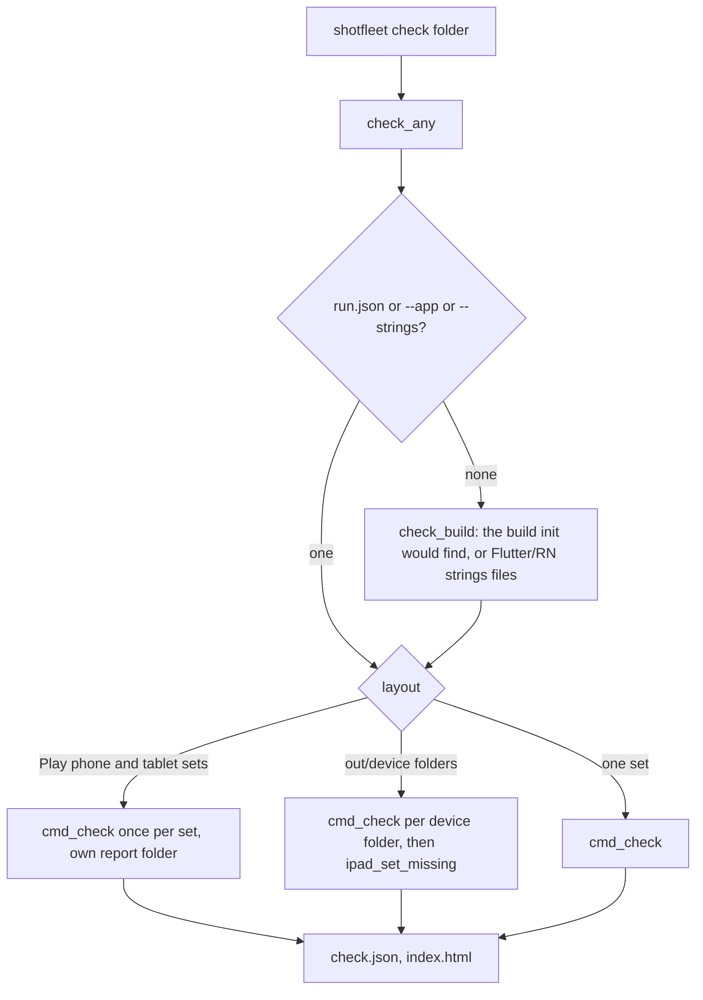

# 3. Check, text recognition and export

Scope: what happens to screenshots after they exist: `check` (language, copies, missing screens, blank frames, dialogs, `[expect]` texts, store rules, coverage matrix, release diff), the OCR stack (the Swift helper, macOS Vision, the Neural Engine compiler issue, Tesseract), and `export` into fastlane folders. Anchors are `shotfleet.py:LINE` at `7e5176c` (0.1.7). The capture side is in [02](02-capture-and-devices.md); file shapes (`check.json`, `--json`) are in [01](01-runtime-architecture.md#18-output-files).

`check` is free for everybody, in every build, and works on any folder of screenshots, not only shotfleet's own (fastlane snapshot, screengrab, hand-made). `run` calls the same `cmd_check` at its end.

## 3.1 The question `check` answers

For every screenshot in every language folder: does it show **that language's strings from the app**, is it **not a copy** of another language's, is **no screen missing** from any language, is it **not blank**, **no system dialog or banner** over it, does it contain the texts the developer said must be on it (`[expect]`), and does it satisfy the **stores' size, count and transparency rules**. The verdict is a list of `problems` (they fail the check, exit 1) and `notes` (information, never fail).

## 3.2 Entry points and what they decide

- `check_any` (`:5652`) refuses a missing folder, validates `--compare`, calls `check_build` (`:5623`) when nothing says where the app's strings are (it prints one line saying which build it picked, or that it found none and will only judge by language detection), then branches on layout. Several Play device sets (`phoneScreenshots`, `sevenInchScreenshots`, `tenInchScreenshots`) are checked one set at a time into `<report>/<set>/`; a parent folder of per-device runs is checked per sub-folder.
- `cmd_check` (`:3572`) is the engine; it is decorated with `@ocr_budget()` so all text-recognition waiting in one check shares one budget.
- `find_screenshots` (`:3125`) understands: shotfleet's own `raw/<locale>/*`, fastlane supply (`metadata/android/<locale>/images/<phone|sevenInch|tenInch>Screenshots/*`), fastlane deliver (`screenshots/<locale>/*`), plain `<locale>/*` folders, and (with `--locale`) one flat folder of a single language. `.jpg` counts too. A folder holding both stores' layouts needs `--app` to say which half (`.apk` or `.app`).
- Which store's rules apply (`android`: True for Google Play, False for the App Store, None for unknown): the build suffix wins, then `run.json`'s `platform`, then the folder layout, then the screenshot sizes (`store_from_sizes` `:4871`); with None each screenshot is judged against both stores and only what both reject is a problem.
- `locale_tags`, `shot_key`, `screen_keys` (`:3103-3123`) make `1_de-DE.png` in `de-DE/` and `1_en-US.png` in `en-US/` the same screen `1.png` (fastlane supply puts the locale in every name), and ignore screengrab's 13-digit timestamp suffix. The locale ending is cut only when every file in that folder ends in it, so two different screens cannot be confused.

## 3.3 Where a screenshot's text comes from (the evidence ladder)

1. **The app's own text** (`screen_text`, `:3300`): `<shot>.texts.json` written during `run` (iOS: the driver's accessibility tree; Android: Maestro's saved hierarchy). Exact, any script, no OCR. `usable_text` (`:3309`) accepts it only if at least 2 of its lines are exactly strings of some language's table, because a screen full of user content proves nothing about language; otherwise the pixels are read too. `check.json` marks it `evidence: "hierarchy"` (the name is Android-shaped; it covers iOS).
2. **macOS text recognition** (Vision), through the helper `ocr.swift`, on a Mac.
3. **Tesseract** (or any `--ocr-command`) on Linux, or on a Mac for scripts Vision cannot read, or when Vision is stuck.

For screenshots made by other tools (`check` on a fastlane folder) there is no `.texts.json`; steps 2 and 3 apply.

## 3.4 `ocr.swift`: the helper

56 lines, compiled with `swiftc -O` (`ocr_tool`, `:2877`: built aside under a unique name then renamed, so two checks at once never run a half-written helper; a frozen build ships it prebuilt). It uses `VNRecognizeTextRequest` at `.accurate` with automatic language detection plus `NLLanguageRecognizer`. Three modes:

| Call | Output |
|---|---|
| `ocr --langs` | JSON array of the languages this Mac's recognizer supports (33 on macOS 27 per the code comments) |
| `ocr --warmup` | draws the word "Ready" in memory and recognises it, which forces macOS to compile its model now; prints the recognised text |
| `ocr <image.png>` | `{"lang", "langs" (top 3 hypotheses with scores), "chars", "text" (lines joined by \n), "lines" ([{text, h, top}], height and top edge as image fractions), "caption", "caption_lang"}` |

`caption` is text in the top third at least twice as tall as the median line (framed store screenshots carry a marketing caption); its language is reported only if the caption has 8 or more characters and detection is at least 0.8 sure.

`readable_languages` (`:2897`) is the set Vision can read on this Mac (`vision_languages` `:2916`), else what the installed Tesseract data covers; `LATIN_UNLISTED = {ca, hr, hu, sk, sl}` (`:2909`) are Latin-script languages Vision lists no model for but reads well enough with the Latin model, so they are judged like listed ones (for macOS 14 and 15 this is marked INFERENCE in the comment; the Catalan result differs between macOS 14, 15 and 27, `research/limits-catalan-check-macos-2026-10-05.md`). Greek, Hebrew, Armenian, Georgian and most Indic and Southeast Asian scripts are not readable by Vision; those screens get Tesseract if it is installed with the language, otherwise they are only checked for "shows another language", copies and missing screens.

## 3.5 The slow first run: `ANECompilerService`

The recurring support problem. On a Mac, the first text recognition after boot, after a macOS update, or on a busy machine makes the root service `ANECompilerService` (the Apple Neural Engine model compiler) compile Vision's model. While it compiles, `ocr` calls do not answer. Measured: 17 to 188 s on a loaded Mac (35 to 122 s at load 550 to 890); one episode on 2026-10-06 ran about 40 minutes on a quiet Mac. An earlier belief that the service was "wedged" and needed a **restart** was wrong: the compile finishes by itself and the result is cached. Do not reboot. Sources: `research/workarounds-text-recognition-2026-10-05.md` (CONFIRMED section), `research/ocr-cpu-reader-2026-10-06.md` (why a CPU reader was researched), `STATUS.md` ("Text recognition is not wedged and no restart is needed").

How the code copes (`:3158-3342`):

- `ane_state()` (`:3165`) reads `ps` for `ANECompilerService`: (is it using more than 20% CPU now, CPU minutes it has used in total).
- **Warm-up** (`warm_up_ocr` `:3240`): before the parallel reads, run `ocr --warmup` alone so macOS compiles once. It waits up to `timeout` (90 s when a fallback reader exists, else 600 s) and keeps waiting up to `patience` (`OCR_COMPILE_PATIENCE_S = 360`) **as long as the compiler service is using CPU** (`wait_for_ocr` `:3270`): a compile making progress, not a stuck Mac. It never kills the helper (killing and retrying waited behind the first compile anyway); a helper that exits without an answer is started again after `OCR_RETRY_S = 10`.
- `ocr_warmup_lock` (`:3216`): one shotfleet per Mac warms up at a time (`/tmp/shotfleet-ocr-warmup.lock`), so concurrent checks do not pile compiles on the service; the helper inherits the lock, so one left running keeps it until its compile ends.
- **Budget**: `OCR_BUDGET_S = 480` seconds for all of one check's waiting (warm-up, waiting for another shotfleet's warm-up, retries inside reads); nested checks (several device folders, Play sets) share the outer one. `OcrBusy` (`:3199`) is raised when it runs out.
- `OCR_STUCK_CPU_MIN = 120` (an INFERENCE in the comment): a service that has used 2 hours of CPU is treated as stuck (a 2026-10-05 episode ran 10 hours at 90%; a healthy one had used 18 minutes after five cold compiles).
- `ocr_not_answering()` (`:3176`) words what ps shows ("still compiling its text-reading model", or "looks stuck"), and `OCR_WHAT_TO_DO` (`:3187`) adds the advice: run check again later (about 40 minutes once), close heavy apps, or install Tesseract. No restart.
- `read_text` (`:3318`) retries a hung read once, waits through a mid-check compile like the warm-up does, and treats a helper exit 2 as an error unless a compile is running.
- **Outcome when macOS cannot answer in budget and no other reader exists**: `cmd_check` goes on, marks the screens it had to OCR as **not verified** (`check.json` `unverified`, a note per screen, a loud "NOT VERIFIED" block at the top of `index.html` and in the console), still performs the checks that need no reading (store sizes, missing screens), and exits 0. `--strict` makes those exit 1 (`:3816`). If Tesseract or `--ocr-command` exists, it is used for the rest instead and the console says so.
- `doctor` also warms up, waiting at most `DOCTOR_OCR_TIMEOUT_S = 60`, and prints `note: text recognition: slow to start ...` rather than a failure.

## 3.6 Tesseract and `--ocr-command`

- `TESSERACT_COMMAND = "tesseract {image} stdout -l {tesseract_with_english}"` (`:3282`). Placeholders `{image}`, `{lang}`, `{tesseract}` (`tesseract_code` `:3296`, via the `TESSERACT` table `:3345` of ISO 639 to Tesseract names) and `{tesseract_with_english}` (`eng+xxx`). `external_ocr` (`:3367`) runs it with a 180 s timeout; the result has `ocr: "external"` and no language guess.
- `OMP_THREAD_LIMIT` defaults to 1 per process (`tesseract_env` `:3285`): four Tesseracts on four OpenMP threads each spin against each other (73 s instead of 2 s for four screenshots, measured on 4 cores).
- On Linux every screenshot goes to Tesseract (`vision_available()` is `is_mac()`, `:2869`); without Tesseract `check` stops with `install_hint()`. On a Mac, installed Tesseract is used **automatically** for scripts Vision cannot read when its language data exists (`auto`, `:3697`; "84/85 verified" in a comment), and as the fallback when Vision is stuck.
- `tesseract_script` (`:3357`): script detection (`osd`) for Japanese, Korean, Thai only, trusted at confidence 1.0 or more (right on 142 of 144 real screenshots per the comment).
- `--ocr-command` over MCP is refused (it runs a program).
- Reads run 4 at a time (`ThreadPoolExecutor(max_workers=4)`, a `ponytail:` note: ten parallel first-use requests are the likely trigger of Vision wedging).

## 3.7 `judge_screen`: is this the right language?

`judge_screen(lp, ocr, tables)` (`:3004`) returns `(language the screen shows, problem or None)`.

1. `string_tables` (`:2983`) turns every locale's strings (with parent fallback) into a `Table`: a frozenset of `norm()`ed strings (NFKD without accents, casefolded, bidi marks stripped, native digits to ASCII, single spaces, `:2925`) plus one regex for the format strings (`Day %d of 15`, `{name}`; text placeholders need more surrounding words than number placeholders before a match counts).
2. A screen's **score** for a locale is the number of recognised lines that **exactly equal** one of that locale's strings (plus format matches; for Tesseract, whose labels on one visual line are joined, strings of 5 or more characters found inside the text). Generic language detection is unreliable on short UI labels (it read Russian tab bars as Kazakh), so exact string matching is primary.
3. No characters read: if the language cannot be read at all by this reader (Hebrew, Georgian, Burmese often read as nothing) the screen is unjudged (`None, None`); otherwise `no text found (blank or still loading?)`.
4. Fewer than 2 matching lines (one label such as "Training starten" is German and Dutch): fall back to the detector, with guards: unreadable scripts pass unless the screen is confidently English; Tesseract's script detection can veto; Japanese, Korean and Thai scripts passing on three or more characters; Cyrillic neighbours (`CYRILLIC` `:2894`: ru, uk, be, bg, kk, mk, sr, ky, mn, tg) pass when the app's strings back the expected language and no other; `TWINS` (`ms`/`id`, `hr`/`sl`, `:2891`) are not separated; low-confidence guesses on short language-neutral screens ("AMRAP / EMOM / Tabata") are not evidence.
5. Otherwise a problem `shows <xx> strings (N lines) more than <lp> (M)` when another locale beats the expected one by 2 lines (1 line when the screen has plenty of evidence, to separate "Colour" from "Color"). `caption_problem` (`:3076`) turns a mismatch into "the caption is in X but the app UI shows ..." when the caption's language matches the folder's; it never fails on the caption alone (detection misreads short captions).

## 3.8 The other per-screenshot and per-set rules (all in `cmd_check`)

| Rule | Where | Result |
|---|---|---|
| Listing language the app does not have (`de-DE` folder, no German strings) | `unmapped` list, `app_locale` `:3148` | problem: "the app has no X translation, so this listing shows another language" |
| Identical image in two languages | `by_hash` on a 12-hex sha of the file, only when the screen has at least 40 recognised characters (short screens such as a watch button can be identical) and the languages differ (`en-GB` and `en-US` showing English is fine) | problem `identical image in N languages: ...` |
| Missing screen | union of screen names across languages minus each language's | problem `<lp>: missing a.png, b.png` |
| Same screen saved twice with two screengrab timestamps | `seen` | problem: keep the newest, delete the rest |
| Blank frame | `blank_screenshot` `:4939`: only PNG pixels, counts distinct rows in the middle band; 3 or fewer is blank | problem with the fix ("wait for text before takeScreenshot"). Pixels, not OCR: "only a flat frame is provably blank" |
| Reader found nothing but the picture is not blank | `read_nothing` `:2998` | a **note**, "could not read this screenshot", never a failure; a failed reader must not fail a run |
| Android crash/ANR dialog over the app | `system_dialog` `:3063`: "isn't responding" / "keeps stopping" / "has stopped" AND a "Close app / Wait / App info" button | problem |
| System notification banner over the top | `system_banner` `:3070`, needs OCR line positions (so not from `.texts.json`); only "Ready for Apple Intelligence" is known | problem |
| `[expect.<shot>]` texts | `content_rules` `:3399`, `check_content` `:3411` | problem when a text that the reader could read (`ocr_can_read`, or the app's own exact text) is missing/present; otherwise a note "could not verify" and `unverified` count; an `[expect]` for a screenshot that does not exist is a problem with a "did you mean" |
| A kept earlier language folder not from this run | compare with `run.json` | note |
| Store rules | `store_rules` `:4879` | problems and notes, below |

## 3.9 Store rules, coverage matrix and release diff

**Store rules** (`store_rules` `:4879`; data in `research/store-specs.md`). Problems (the store rejects): not a PNG/JPEG; an alpha channel even if fully opaque (both stores reject the channel itself; `png_alpha` `:4823` distinguishes none, opaque, transparent without decoding the image); App Store: size not one of `APPLE_SIZES` (`:4805`, every display class from iPhone 3.5" to Mac and TV), more than 10 per class, iPhone set without a 6.9" or 6.5" size, iPad app without a 13" set, Apple Watch sizes differing across languages; Google Play: side under 320 or over 3840 px, more than 8 phone screenshots. Notes (do not block): Play's 2:1 limit (Play accepts 20:9 in practice), tablet screenshots under 1080 px, listings that cannot be recommended (fewer than 4 screenshots at 1080 px+ in exactly 9:16 or 16:9).

**Coverage matrix** (0.1.7, `coverage_matrix` `:3448`). Per language by device class: App Store `iPhone 6.9"`, `iPhone 6.5"`, `iPad 13"`, plus "other sizes"; Google Play `phone`, `7" tablet`, `10" tablet`. A cell is `{"status": ok | missing | too many | wrong size | optional, "count": N}`; `summary` is plain sentences. It uses only rules `store_rules` already applies and is conservative where the source is unclear (a Play language with no phone screenshot is "missing" although Google states a minimum of two across device types: marked UNVERIFIED for phones alone in the docstring). `coverage_text`/`coverage_html` render it for the console and `index.html`; it is in `check.json` and `--json` as `coverage`. It never changes the exit code.

**Release diff** (0.1.7, `check --compare <earlier folder>`, `compare_folders` `:3521`). The earlier folder can be a shotfleet output or a fastlane folder (store codes are mapped back: `de-DE` to `de`). Per language and screen: `new`, `removed`, `changed` (different sha256 of the image). When both sides have `.texts.json`, the text lines added and removed are listed; an exported fastlane folder has none, so there only "the picture changed". No OCR, report only, exit code unchanged; in `check.json` as `compare`.

## 3.10 The gallery: `index.html`

`write_gallery` (`:3818`) writes a self-contained page: a row per language, a column per screen, flagged screenshots outlined in red **and** marked "problem:" in words with the reason, alt text on every image (language, screen, verdict), light and dark schemes, focus outlines; then the coverage and diff tables. A NOT VERIFIED block is inserted above the table when screens were unreadable. It is written to the report folder: the run's own folder when `run.json` exists there, else `./shotfleet-check` (or `--report`).

## 3.11 `export`

`cmd_export(out, fastlane, name_prefix)` (`:4987`) copies the screenshots of every language that **passed** into the folders fastlane uploads from. It never uploads.

1. A parent folder of per-device runs is exported device by device, same language folders, file names prefixed with the device sub-folder's name and an underscore (`name_prefix`); `ipad_set_missing` can refuse the whole export.
2. It requires `check.json` in the output folder ("hasn't been checked" otherwise) and a `run.json` (or a plain `<locale>/*.png` folder that was checked with `--report`).
3. **Bad languages are skipped**: any language named in a problem, any language in an identical-image problem, any language whose capture failed or has no PNG. This is the safety property: a bad screenshot cannot reach a store listing. Exit code 1 if anything was skipped.
4. Folder naming: `store_code` (`:272`) maps the app locale to a store listing (`de` to `de-DE`, `nb` to `no`, `zh-Hans`, `es-419`); `PRIMARY` chooses among several regional listings. An existing listing folder with the same canonical code keeps your spelling (`nb-NO`, `he-IL`). Existing listings in the same language the app lacks (`en-GB` when the app has `en`) get the language's screenshots, with a printed line.
5. Layout: App Store `fastlane/screenshots/<listing>/`; Google Play `fastlane/metadata/android/<listing>/images/<phone|sevenInch|tenInch>Screenshots/`. Every write goes through `inside()` so a malicious locale name cannot escape. Screenshots of the same pixel size as the new set are replaced; other sizes in the folder (iPad, 6.5") stay.
6. `export_with_hooks` (`:5583`) runs `before_export`/`after_export`, found through `run.json`'s `config`. `--print-upload` (0.1.7) prints `upload_command` (`:5573`): `fastlane deliver --screenshots_path ... --skip_metadata --skip_binary_upload --overwrite_screenshots --force`, or the `fastlane supply` equivalent with every `--skip_upload_*` flag; flags were checked against docs.fastlane.tools on 2026-10-07 (`tests/claims.json` C279 records that reading). It only prints.
7. `export` needs a licence (`require_licence`); `check` never does.

## 3.12 Extending the check

- A new rule is a pure helper or an inline condition in `cmd_check`. Use `problems` when a store or the user would be hurt, `notes` otherwise. **Never report a failure from a reader that may simply have failed to read** (the `read_nothing`/`unverified` paths exist for that).
- Give it a unit test with a faked reader (see `tests/test_check_quality.py`, `tests/test_flat_check.py`, [08](08-testing.md)).
- If the rule is user-visible, add its line to `skill/shotfleet-review/SKILL.md`'s table (a test checks fragments exist in the program), a CHANGELOG bullet, and a claim row if public text promises it ([10](10-contributing.md)).
- To make `check` read a new language: `TESSERACT` (`:3345`), `OSD_SCRIPT` for scripts needing detection, `LATIN_UNLISTED` for Latin-script languages Vision lacks, `TWINS` for pairs detection confuses; extend the Docker image's `LANGS`; measure with `tools/langmatrix.py` and a real screenshot set.

## 3.x Added after 0.1.7 (branch `claude/018-capture-check`; search by name)

- `framework_of` / `no_translations_message`: `check --app` on a Flutter, React Native, MAUI or Unity build names the `--strings` glob to pass. With `--app` and `--strings` together, `cmd_check` loads the files (the app still decides the store).
- `cmd_check(ipad_rule=None)`: `None` means "decide": `run.json`'s `multi_device` (written by the iOS run), else the old folder-layout guess. `check_any` on a parent of device folders asks `ipad_set_missing(..., say=False)` first and passes the answer, so every device's check shows the iPad column as `missing`, lists the problem, and the exit code agrees.
- `[expect.<shot>] key = "..."`: `EXPECT_KEYS` has `key`; `content_rules` reads a string or list; `key_texts` turns keys into the app's text for the screenshot's language (`with_fallback`) and `cmd_check` adds them to `all`. Wrong key, no strings, a placeholder text and no text for that language are problem lines.
- `doctor_runtime`: the runtime `doctor` reports is the one `run` picks (`pick_ios_runtime`), or the config's `runtime`.
