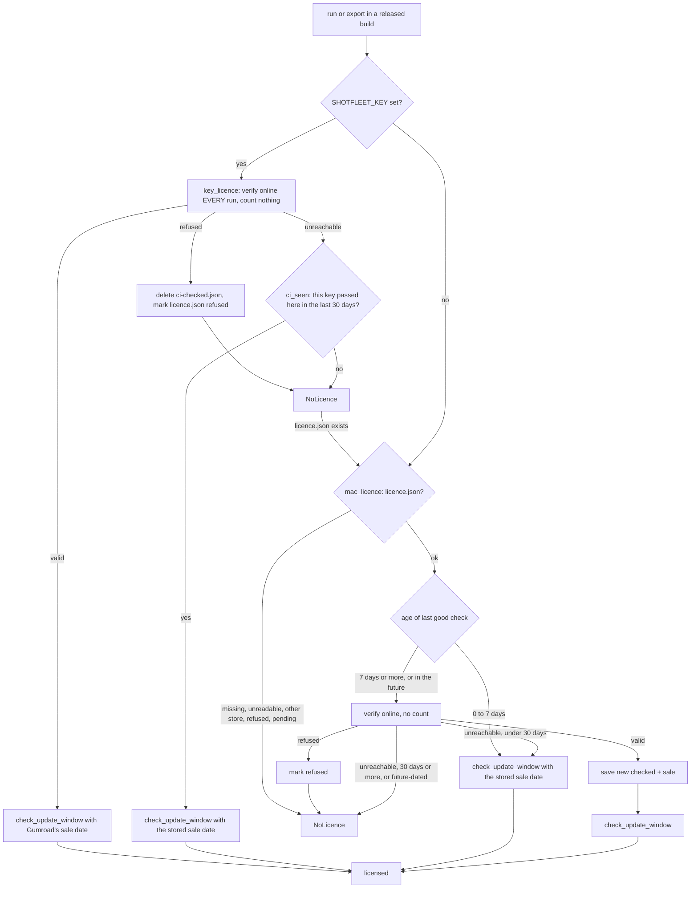

# 5. Licence and money

Scope: how shotfleet is sold (Gumroad only), what is free and what needs a key, and every behaviour of the client-side licence check: key shape, activation, the 5-use counter, the weekly re-check, the 30-day offline grace, refund / disable / chargeback handling, the CI key, the update window. Anchors are `shotfleet.py:LINE` at `7e5176c` (0.1.7); the licence code is lines 5281-5622 and was not changed by 0.1.7 (the 0.1.6 release rewrote it). The refund and key-reset procedures for the owner are in [../refund-runbook.md](../refund-runbook.md); do not duplicate them here. A longer 0.1.6-era treatment including the review history is [../architecture/05-licensing.md](../architecture/05-licensing.md).

## 5.1 The business in one page

| Fact | Value | Source |
|---|---|---|
| Product | one Gumroad product named `shotfleet`, licence keys on, no file attached (the buyer gets a key and installs the free program from the site) | `research/gumroad-setup.md`, `STATUS.md` |
| Price | $49 once per developer; $29 for the first 100 buyers via the offer code `FOUNDER29` ($20 off, limit 100, applied automatically); before VAT or sales tax where it applies | `README.md` "Free and paid", `STRATEGY.md` section 4, claims in `tests/claims.json` |
| What the buyer gets | every language in `run` plus `export`; every version released within a year of the purchase; a 14-day refund | `README.md`, `site/public/terms.html` |
| Free tier | `check`, `doctor`, `init`, `skill`, `mcp`, `activate`, `deactivate` always; `run` for up to 2 languages, both platforms, every device size | code below |
| Who is the merchant | Gumroad is the merchant of record: it handles payment, VAT and sales tax worldwide, added on top of the price | `DISTRIBUTION.md`, `site/public/terms.html` |
| Fees | Gumroad 10% + $0.50 plus card processing 2.9% + $0.30 (about $24.46 net at $29) | `DISTRIBUTION.md`, `research/gumroad-setup.md` section 2 (read from Gumroad pages 2026-10-02) |
| Payout | Individual Gumroad account, Netherlands, EUR bank payout, weekly, $100 minimum | `STATUS.md` gate 1 |
| Why Gumroad | Polar and Lemon Squeezy both end in a Stripe verification that asks a Dutch person for a KvK (chamber of commerce) number; Gumroad does not (the owner already used it for another product). Polar and Lemon Squeezy code was removed on 2026-10-03 | `research/gumroad-setup.md` header, `STRATEGY.md` week 4, [11](11-history-and-decisions.md) |
| Open owner items | KvK registration and an accountant question about VAT on the supply to a US merchant of record (`research/tax-nl-2026-10.md`); one real paid test sale to prove a refunded key is refused (`STATUS.md` "Manu only" list) | `STATUS.md` |

**Where the product id lives.** `GUMROAD_PRODUCT_ID` at `shotfleet.py:5288`. It is not secret (Gumroad's verify endpoint takes it with the key, and it is in every released program). `packaging/go-live.sh:85` rewrote that line once, for 0.1.0; `tools/release-candidate.sh:96` writes a TEST id (starting with `RCTEST`) into a temporary **copy** to build a gated test program without touching the repo. Other places that use it: `tools/golive/storefront.sh` (checks the live product page: published, licence keys on, id matches, price, refund policy, and that the licence API rejects a made-up key), the owner's weekend watchdog ([09](09-operations-and-support.md)), and the refund runbook's optional read-only `curl`. Do not paste a key or a buyer's email anywhere.

## 5.2 What is free and what is paid, in code

```text
command                      without a licence                 with a licence
check, doctor, init, skill,  works, never touches licence code  same
mcp, activate, deactivate
run (iOS, Android,           first FREE_LANGUAGES = 2 languages every language
 [capture], MCP run)         (cap_locales :5297)
export                       refused, exit 2                    works
```

- The gate lives in `main_dispatch` (`:5675`): `export` calls `require_licence()`; `run` calls `apply_free_tier()` (`:5602`), which turns a `NoLicence` into `LOCALE_CAP = 2` and a stderr note instead of a refusal. `cap_locales` then cuts the language list inside `ios_run_inner` and `android_run_inner` to the **first two** (of the sorted default list, or of `--locales`) and prints a `free tier:` line saying why; the MCP summary carries the same text in `note` (`FREE_TIER_NOTE`, 0.1.7).
- **The cap is per run.** Two runs of two languages give four. A test documents this on purpose (`tests/test_claims_unit.py`, `FreeTierOnAFrozenBuild`); the owner chose on 2026-10-06 to leave it. Nothing ends the free tier: no date, no version switch.
- **The one exception**: when `SHOTFLEET_KEY` is set and refused or unverifiable, `apply_free_tier` raises a `Fail` (exit 2, "`run` stops here instead of capturing only 2 languages") because a CI job that sets a key wants every language, and a green job that quietly captured 2 would be a lie. Unset the variable to get the free tier back.
- **Enforced only in released (frozen) builds.** `require_licence` (`:5560`) returns immediately when `sys.frozen` is false: a source checkout runs everything. This is why the source repo is private, and why tests patch `sys.frozen`.

## 5.3 The Gumroad call: `gumroad_verify` (`:5414`)

`POST https://api.gumroad.com/v2/licenses/verify` with form fields `product_id`, `license_key`, `increment_uses_count` (`"true"` or `"false"`). No token: the verify endpoint is public, and a seller's token that could give activations back cannot ship inside a program.

- **Key shape**: `is_gumroad_key` (`:5392`): four groups of eight hex characters, `ABCDEF12-34567890-ABCDEF12-34567890`. Anything else is refused before any network call.
- **Time limit**: `gumroad_fetch` (`:5396`) runs the request in a daemon thread and stops waiting after `GUMROAD_TOTAL_SECONDS = 20`; the socket timeout of 15 s alone does not cover DNS or a server that drips one byte a second.
- **TLS**: `tls_context()` (`:3998`): `SSL_CERT_FILE` and friends if set (corporate proxies that re-sign HTTPS), else certifi's bundle (shipped in the released program), else the system's.
- **API base**: `gumroad_api()` (`:5311`) returns the real URL for any frozen build unless the baked product id starts with `RCTEST`; from source `SHOTFLEET_GUMROAD_API` points the check at a fake server (how the tests work). Before 0.1.6 the variable also worked in released builds, a one-line bypass.
- **Return value**: `(ok, uses, reason, sale)`; `sale` is `purchase.sale_timestamp` as unix time or None.
  - `success: false`: refused with Gumroad's message, except that "disabled" becomes "the key was disabled, as Gumroad does after a full refund".
  - `success: true`: Gumroad **answers success even for a refunded or charged-back purchase** ("licence enforcement is up to the seller"), so the purchase flags are checked: `refunded`, `chargebacked`, and `disputed` without `dispute_won` all refuse (a won dispute keeps the licence; a partial refund keeps working because `refunded` stays false).
  - **Offline or odd replies are not verdicts.** A 5xx, a connection error, a timeout, a cut-off body, a proxy's garbage status line, a 200 that is not JSON (a hotel Wi-Fi login page), and any answer whose `success` is not a real boolean (an empty 403/407, a 429) raise `OSError`, which callers treat as "could not ask", never as "invalid".
- `uses` is **one lifetime counter per key**, incremented by every call with `increment_uses_count=true`. It is not a count of Macs: nothing knows which Mac is which, and no machine id is sent.

## 5.4 Activation: `cmd_activate` (`:5450`)

1. Key shape check. 2. A first call with `count_use=False` reads `uses` and the sale date and refuses refused keys without burning anything. 3. `check_update_window(sale)` runs **before** anything is counted, so a key that covers no version like this one is refused with "nothing was activated and no activation was used". 4. If this Mac's `licence.json` already holds the same key (or a file exists but is unreadable) it is a re-check and counts nothing. 5. Otherwise `uses >= MAX_MACS` (**5**, `:5289`) refuses with "this key has used all 5 activations. Email hello@shotfleet.com and I'll reset the count". 6. **Save first, count second**: `licence.json` is written with `pending: true` before the counted call, so a folder that cannot be written fails before anything is charged, and a lost reply after Gumroad counted is remembered (the retry finds the key and does not count again). 7. If the counted call comes back refused, or `uses > MAX_MACS` (two people activated at the same instant), the previous file is restored or removed and the user is told; the count stays burned and the owner resets it by hand. The race itself is accepted (a `ponytail:`-style limit). 8. Success writes `{"key", "store": "gumroad", "checked": <unix time>, "sale": <sale time>}` to `~/Library/Application Support/shotfleet/licence.json` (`LICENCE_FILE` `:5283`), plain text, unsigned; the agent skills tell agents never to print it.

**"3 Macs" is a promise, 5 is the mechanism.** The site, terms, README and skills say "use it on up to 3 of your Macs; there are spare activations for reinstalls (the key has 5)". The code counts Gumroad's lifetime counter, so five activations on one Mac (reinstalls, `deactivate` then `activate`, new user accounts) use the key up, and a fourth Mac works while the counter is below 5. Builds 0.1.5 and earlier enforced 3 (`STATUS.md` still says "3 activations per key" in places: stale). Gumroad itself does not enforce the number; the product's own licence-key block just stores the counter.

`cmd_deactivate` (`:5491`) deletes the file. It **cannot** give the activation back (Gumroad needs the seller's access token for `decrement_uses_count`), so a new macOS install, a new user account or `deactivate` followed by `activate` consumes another one. The owner resets the count in Gumroad (Sales, the sale, Manage license keys, the Uses row; see the runbook section 5).

Both state files are written by `write_json_atomic` (`:5366`): a private (0600) temp file in the same folder, then `os.replace`, so a reader never sees half a file. `read_licence` (`:5483`) returns None for anything wrong (not a dict, key not a non-empty string, `checked` not a believable time via `is_time` `:5335`); the message then says to activate again, which re-checks online and **does not spend another activation**.

## 5.5 Checking a licence: `require_licence` (`:5560`)



- **Weekly re-check** (`LICENCE_RECHECK_DAYS = 7`, `:5284`): only when `run` or `export` is used, never counted. **Offline grace** (`LICENCE_OFFLINE_DAYS = 30`) after the last good check, for an activated Mac.
- **A date in the future is not trusted and not fatal**: it is treated as due for a re-check; online the file is rewritten with today's date (a fast clock heals); offline the message says to set the clock or connect once.
- **Refusals are remembered.** A refund, charge-back or disabled key found online writes `refused: <reason>` into `licence.json`, and `mac_licence` refuses from then on, offline included, until `shotfleet activate` checks again. For a CI key, `key_licence` deletes `ci-checked.json` and marks a `licence.json` holding the same key. Without this, blocking Gumroad after a refund brought the licence back for up to a month.
- **Other `licence.json` states** and their messages: `store != "gumroad"` (a file from a store the program no longer uses): activate the Gumroad key; `pending`: "activating on this Mac didn't finish: run `shotfleet activate <key>` again"; unreadable: activate again (no activation used).
- **`SHOTFLEET_KEY` (CI) is a gate, not a free pass.** `key_licence` (`:5504`) checks online on every run and uses no activation. When Gumroad cannot be reached it counts only on a machine where **that exact key passed a check in the last 30 days**: `ci-checked.json` (next to `licence.json`) holds a SHA-256 of the key (never the key), the time and the sale date, and `ci_seen` (`:5381`) also accepts a `licence.json` holding the same key. A hosted runner that starts clean every time gets no grace during an outage unless it caches that file (`~/Library/Application Support/shotfleet/ci-checked.json`; no secret in it). A stale key in a shell profile does not hide a licence activated on this Mac: `require_licence` falls back to `mac_licence` and warns. A CI key also works on a developer's Mac and skips the activation limit entirely.

## 5.6 The update window ("a year of updates")

Enforced by code, not by promise.

- **The release date is frozen into the program.** `packaging/build.sh` writes `build/_release.py` (`RELEASE_DATE = "YYYY-MM-DD"`, the build day in UTC) and passes `--paths $PWD/build --hidden-import _release` to PyInstaller, so the module is compiled into the program's archive; `baked_release_date()` (`:5317`) imports it into `RELEASE_DATE` (`:5328`). From source there is no `_release`, so no window applies. The first version shipped the date as a loose data file, and deleting one file turned the check off (review note N2); now someone must unpack and rewrite the archive. The Linux build and Docker image bake it the same way since 0.1.7. The date is the build day, not the publish day: builds are published days later, never earlier, so the window errs in the buyer's favour.
- **The comparison never uses the Mac's clock.** `check_update_window(sale)` (`:5347`) compares `RELEASE_DATE` with the purchase date from Gumroad. `updates_until` (`:5338`) is the same calendar date a year later (29 February counts to 1 March), so "a year" and "365 days" can differ by a day; the code is the calendar year. A release on the last covered day is still covered.
- **Newer than the window**: `NoLicence` naming the date the licence covers until, saying this version "runs as the free tier", that older versions keep working with the key (every version stays at `/download/<version>/`), and to email hello@shotfleet.com about a renewal (**no renewal is on sale**). `export` stops with it; `run` falls back to 2 languages (or stops, with `SHOTFLEET_KEY`).
- **Applied** in `cmd_activate` (before counting), `key_licence` (online and offline branches) and every success path of `mac_licence`. The sale date is stored in `licence.json`/`ci-checked.json` and refreshed at each online check, so it works offline.
- **Open and closed cases.** No sale date (Gumroad sent none, or a pre-0.1.6 file not yet re-checked) means no window, so existing buyers are not locked out. An unreadable sale date is None. The one closed case: a released build with no usable release date and a known sale date runs as the free tier, with a stderr warning.

## 5.7 How a refund reaches the program

Gumroad, not shotfleet, takes the refund (never from Stripe or PayPal directly). Then:

1. Full refund: Gumroad disables the key itself (the verify endpoint answers 404 "This license key has been disabled", per Gumroad's source as of 2026-08-19 quoted in the runbook) and/or flags `refunded: true`. Either way `gumroad_verify` returns a refusal.
2. An activated Mac notices at its next **weekly** re-check (up to 7 days; up to 30 if the Mac is offline), because the check only runs inside `run` and `export`. The refusal is written into `licence.json` and sticks.
3. A CI key is checked on every run, so it stops at the first run that reaches Gumroad after the refund; while Gumroad is unreachable it keeps working only on machines where it passed within 30 days.
4. The buyer keeps everything they already made; `check` and 2 languages stay free.

**Proven versus not.** Activate, re-activate and refuse a made-up key were proven on the signed 0.1.2 release against the real Gumroad API using the creator's own test purchase (2026-10-05, `STATUS.md`). That a **refunded** key is refused has **never been proven against a real paid sale**: a $0 sale has no refund action, and buying with your own card is treated by Gumroad as card testing and can get the account suspended. Everything on that path is proven only against a fake Gumroad built from Gumroad's docs and source (`tools/release-candidate.sh`, `tests/test_shotfleet.py`). The plan is one purchase by another person with their own card, a refund in Gumroad Sales, and then watching the weekly re-check (set `checked` in `licence.json` back 8 days to see it sooner); steps in the runbook and `STATUS.md`.

## 5.8 Known limits of client-side licensing (accepted)

Everything follows from "the check runs on the buyer's Mac, in a program the buyer owns". The product promise today is "no account, offline-first"; closing these needs a small server of ours that signs short-lived, machine-bound licences, and even then the attack only moves to patching the binary. Do not "fix" them by adding obfuscation or a server without the owner.

1. `licence.json` and `ci-checked.json` are unsigned text; a hand-written one makes a made-up key count for 7 to 30 days at a time.
2. The 7-day and 30-day checks use the Mac's clock (a Mac held offline with a still clock keeps its grace); the update window does not.
3. `SHOTFLEET_KEY` uses no activation, so one key in a team secret serves any number of machines; the only brake is the online check on every run.
4. A proxy with its own CA (`HTTPS_PROXY` plus `SSL_CERT_FILE`) can answer for Gumroad; the program does not check that the reply's product matches (a `ponytail:` comment at `:5308`).
5. A patched binary: the code signature seals the executable, not the rest of the frozen folder.
6. Activations are a lifetime counter, only the owner can reset them, the activation race can pass the limit, and Gumroad's verify says `success: true` for refunded purchases, so refusal rests on the flags and the weekly re-check.

Records: `research/review-2026-10-03.md`, `research/refund-process-2026-10-05.md`, and the 0.1.6 review notes kept outside the repo in `shotfleet-rc-build/code-review-2026-10-07/`.

## 5.9 Testing the licence and changing it

- **Unit tests**: `tests/test_shotfleet.py` (classes `Licence`, `GumroadLicence` with an in-process fake `BaseHTTPRequestHandler`, `LicenceHardening`, `UpdateWindow`, `CorruptLicenceFile`), `tests/test_claims_unit.py` (free tier, MCP), `tests/test_free_tier_message.py`, `tests/test_release_candidate.py`. They patch `sf.GUMROAD_API`, `sf.LICENCE_FILE`, `sf.GUMROAD_PRODUCT_ID`, `sf.RELEASE_DATE` and `sys.frozen`.
- **The frozen program**: `tools/release-candidate.sh` (needs `SHOTFLEET_RC=1`) builds with PyInstaller from a temp copy with a TEST product id and runs the real binary through free tier, activate, re-activate, refused key, five activations then the sixth, deactivate, weekly re-check, 503, dead server, 31 days offline, `SHOTFLEET_KEY` including an outage, TLS from the frozen build, and the baked release date (a 2020 purchase must say "covers every version released until 2021-01-01", which only the dated path produces). Result record: `research/release-candidate.md` (92 of 92 checks on its first full run, 2026-10-02; the script has gained checks since, and the number for later releases is in each release's folder under `shotfleet-rc-build`, not verified here).
- **The real API**: `tools/golive/storefront.sh` and `tools/selftest.sh --licence-probe`.
- **Changing any licence behaviour** means changing together: `shotfleet.py`, the unit tests, `tools/release-candidate.sh`, `site/public/terms.html`, `index.html`, `docs.html`, `llms.txt`, README, the skill `references/licence.md` and `ci.md`, and the claim rows that quote them. The 0.1.6 licence commit touched 24 files for exactly this reason. Run `tools/check-claims.sh`; it names what drifted ([06](06-packaging-and-release.md), [10](10-contributing.md)).
