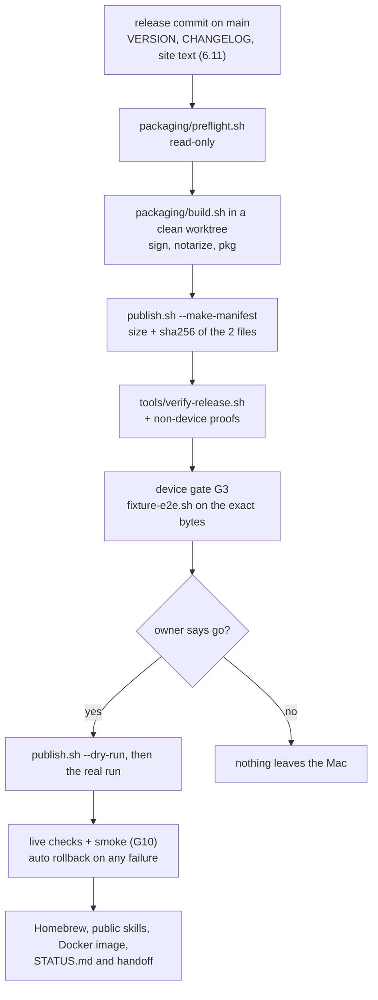
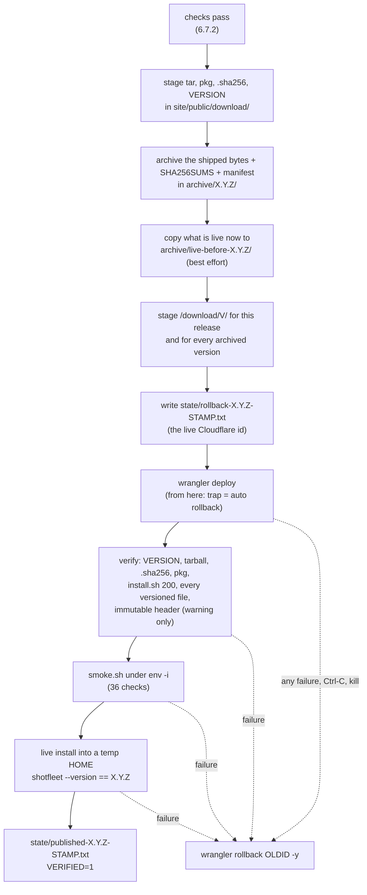

# 6. Packaging and release engineering

> **Update, 2026-11-11:** shotfleet is now free and open source (MIT), funded through GitHub Sponsors. The license check, `shotfleet activate`, the price, the free tier, refunds and the Gumroad product were removed (versions up to 0.1.10 were sold). Wherever this document describes them, it describes the paid period and no longer applies; `LICENSE`, `README.md` and `CHANGELOG.md` are current.

This chapter explains how shotfleet turns a commit into the signed, notarized files that buyers download, how those files are tested before anyone
sees them, how they are published to shotfleet.com, and how to undo a bad release. It is written for an engineer who has never seen the project: it
names every script, every flag that matters, the files that carry the version, the evidence files that say what happened in past releases, and the
places where the repo is stale or where something is not verified. It was written on 2026-10-08 against the worktree at `7e5176c` (`VERSION = "0.1.7"`,
`shotfleet.py:28`) and the durable build folder `/Users/manu/Developer/shotfleet-rc-build/` (read only). Every claim cites a file and line, or says
"not verified". Siblings: [01-runtime-architecture.md](01-runtime-architecture.md), [05-licence-and-money.md](05-licence-and-money.md),
[07-website-and-backend.md](07-website-and-backend.md), [08-testing.md](08-testing.md), [09-operations-and-support.md](09-operations-and-support.md),
[10-contributing.md](10-contributing.md), [11-history-and-decisions.md](11-history-and-decisions.md), [README.md](README.md).

**The rule that explains the whole chapter: publish the bytes you tested, never a rebuild** (`packaging/README.md:3`). Two builds of one commit differ
(0.1.0's tested and shipped builds differed by 1,621 bytes: `research/limits-release-engineering-2026-10-05.md` section 1), so the pipeline builds
once, records the hash of the two files, tests those exact files, and lets `publish.sh` upload only files whose hash matches the record.

## 6.0 State when this was written (it will age; the dated sources below stay true)

| Fact | Source |
|---|---|
| Live site runs 0.1.6 (given by the coordinator; not re-fetched for this chapter) | brief; `release-archive/state/published-0.1.6-*.txt` |
| This worktree: `VERSION = "0.1.7"`, CHANGELOG top heading `## 0.1.7 (2026-10-07)` | `shotfleet.py:28`, `CHANGELOG.md:3` |
| `origin/main` already holds `b41ac94`, which moves the three 0.1.7 dates to 2026-10-08 (the build day) | `git show b41ac94` |
| 0.1.7 was built from `b41ac94` on 2026-10-08 06:35 to 06:37 (notary: zip and pkg Accepted, `verify-release.sh` PASS 12 checks), non-device proofs were running at 06:50; the device gate `g3-017.log` has not run; `publish-017.sh` is prepared and has not been run | `shotfleet-rc-build/0.1.7/progress.log` |
| The first 0.1.7 build attempt (2026-10-07 18:17) was blocked about 6 hours by a locked screen and gave up at 00:55 | same file |
| Release archive holds `0.1.1` to `0.1.6` (no `0.1.0`) plus `live-before-*` records | `shotfleet-rc-build/release-archive/archive/` |

## 6.1 Map: what a release is and the path it takes

A release is **two files** plus three small ones, for Apple silicon Macs, macOS 13 or later:

| File served | Made by | Notes |
|---|---|---|
| `shotfleet-<version>-macos-arm64.tar.gz` | `packaging/build.sh:64` | PyInstaller one-folder build (`shotfleet/`), installed by `site/public/install.sh` |
| `shotfleet-<version>-macos-arm64.pkg` | `packaging/pkg.sh` | lays the folder at `/usr/local/lib/shotfleet` and links `/usr/local/bin/shotfleet` (`pkg.sh:21-30`) |
| `...tar.gz.sha256` | `publish.sh:254` | the checksum `install.sh` verifies (`install.sh:9-11`). There is **no** `.pkg.sha256` |
| `VERSION` | `publish.sh:254` | one line; `doctor` reads it (`shotfleet.py:3864-3867`, announced at `:4280-4281`) |
| `/download/<version>/...` | `publish.sh:267-274` | the same three files, permanent (section 6.7.6) |

Why a folder and not one file: a folder starts in about 0.15 s, a one-file build unpacks itself on every launch (about 1.2 s, measured; `packaging/build.sh:2-3`).
Why a `.pkg` as well: files the macOS Installer lays down carry no quarantine flag, so Gatekeeper never checks them at run time (`pkg.sh:4-6`).



### Words used in this repo

| Term | Meaning | Where it is defined |
|---|---|---|
| **go-live** | the one-time 0.1.0 launch on 2026-10-05: put the Gumroad product id into the program, build, deploy, flip the site from waitlist to Buy. Not repeated | `packaging/go-live.sh`, section 6.9 |
| **release** | any later version: build, test the files, `publish.sh` | `packaging/README.md` |
| **release candidate (RC)**, sense 1 | `tools/release-candidate.sh`: builds a TEST copy of the program (test Gumroad product id) and checks the frozen program against a fake Gumroad. Not what ships | section 6.9 |
| **release candidate / "rc-build"**, sense 2 | the durable folder `/Users/manu/Developer/shotfleet-rc-build/`, where the real release builds, logs and archive live. Its name is historical; the files built there are the real release | section 6.10 |
| **gate** | a check that must pass before a step. Three numbering schemes exist, do not mix them | section 6.5 |
| **manifest** | text file listing version, size and sha256 of the two tested files; `publish.sh` refuses anything else | section 6.7 |
| **claims register** | `tests/claims.json`: every public promise with its status and proof | section 6.6 |

## 6.2 Inventory of scripts

### In the repo

| Script | What it does | Reads / writes | Needs |
|---|---|---|---|
| `packaging/build.sh` | pinned Python, hashed pip install, Swift OCR helper, bake release date, PyInstaller, sign, notarize, tarball, calls `pkg.sh` | writes `build/` and `dist/` (deletes both first, `:34`) | uv Python 3.14.2, Xcode `swiftc`, certificates, notary profile |
| `packaging/pkg.sh` | installer package: build, sign (Developer ID Installer), notarize, staple, `spctl` check | `dist/*.pkg`, `build/notary-pkg.log` | `INSTALLER_ID`; `NOTARY_PROFILE` to notarize |
| `packaging/notary-check.sh` | read-only `notarytool history` with a 60 s limit; tells a locked screen from a missing profile (it cannot, so it names the lock first) | none | network, unlocked Mac |
| `packaging/preflight.sh` | read-only: both certificates present and not within 14 days of expiry, `notarytool history`, `wrangler whoami`, clean tree, 5 GB free, uv Python at macOS 11.0. Prints `OK` or `FAIL` per line, exit 1 on any FAIL | none | network |
| `packaging/publish.sh` | publish tested files; `--make-manifest`; `--dry-run`; `--staging`; `--tree`; `--checkout` | `site/public/download/`, `$SHOTFLEET_RELEASE_DIR/{archive,state}`, Cloudflare | wrangler login, `SHOTFLEET_RELEASE_DIR` |
| `packaging/release.sh` | check-claims, build **and** deploy in one run. Its header says it ships different bytes than it tested and was used once, by `go-live.sh` (`:4-5`). Do not use | | |
| `packaging/go-live.sh` | the 0.1.0 launch; `--dry-run` rehearses on a temp copy | | section 6.9 |
| `packaging/build-linux.sh` | unsigned Linux folder with the same pinned inputs, no Swift helper | `dist/shotfleet-<v>-linux-<arch>.tar.gz` | Linux, `python3` |
| `packaging/docker-check.sh` | buildx for amd64 and arm64, push `:<version>` and `:latest`, run `--version` from the registry on both CPUs | ghcr.io | Docker, login with `write:packages`, clean tree |
| `packaging/entitlements.plist`, `packaging/requirements-build.txt` | hardened-runtime entitlements; the pinned, hashed build inputs | | |
| `Dockerfile` | the Linux `check` image (section 6.3) | | |
| `tools/verify-release.sh` | read-only verification of a folder, `.tar.gz` or `.pkg` (section 6.5.2) | temp dir | macOS |
| `tools/macho-minos.py` | minimum macOS of every Mach-O file; `--max N` exits 1 when exceeded | | `otool`, `lipo`, `file` |
| `tools/release-candidate.sh` | frozen-program test harness (section 6.9) | temp dir | `SHOTFLEET_RC=1`, 3 GB free |
| `tools/golive/smoke.sh` | read-only post-deploy smoke test of a base URL, 36 checks | temp dir | network |
| `tools/golive/storefront.sh` | read-only check of the live Gumroad product page (published, licence keys on, refund policy, product id, list price) | | network |
| `tools/check-claims.sh` | the local test gate (section 6.5.1) | | python3, node |
| `tools/status.sh` | prints the numbers `STATUS.md` quotes (section 6.5.4) | | curl, git, node |
| `tools/fixture-e2e.sh` | the device gate: fixture app, `init`, `doctor`, `run`, `check`, `export`, planted failures | boots simulators and emulators | `SHOTFLEET_E2E=1` |
| `tools/bump-homebrew.sh`, `tools/sync-public-skills.sh` | point the Homebrew cask / the public skills repo at a release; print a diff, never push | the other repo's checkout | published release |
| `tools/selftest.sh` | one script a person runs on any Mac to test a release in a throwaway folder (clean-Mac evidence) | | |
| `tools/watch-upstream.sh` | runs `latest-maestro.py` (downloads about 315 MB only on a new tag) and `apple-specs-watch.py`; exit 0 both fine, 1 something to update, 2 a watcher could not read its source. Run monthly and before a release | | network |
| `tools/maestro-compat.py`, `tools/pretend-mac.py` | Maestro interface check without a device; run one test module as if on an Apple silicon Mac | | |
| `.githooks/pre-commit` | `exec tools/check-claims.sh` (`:3`); enable once per clone with `git config core.hooksPath .githooks` (`:2`) | | |
| `.github/workflows/*.yml` | five workflows, **all `workflow_dispatch` only**: `ci.yml` (claims on macOS plus Linux Python 3.11 and 3.13), `macos-compat.yml` (live download on macOS 14 and 15), `maestro-latest.yml`, `apple-specs.yml`, `e1-android-kvm.yml`. The owner pays per runner minute, so the local gate is the gate (`ci.yml:2`) | | |

### Not in the repo (important, and a risk)

Each release has a folder `shotfleet-rc-build/<version>/` with the **operational scripts** the release builder used. They are copied from the previous
release and renamed ("Recipe = ../0.1.6", `0.1.7/RESUME.md`); the folder is not a git repository (no `.git`), so these are the least protected part of the
process. A new engineer should copy from the newest release folder:

| File (in `<version>/`) | Purpose |
|---|---|
| `RESUME.md`, `progress.log`, `log.sh` | state for a builder that restarts; `progress.log` is "the source of truth" (`0.1.7/RESUME.md`) |
| `build.py`, `build-run.sh` | run `packaging/build.sh` detached under `caffeinate -di` with a hard limit (45 min in 0.1.6, 120 min in 0.1.7), write `build.log` and `build.exit` (`EXIT 0` or `EXIT 124` on timeout) |
| `build-when-unlocked.sh` (0.1.7) | polls every 2 minutes for up to 6 hours until the keychain unlocks, then runs `build.py` |
| `proofs.sh`, `proof-d-one.sh`, `mcp-client-test.sh`, `step34.sh` | the non-device proofs (section 6.5.3) and the real MCP client test |
| `waiter.py` / `g3-0NN-waiter.py` | the gate waiter: takes the device lock only when the Mac is quiet, runs `fixture-e2e.sh`, kills on a hard or stall limit, writes `e2e result: PASS` or `FAIL` (section 6.5.5) |
| `publish-0NN.sh` | wrapper around `publish.sh` with extra guards (section 6.7.7). Prepared by the builder, run only after the owner's go |
| `redeploy-016-site.sh` (0.1.6 only) | site-only re-publish of the same bytes (section 6.7.6) |

## 6.3 The build (`packaging/build.sh`)

All line numbers below are `packaging/build.sh` unless stated.

1. **Notary check first** (`:17`): when `DEVELOPER_ID` and `NOTARY_PROFILE` are both set it runs `packaging/notary-check.sh`, because a locked keychain would
   otherwise be found minutes later, after compiling. The script has no default for `NOTARY_PROFILE`; `release.sh:9`, `notary-check.sh:7` and
   `preflight.sh:15` default it to `ShotfleetNotary`. **Without `NOTARY_PROFILE` the build only signs, on purpose** (`tools/release-candidate.sh` relies on that, `:100`).
2. **Pinned Python** (`:24-31`). `PINNED_PYTHON` (default `3.14.2`) must be a uv-managed python-build-standalone interpreter
   (`uv python install 3.14.2`; found with `uv python find 3.14.2 --managed-python`). A different version (`:28`) or a Mach-O whose minimum macOS exceeds
   `PYTHON_MINOS_MAX` (default 11, `:24`, checked by `tools/macho-minos.py --max`, `:30`) is refused **before** anything is built. Why: Homebrew's Python is built for the
   macOS it was built on (27.0 measured on 2026-10-05, `tools/macho-minos.py:8-9`), so a PyInstaller folder made from it would need that macOS. The standalone one
   declares macOS 11 (`preflight.log` of 0.1.6: "needs macOS 11.0"). `tests/test_pinned_build_inputs.py:41-48` pins this ordering (the Python check precedes `swiftc`) and `:67-74` runs the script with a fake Python to see the refusal.
3. **Swift OCR helper** (`:35`): `swiftc -O -target "$ARCH-apple-macos${MACOS_MIN:-13.0}" ocr.swift -o build/ocr`. Vision's newer text models start at macOS 13, hence the 13.0 floor.
4. **Pinned pip inputs** (`:36-38`): a fresh venv from that Python, then only `pip install --only-binary=:all: --require-hashes -r packaging/requirements-build.txt`.
   The file (`requirements-build.txt:10-25`) pins `altgraph 0.17.5`, `certifi 2026.6.17`, `macholib 1.16.4`, `packaging 26.3`, `pyinstaller 6.22.3`,
   `pyinstaller-hooks-contrib 2026.8`, `setuptools 84.0.0`, each with sha256 of the wheels; PyInstaller has three hashes, the second and third being its Linux
   wheels for the Docker image (`requirements-build.txt:8-9`). A hash mismatch stops the build; the message says "do not build until you know why" (`:38`). To change a pin follow the comment at the top of the file
   (`requirements-build.txt:6-7`) and record the new versions in the release record. Offline: `PIP_NO_INDEX=1 PIP_FIND_LINKS=<folder of wheels>` (hashes still checked, `:12-13`).
   `tests/test_pinned_build_inputs.py` checks: every line is `name==version` with hashes and PyInstaller is `6.22.3`, certifi `2026.6.17` (`:27-34`); no `--index-url`, `>=`, `--no-deps` (`:36-39`);
   no unpinned `pip install` or `--upgrade` anywhere in `packaging/*.sh` (`:58-65`).
5. **The baked release date** (`:42`): `printf 'RELEASE_DATE = "%s"\n' "$(date -u +%Y-%m-%d)" > build/_release.py` (the build day, UTC).
   PyInstaller gets `--paths "$PWD/build" --hidden-import _release` (`:43`), so the module is **frozen into the program's compiled archive**. `baked_release_date()`
   (`shotfleet.py:5317-5326`) does `import _release`; `RELEASE_DATE = baked_release_date()` runs at import (`:5328`). Why a module and not a data file: a loose file in
   `_internal/` could be deleted with one `rm`, which would switch the licence's one-year update window off, and the code signature would not notice. Why the build day: a build is published days later, never earlier, so the date errs in the buyer's favour (`:39-41`).
   A frozen build without a usable date prints a warning to stderr, still runs, and its licence is *not* treated as covering it (`shotfleet.py:5324-5325`, `check_update_window` `:5347`).
   The licence rules are in [05-licence-and-money.md](05-licence-and-money.md); how a frozen program differs from a source run is in [01-runtime-architecture.md](01-runtime-architecture.md). Tests: `tests/test_shotfleet.py:1768-1783` (module present, bad values, the `build.sh` line itself) and `tests/test_pinned_build_inputs.py:50-56` (all three builds freeze the date).
6. **PyInstaller** (`:43-49`): `--onedir --name shotfleet --add-binary build/ocr:. --add-data skill:skill --paths build --hidden-import _release --distpath dist --workpath build/pyi --specpath build --noconfirm`.
   There is no committed `.spec` file: it is generated into `build/`. When `DEVELOPER_ID` is set the helper is signed first (`:46`) and PyInstaller is given `--codesign-identity` and `--osx-entitlements-file packaging/entitlements.plist` (`:47`).
7. **Re-sign everything** (`:50-63`): every Mach-O file in `dist/shotfleet`, **deepest path first** (`awk` counts slashes, `:54`), then `*.framework` directories, then the main executable with the entitlements, then
   `codesign --verify --deep --strict`. All with `--options runtime --timestamp` (hardened runtime plus Apple's secure timestamp, which notarization requires). It re-signs what PyInstaller already signed because
   PyInstaller's own signing left a Python framework with a signature Apple's notary rejected (comment `:51-52`, which still says "Homebrew's Python"; the same code runs with the standalone Python).
   Entitlements (`entitlements.plist:5-6`): `com.apple.security.cs.disable-library-validation` and `com.apple.security.cs.allow-unsigned-executable-memory`. The plist's comment (`:4`) says "one-file build", but the product is one-folder; whether both entitlements are still needed was not re-tested (not verified).
8. **Tarball** (`:64`): `tar -C dist -czf dist/shotfleet-$VERSION-macos-$ARCH.tar.gz shotfleet`. `VERSION` is read from `shotfleet.py` by regex (`:32`); `pkg.sh:15`, `build-linux.sh:9`, `docker-check.sh:9` and `tools/sync-public-skills.sh:12` do the same.
9. **Notarize** (`:65-79`, only with `DEVELOPER_ID` and `NOTARY_PROFILE`): `ditto` zip of the folder, `notary-check.sh` again (the build took minutes and the screen may have locked), `xcrun notarytool submit --wait`, require `status: Accepted` in `build/notary.log`
   (else `notary_failed` prints the submission id and the `notarytool log` command, `:18-23`). **Then do not trust the verdict**: unpack the tarball that will ship, set `com.apple.quarantine`, and run `--version` under a 90 s alarm (`:72-78`). `spctl` cannot assess a bare executable (no source line), but a quarantined, not-notarized copy hangs and is killed,
   while a notarized one prints its version (first run asks Apple, about 10 s). `tests/test_release_candidate.py:222-230` pins this block.
10. **Package** (`:81`): with `INSTALLER_ID` set it runs `packaging/pkg.sh`: `pkgbuild --identifier com.shotfleet.cli --install-location /` with a `postinstall` that links the binary (`pkg.sh:21-30`), checks the signature says "Developer ID Installer" (`:31`), and, with `NOTARY_PROFILE`, notarizes, staples, validates, and requires
    `spctl --assess --type install` to say `source=Notarized Developer ID` (`:32-42`). There is no `preinstall`, so an older install's stale files are not removed by the package (the question is listed unverified in `research/limits-release-engineering-2026-10-05.md`, "Unverified").
11. **Informational** (`:82-83`): `tools/macho-minos.py dist/shotfleet || true` prints the oldest macOS the build runs on (the 0.1.7 build: two files at 11.0, the `ocr` helper at 13.0, "this build needs macOS 13.0 or newer", `0.1.7/build.log`), then the tarball's sha256.
    Enforcement is in `verify-release.sh` (default `--max-macos 13`, `:16`).

`build.sh` deletes `build/` and `dist/` first (`:34`): **copy the two files out of `dist/` into a durable folder immediately** (`packaging/README.md:8`).

### The notary profile gotcha: "No Keychain password item found" usually means the screen is locked

`notarytool` keeps the profile in the data-protection keychain, which locks about 5 minutes after the screen locks; it then prints the same text as for a profile that was never stored.
`security find-generic-password` cannot see that item, so it proves nothing. Measured: 25 of 25 notarytool errors in one night were "keychain is locked" while the Mac was locked, and the profile worked
again after unlock (`research/notary-profile-2026-10-06.md`, "Answer" and "What happened between ..."). So:

- unlock the Mac and keep it awake. `release.sh:13` and the builder's `build.py` run the build under `caffeinate -di`; `notary-check.sh:11-15` prints the lock explanation first and the `store-credentials` command second;
- only if it still fails after unlocking, store the profile again with `xcrun notarytool store-credentials ShotfleetNotary --apple-id <id> --team-id 2357A78TMR` (it prompts for the app-specific password: never put it in a command line or a chat);
- `caffeinate` does not help if someone locks the Mac by hand or closes the lid (`notary-profile-2026-10-06.md`, "Prevention" item 1). On 2026-10-07 the 0.1.7 builder
  waited 6 hours with a poll script and still gave up (`0.1.7/progress.log` lines for 18:18, 19:05 and 00:55); why the screen stayed locked is not recorded. **Waiting is the right response; asking the owner to recreate credentials is not.**
- The profile is `ShotfleetNotary`; an earlier shared profile `KeysiNotary` belonged to another product and was used for 0.1.4 (`docs/handoff.md:212`).

### Linux build and the Docker check image

`packaging/build-linux.sh` makes an unsigned folder with the same hashed inputs and no Swift helper (`:14-18`); there is no Linux installer and `install.sh` refuses non-Macs
(`install.sh:5-6`). Linux gets `check` through the image `ghcr.io/noloman/shotfleet-check`:

- `Dockerfile` has two stages. Build stage `python:3.14.2-slim-trixie@sha256:1a3c6dbfd217...` (pinned by digest, `:8`): installs `requirements-build.txt` with `--require-hashes` (`:12-13`), writes `build/_release.py` (`:17`), runs PyInstaller with `--hidden-import _release` and **fails the build if any `.py` ships**
  (`! find /dist -name '*.py' | grep .`, `:21`). Runtime stage `debian:trixie-slim@sha256:a29215f6a35e...` (`:25`): Tesseract plus 34 language packs, `aapt`, `jq` (`:28-31`), user `shotfleet` uid 1000, `ENV SHOTFLEET_IMAGE=check` (`:41`) which makes `run` and `export` stop with one line (`shotfleet.py:5683`). The `apt` packages are **not** pinned (not covered by the hash story).
- Since 0.1.7 both the Linux build and the image bake the release date like the Mac build (`build-linux.sh:16-18`, `Dockerfile:16-18`, CHANGELOG 0.1.7). Older documents say they do not (section 6.15).
- `packaging/docker-check.sh` needs a **clean tree** (`:12`), builds both CPUs, pushes `:<version>` and `:latest` (`PUSH=0` loads into local Docker only, `:13-15`) and runs `--version` from the registry on both CPUs (`:16-18`). It is a by-hand step after `publish.sh` (`packaging/README.md:19`), is not in the manifest, and needs `gh auth refresh -h github.com -s write:packages` once.
- **The image is not announced yet.** The site keeps every mention behind `<!-- DOCKER-PENDING ... -->` markers, the held-back text is in `site/draft/docker-pending.txt`, and the flag file `site/DOCKER_PUBLISHED` does not exist. `tests/test_site.py:338-360` (`DockerPending`) forbids any visible mention while the flag is missing and forbids the markers once it exists.
  To announce: push the image, make the package public (GitHub UI only, no API), delete the marker lines in `site/public/docs.html`, `llms.txt` and `README.md`, put the held-back text back, add an empty `site/DOCKER_PUBLISHED`. Whether the image is already on ghcr.io is **not verified**: the last record says publishing was blocked on the `write:packages` scope on 2026-10-06 (`shotfleet-rc-build/docker-check/RESUME.md`).

## 6.4 Minimum macOS and `tools/macho-minos.py`

`macho-minos.py <folder> [--max N]` reads `LC_BUILD_VERSION minos` (or the old `LC_VERSION_MIN_MACOSX`) of every regular Mach-O file, skips symlinks and non-macOS platforms, prints one line per (architectures, minos) and the highest value,
and exits 1 only when `--max` is exceeded (`tools/macho-minos.py:15-48`). The build calls it twice: on a **copy** of the Python interpreter before building (it reads regular files only, so symlinks must be resolved and copied, `build.sh:29`) and, informationally, on `dist/shotfleet` afterwards. `verify-release.sh` enforces `--max 13`.
The statement it supports: "built for macOS 13 or later on Apple silicon". Running on macOS 13 and 26.0 to 26.2 is **not proven** (only "tested on macOS 27", plus hosted runners on 14 and 15 and one 26.2 VM; `docs/compat.md`, `docs/handoff.md:220`). The Homebrew cask says `depends_on macos: :ventura` (local checkout `shotfleet-rc-build/homebrew-tap-016/Casks/shotfleet.rb`; the remote repo was not read).

## 6.5 Verification and gates

### 6.5.0 Which "gate"? Three numbering schemes

| Scheme | Where | Meaning |
|---|---|---|
| **G1 to G11** | `research/go-live-gate.md` (a table with 11 rows) | the evidence table for the 0.1.0 go-live. Authoritative when someone says "G3" or "G10" |
| **Gates 1 to 16** | `STATUS.md` "Gates to first sale" | the older roadmap rows (payment, licence, release build, claims, website ...). `tools/release-candidate.sh:3` calls "gates 5 and 6" these rows |
| **G1 to G5** | `research/roadmap-2026-10.md` lines 111-115 | post-launch decision gates (reach, pace, refunds, support, decide). Not about releases |

Say "the G3 gate" (a log named `g3-0NN.log`), never "gate 3". The go-live table, with how a normal release covers each row today (the right column is my mapping, not a statement in the repo):

| # | What (`research/go-live-gate.md:9-19`) | Covered in a release by |
|---|---|---|
| G1 | final code on main, all local checks green | `tools/check-claims.sh` rc 0 on the commit that is built |
| G2 | iOS fixture on Maestro 2.0.10 and 2.11.0 | **row is blank in the file**; the 0.1.6 fixture runs on both versions are recorded in `research/maestro-2-11-0.1.6-2026-10-07/NOTES.md`, `docs/compat.md:12` and `site/public/docs.html:180` |
| G3 | the release binary (not the source) runs the fixture end to end with a real licence | `tools/fixture-e2e.sh` with `SHOTFLEET_BIN` on the unpacked build (section 6.5.5). Log files `g3-0NN.log` |
| G4 | artifacts built from final main: tarball and pkg, signed and notarized | `packaging/build.sh` |
| G5 | Gatekeeper accepts them | `tools/verify-release.sh` and proofs B |
| G6 | licence on the signed binary against the real Gumroad API | later releases only repeat the *made-up key is refused* half (proofs C); the activation with the owner's real key was done once for 0.1.0 |
| G7 | install paths | proofs E (`install.sh` into a throwaway HOME, wrong checksum refused) and the pkg checks |
| G8 | real apps with the release binary | **blank in the file**; proofs D runs `check` on 72 real Android screenshots |
| G9 | site rehearsal off the production domain | `publish.sh --staging` (section 6.7.4) |
| G10 | production smoke right after the deploy | `publish.sh` runs `tools/golive/smoke.sh` and a live install itself (section 6.7) |
| G11 | rollback is written and rehearsed | the `state/rollback-*.txt` record (section 6.7.3) and `publish.sh`'s automatic rollback (rehearsed on staging, `shotfleet-rc-build/staging-rehearsal/auto-rollback-run.log`) |

### 6.5.1 `tools/check-claims.sh`: the local test gate

It exists so that "every promise on the site and in the docs is tested" (`:2`) is one command with one line of output. Internals:

1. `cd` to the repo root, temp dir `d`, `jobs = CHECK_JOBS` or half the cores (`:8`).
2. `ls -S tests/test_*.py | xargs -P $jobs`: every test **module** runs in its own process as `python3 -m unittest discover -s tests -p <module>.py`, biggest files first so no slow module starts last; output goes to `d/<module>.out`, and a non-zero exit appends the module name to `d/failed` (`:11-12`).
3. An `awk` pass sums each module's last `Ran N tests` line and its `OK` or `FAILED (failures=.., errors=.., skipped=..)` line (`:14-24`).
4. `node site/worker.test.mjs` for the Cloudflare Worker, counting lines starting `ok ` and `FAIL ` (`:26-27`).
5. On any failure it prints every module's output then `check-claims: FAILED (python: ...; worker: N ok, M failed)` and exits 1; otherwise one line and exit 0 (`:28-29`):
   `check-claims: ok (python: Ran 1244 tests in 52s OK (skipped=20) ; worker: 37 checks ok)` (the real line from `shotfleet-rc-build/0.1.7/check-step3.log`; main, not this worktree).

Timing: 51 to 57 s on 2026-10-07/08 (`0.1.7/check-step*.log`), 52 to 69 s on a busy Mac (`TESTING.md:3`). It is used by `.githooks/pre-commit`, `packaging/release.sh:11`, and `go-live.sh --dry-run` (with `SHOTFLEET_DRYRUN=1`, `go-live.sh:128`). **Rule from the coordinator's runs:** push only on the check's own exit code, written to a file (`sh tools/check-claims.sh > <durable log> 2>&1; rc=$?`), never through a pipe, which hides the status (`docs/architecture/10-making-changes.md:10`).

### 6.5.2 `tools/verify-release.sh`

Read-only. `verify-release.sh [--manifest F] [--expect-version X.Y.Z] [--max-macos N (13)] [--team ID (2357A78TMR)] [--no-run] <folder|.tar.gz|.pkg>...`. Prints `ok`/`FAIL`/`SKIP` lines then `PASS: N checks, 0 failed` (exit 0) or `FAIL` (exit 1) (`:103-104`).

| Target | Checks (line) |
|---|---|
| tarball or folder | file matches the manifest by size and sha256 (`:44-50`); every Mach-O file passes `codesign --verify --strict` and carries the team id (`:55-63`); `codesign --verify --deep --strict` on the executable (`:64`); hardened-runtime flag and a Developer ID Application authority (`:65-67`); `macho-minos.py --max` (`:68-69`); a **quarantined copy** prints `shotfleet <version>` under a 90 s alarm (`:70-75`) |
| pkg | manifest match; `pkgutil --check-signature` says Developer ID Installer of the team (`:94-95`); `spctl -a -vv -t install` says accepted and `source=Notarized Developer ID` (`:96-97`); `xcrun stapler validate` (`:98`) |

For the real 0.1.6 files: 8 checks on the tarball and 4 on the pkg, PASS 12 (`0.1.6/verify.out`). The quarantined run asks Apple's servers the first time (about 10 s); `--no-run` skips it. `tests/test_release_scripts.py:411-434` (`VerifyRelease`) runs it against fake files.

### 6.5.3 Non-device proofs on the built bytes

Done by the builder's `proofs.sh` (not in the repo; `0.1.6/proofs.sh` is the model), output kept as `proofs.out`:

- **B** quarantined `--version` with the time it took, `spctl --assess --type install` and `stapler validate` on the pkg, `pkgutil --check-signature`, `codesign --verify --deep --strict` plus flags, team id, authority, timestamp of the unpacked tarball.
- **minos** `macho-minos.py --max 13` on this build and the previous one, and a per-file list diffed against the previous release (identical files and minos means no accidental change in what the build needs).
- **C** `env -i` start (the 0.1.0 candidate crashed at start on any Mac without an Android SDK, a `NameError` at import found only by this; `STATUS.md:26`, `research/go-live-gate.md:45`); stderr must not contain "no usable release date"; `activate` with a wrong-format key (refused locally) and with a made-up key in the real format (must reach Gumroad over TLS in the frozen build and be refused; nothing written); `doctor` under `env -i`. The source-tree twin is `tests/test_clean_env_start.py`, which does **not** test the frozen build.
- **E** `install.sh` against a local `http.server` into a throwaway HOME (good checksum installs and the link runs `--version`, no quarantine attribute; a wrong checksum installs nothing).
- **D** `check` on 72 real screenshots, frozen with `--app`, frozen without, and from source, with 0 problems expected; the first `check` after a macOS update can take over 10 minutes because macOS compiles its text model (`docs/handoff.md:224`, 0.1.5 CHANGELOG).
- **N** per-release extras for new `check` behaviours (0.1.6: a fastlane screengrab folder; 0.1.7: a plain Android-size folder).
- A real **MCP client test** on the signed build (`mcp-client-test.sh`: `claude -p` with a throwaway MCP config, `doctor` and `check` over MCP).

### 6.5.4 `tools/status.sh`

`tools/status.sh [--quick]`, read-only and dependency-free (sh, python3, curl, git, node). Sections: `== when` (date, branch, short hash); `== tests` (plain `python3 -m unittest discover` and the worker tests, skipped by `--quick`; **sequential**, so slower than `check-claims.sh`; its comment says "about 30 s", which is not what the parallel runner takes, not verified for the sequential one);
`== claims register` (counts by status; "green" = `proven` + `fixed`; "needs work" = everything else except `removed`, which also counts `policy`, so it over-reports slightly, `:29`); `== release state in the repo` (is `GUMROAD_PRODUCT_ID` set, `VERSION`, waitlist or sale mode of `index.html`, whether `site/public/download` exists);
`== live site` (HTTP status of 12 paths, http to https and www redirects, CSP header count, whether the live `index.html` equals the repo's, how often the page says waitlist/polar/gumroad); `== git` (commit counts, last 10, uncommitted work); `== this Mac` (free disk). `STATUS.md` quotes these numbers by hand and is stale (section 6.15).

### 6.5.5 The device gate (G3)

**What it proves:** the exact signed bytes, not the source, drive real simulators and an emulator through `init`, `doctor`, `run` (iPhone 17 Pro Max and iPad 13", de/ja/ar/tr), `check`, `export`, and catch a planted copied screenshot and a planted missing one.

```sh
SHOTFLEET_E2E=1 SHOTFLEET_BIN=<unpacked build>/shotfleet/shotfleet tools/fixture-e2e.sh --android --keep
```

- `SHOTFLEET_E2E=1` is mandatory because it boots devices (`fixture-e2e.sh:2-17`). `--platform-only ios|android` runs one half. A built binary needs a licence for the export step: activate it or set `SHOTFLEET_KEY` (`:17-18`).
- Pre-flight refuses with exit 2 when less than 5 GB is free or macOS memory pressure is critical (level 4 or under 10 % free) (`:46-53`). The script itself has **no hard time limit**; it prints "over the 10 minute target" past 600 s (`:112`). Hard and stall limits live in the waiter (`0.1.7/waiter.py`: a hard limit, extended only while files keep appearing, and a 15-minute no-output stall kill).
- Success line: `PASS: all 65 assertions passed` (iOS 36 plus Android 29; `fixture-e2e.sh:113`; real example `0.1.6/g3-016b.log`, 24 min 58 s). The Android half counts 29 assertions on Maestro 2.0.10 (pixel text) and 30 on Maestro 2.11.0 (UI-hierarchy evidence, `research/maestro-2-11-0.1.6-2026-10-07/NOTES.md`), so the total depends on the Maestro on the PATH; which Maestro each gate of record used was not checked. The line `e2e result: PASS` is written by the **waiter**, and the per-release `publish-0NN.sh` greps that exact string in one log (the "single-log rule").
- Recorded durations: 54 min 57 s (0.1.1), 37 min (0.1.2), 25 min (0.1.6 re-run) on a quiet Mac, longer under load (`docs/handoff.md`, `0.1.6/g3-016b.log`).
- **A rebuild after this point voids the gate.** Also void: any run that failed for a Mac reason (see the table in section 6.14). The fixture patch `gate-pin.diff` (pins the iOS 26.4 runtime in the fixture's config) is applied to a separate `gate-src` worktree and is not committed (the 0.1.1 record calls it "a one-line uncommitted patch", `research/release-0.1.1-evidence-2026-10-05.md:13`); since 0.1.7 `run` skips iOS 27.0 by default itself, so whether the pin is still needed is not verified.
- **Combined evidence** is an accepted fallback: 0.1.3 and 0.1.4 were published on Android 29 of 29 from one run plus iOS 36 of 36 from another run of the *same signed build*, because memory failures on the shared Mac voided full runs (`docs/handoff.md:201-206, 217`). Since then the 0.1.6 and 0.1.7 publish scripts require a single log with the PASS line.
- **Device rules** (apply to every device job on this shared Mac; `docs/device-queue.md`, `docs/handoff.md:207-211`): one device job at a time under the lock `/tmp/shotfleet-devices.lock` (`mkdir` as the lock; a holder file says who); queue lines in `/tmp/shotfleet-device-queue.md`; a hard time limit on every waiter; never kill or delete what you cannot prove is yours; start only at memory pressure level 1 with no busy Gradle or Kotlin daemon (`./gradlew --stop`); every emulator under the lock; a simulator that hung is replaced, not reused.
  The 0.1.7 waiter's start rule: lock free, nothing ahead in the queue, load under 100, free memory at least 40 %, pressure at most 2, no swapping (`Swapouts` rising under 2000 pages in 60 s), three good checks 60 s apart (`0.1.7/waiter.py` header). The lock and queue live in `/tmp` and do not survive a restart.

## 6.6 The claims register

**What it is:** `tests/claims.json` is a list of every public promise (site, README, docs, `llms.txt`, terms, skills), with the exact words, where they appear, a status and the proof. In this worktree: 273 rows, ids `C001` to `C280` (`C133` to `C139` do not exist), statuses
`proven` 120, `evidence` 103, `fixed` 22, `partial` 20, `removed` 3, `policy` 3, `unverifiable` 2 (counted from the file; `main` has since added `C281` to `C287`, so counts differ).

**Row schema** (`tests/test_claims.py:13-16, 28-37`): required `id` (`^C\d{3}$`), `claim`, `where` (list of files), `where_text` (list of exact quotes), `status`, `proof`, `layer` (`unit`, `site`, `fixture`, `device`, `legal`), `assertion`, `fix`; optional `test`, `fixed`, `fixed_by` (`code`, `wording` or `removed`).
Statuses: `proven` (a named test), `evidence` (a recorded run or read source), `partial`, `unverifiable`, `fixed`, `removed`, `policy` (the owner's decision, nothing to test). `false` is not allowed to exist.

**What the tests enforce:**

| Test file | Enforces |
|---|---|
| `tests/test_claims.py` | schema; every `where` file exists and **every `where_text` quote is still in its file** (so changing the words of a public promise breaks the register until its row is updated; rows quoting `site/public/index.html` are skipped once the waitlist copy is gone, `:19, 45`); `removed` quotes are really gone; no `false` rows; `fixed`/`removed` rows say how and why (a code fix names its `test`); a `proven` row names a test that exists (`Class.test_name` is searched in all `tests/test_*.py`) |
| `tests/test_claims_unit.py` | unit-layer proofs for rows about the licence tier on both platforms, Gumroad answer shapes, hook events and exit codes, a translated caption over an English UI, and the `init` framework matrix. Fake tools only |
| `tests/test_claims_site.py` | site-layer rows: platform and requirements text, one price everywhere, links resolve, Worker behaviour (runs `site/worker.test.mjs` once and looks each named check up), Wrangler config, the privacy page's stored-data list, browser behaviour through Playwright when available, the comparison table |
| `tests/test_cli_claims.py` | what the site and README say the program prints and accepts, checked against the program: command samples, JSON reports, `check` promises, fastlane renders, `--version` makes no network call, `doctor` reads `/download/VERSION`, nothing is uploaded |
| `tests/test_release_consistency.py` | the three version places agree (section 6.11) and the minos tool still exists and fails a too-new build |
| `tests/test_release_scripts.py` | `publish.sh`, `preflight.sh`, `verify-release.sh`, `notary-check.sh` against a **fake wrangler** and a local web server: dry run touches nothing; refuses a changed file, a non-digit manifest version (`9.9.9;x`, finding S7), a disagreeing version, a placeholder date, a dirty tree, `RESUME.md`, a non-`origin/main` HEAD, a `/tmp` release dir, an unreadable live id; success stages, archives, records, deploys, verifies; a failed verification, a failed smoke and a killed script each roll back; versioned folders staged, corrupted archive refused, headers `immutable`/`no-cache`; the whole staging guard |
| `tests/test_golive.py` | `go-live.sh --dry-run` (the copy gets the checkout link, no markers, static "first 100 buyers" text, real tree untouched), `smoke.sh` against a local fake site (fails on wrong checksum, missing CSP, waitlist left, missing checkout link, a counter number, a program that disagrees with `VERSION`), `storefront.sh`, `install.sh` (wrong checksum, Intel, Linux, test HOME stays inside itself) |
| `tests/test_release_candidate.py` | the RC script without building: syntax, refuses without `SHOTFLEET_RC=1`, never submits, deploys, pushes or calls a store (`:54-61`), the fake Gumroad server answers the way `gumroad_verify` reads it, `build.sh` runs a quarantined copy after notarizing, `pkg.sh` signs, notarizes, staples and verifies |
| `tests/test_pinned_build_inputs.py` | section 6.3 items 2 to 5 |
| `tests/test_site.py` | `WhatsNew` (`:309-335`), `DockerPending` (`:338-360`), `ByocPending` (`:363`), and the go-live transform via `go_live()` (`:71`) which runs the same Python heredoc as `go-live.sh` |

**How to add a promise:** add the words to the page, add a row (next free id) with exact `where_text`, give it a layer and a status honestly (`evidence` or `partial` with a recorded run is better than a `proven` with no test), and run the check. See [08-testing.md](08-testing.md) and [10-contributing.md](10-contributing.md).

## 6.7 Publishing (`packaging/publish.sh`)

`publish.sh` **builds nothing**. It takes the two tested files and a manifest.

### 6.7.1 The manifest

`publish.sh --make-manifest <version> <tarball> <pkg> > manifest.txt` (`:33-40`) writes three kinds of lines: a `#` comment, `version X.Y.Z`, and `file <sha256> <size> <name>` for each file. A real one is three lines of content, e.g. `shotfleet-rc-build/0.1.6/manifest.txt`. `verify-release.sh --manifest` and `publish.sh --manifest` both read it. The version must be digits and dots only (`publish.sh:114-120`) because it goes into file names and paths.

### 6.7.2 What the checks do (dry run and real run share them)

All lines are `packaging/publish.sh`.

| Check | Lines | Refuses when |
|---|---|---|
| manifest lists exactly two files, `shotfleet-<v>-macos-arm64.tar.gz` and `.pkg`; both exist in `--artifacts`; size and sha256 equal the manifest | `:121-132` | a file differs from the tested one |
| the tree has `shotfleet.py`, `CHANGELOG.md`, `site/public/docs.html`, `install.sh`, `site/wrangler.toml`, `tools/golive/smoke.sh` | `:135-137` | missing |
| **version agreement**: manifest, `shotfleet.py` `VERSION`, the first `## X.Y.Z` heading of `CHANGELOG.md`, and the docs line "Last checked against version X.Y.Z on" | `:138-142` | any differs |
| `<!-- RELEASE_DATE -->` in `site/public/whats-new.html` or in the top CHANGELOG heading | `:143-144` | still there |
| `RESUME.md` in the tree (builders' notes must not ship) | `:145` | exists |
| git: `fetch`, tree clean, `HEAD == origin/main` (`PUBLISH_ALLOW_BRANCH=1` downgrades to a warning) | `:146-152` | dirty or not main |
| `SHOTFLEET_RELEASE_DIR` set, absolute, and **not** under `/tmp`, `/private/tmp`, `/var/tmp`, `/var/folders` (`SHOTFLEET_ALLOW_TMP_DIR=1` is for tests) | `:155-167` | missing or temporary |
| every earlier version in `$REL/archive/<X.Y.Z>/` matches its `SHA256SUMS` and its kept `manifest.txt` (and `manifest.txt` is for that version) | `:176-202` | any mismatch; `live-before-*` folders are skipped |
| the live Cloudflare version id (the rollback target) can be read from `wrangler deployments list` (last `Version(s): (N%) <id>` line) | `:205-210` | real run refuses without it; the dry run only warns |

The only overrides in the script are `PUBLISH_ALLOW_BRANCH=1` and the test-only `SHOTFLEET_ALLOW_TMP_DIR=1`; **there is deliberately no flag that skips the version or placeholder checks** (`publish.sh:23-25`).

### 6.7.3 What the real run does, in order



| Step | Lines | Why |
|---|---|---|
| `rm -rf site/public/download`, copy the artifacts, write `.sha256` (as `<hash>  shotfleet-macos-arm64.tar.gz`) and `VERSION`; re-hash the staged files against the manifest | `:251-257` | `site/public/download/` is in `.gitignore`, so it exists only because this step makes it |
| archive: `SHA256SUMS` from the staged files; if `archive/<X.Y.Z>/` exists it must hold identical sums ("move it aside" otherwise), else create it with the files, `SHA256SUMS` and `manifest.txt` | `:259-262` | the shipped bytes are kept outside the repo; an existing version can never silently change |
| download what is live now into `archive/live-before-<X.Y.Z>/` (tarball, pkg, sha, VERSION) | `:263-265` | a record; 0.1.0's live bytes were never kept (`:263`), which is why `archive/0.1.0` does not exist |
| stage `/download/<version>/` for the release and for every archived version, each re-hashed after the copy | `:267-274` | a deploy replaces **all** static assets, so old versions survive only by being staged again |
| write the rollback record: line 1 the live Cloudflare id, line 2 `version X; live before: Y; recorded STAMP` | `:276` | durable, outside `/tmp` |
| `wrangler deploy` (`DEPLOYED=1` is set first, so a failed deploy also triggers the rollback logic, which does nothing when the live id still equals the old one) | `:279-283`, `:238-247` | |
| settle 20 s (`PUBLISH_SETTLE`), poll `/download/VERSION` up to 6 times 15 s apart; tarball, `.sha256`, pkg hashes; `install.sh` is 200; every versioned file and each `.sha256` | `:285-304` | prove the served bytes are the tested bytes |
| `Cache-Control` of `/download/<v>/...` must contain `immutable` | `:305-306` | **warning only**, not a failure |
| `env -i sh tools/golive/smoke.sh <base> [<checkout>]` | `:308-309` | G10 (36 checks) |
| on an Apple silicon Mac: install the live `install.sh` into a temp HOME (its `DIR` loop rewritten to `$HOME/.local/bin`) and require `shotfleet <version>` | `:310-316` | the exact path a buyer takes, minus the real PATH |
| `VERIFIED=1`, write `state/published-<v>-<STAMP>.txt` (old id, new id, both hashes, time) | `:318-320` | |
| `trap on_exit EXIT` + `trap 'exit 130' INT TERM HUP`: if `DEPLOYED=1` and not `VERIFIED`, run `wrangler rollback $OLDID --message "rollback <v>: <reason>" -y` | `:238-249` | also when the script dies or is Ctrl-C'd |

### 6.7.4 `--staging`

`--staging` targets the throwaway worker `shotfleet-staging` (`site/wrangler.staging.toml`: no routes, no custom domains, no bindings, only `[assets]`) for rehearsals. `check_staging` (`:74-92`) refuses when the config names the production worker, has any route, zone, `[env]`, `custom_domain`
or `shotfleet.com`, has any table but `[assets]`, or when `PUBLISH_BASE` is not `https://shotfleet-staging.<account>.workers.dev` (no default in staging mode; the exact address is in `packaging/README.md:23`). `wr()` adds `--config wrangler.staging.toml --name shotfleet-staging` to every call and aborts any `deploy`/`rollback` whose base contains `shotfleet.com` (`:99-104`).
State is kept under `$SHOTFLEET_RELEASE_DIR/staging` (`:158`) and the http to https smoke check is skipped (`:109`; `workers.dev` does not redirect), so a staging smoke has 35 checks. Known wart: the staging config keeps `main = "worker.js"` with `run_worker_first = ["/api/*"]`, so `/api/*` on staging would throw (no bindings); rehearsals only fetch static files (`docs/architecture/13-mismatches.md` row 11).
Staging runs recorded: `shotfleet-rc-build/staging-rehearsal/` (real run and auto-rollback log), `versioned-rehearsal/`.

### 6.7.5 `SHOTFLEET_RELEASE_DIR`: layout and the rollback id

```
$SHOTFLEET_RELEASE_DIR            (production: /Users/manu/Developer/shotfleet-rc-build/release-archive)
  archive/
    0.1.1/ ... 0.1.6/             shotfleet-macos-arm64.tar.gz, .pkg, .tar.gz.sha256, VERSION, SHA256SUMS, manifest.txt
    live-before-0.1.2/ ...        what was live before each publish (4 files, no SHA256SUMS; never staged)
  state/
    rollback-<version>-<YYYYMMDD-HHMMSS>.txt    line 1: Cloudflare version id that was live before this deploy
                                                line 2: "version X; live before: Y; recorded STAMP"
    published-<version>-<STAMP>.txt             old id, new id, tarball sha256, pkg sha256, verified time
  staging/                         same layout, only for --staging
```

Things to know when reading it:

- **A version can be published many times.** The site text changed after 0.1.6's bytes were final, so 0.1.6 has six `published-` and six `rollback-` files (2026-10-07 09:54 to 17:42). Each re-publish records the id live *at that time*. The second line tells them apart: the first file of a version says `live before: <previous version>` (0.1.6's first says `0.1.5`); the later ones say `live before: 0.1.6`. **To return to the previous release, use the earliest `rollback-<version>-*.txt` of the current version, not the newest.**
- `live-before-<version>` is overwritten by each re-publish of the same version. The 0.1.6 folder from the first publish was renamed by hand to `live-before-0.1.6.first-publish`; nothing in a script does that. `publish.sh` skips every archive folder whose name is not `X.Y.Z` (`:197`).
- Version ids are public Cloudflare identifiers, not secrets; do not copy them from here, read the state files.
- `archive/<X.Y.Z>/SHA256SUMS` must be written from the **recorded** hashes (release evidence or manifest), never from the files themselves, when adding an older release by hand (`packaging/README.md:15`). Allowed names inside are only the two `shotfleet-macos-arm64.*` files (`publish.sh:182`).

### 6.7.6 Versioned immutable downloads, and why there is no "site-only deploy"

`/download/<file>` and `/download/VERSION` are **latest**: `Cache-Control: no-cache`. `/download/<version>/shotfleet-macos-arm64.tar.gz`, its `.sha256` and the `.pkg` are **permanent**: `public, max-age=31536000, immutable` (`site/public/_headers`, rules `/download/:file` and `/download/:version/*`). They exist so that old versions stay installable
(a buyer whose year of updates ended keeps the version they had; the free-tier message says "every version is at https://shotfleet.com/download/<version>/", `shotfleet.py:5360`), so the Homebrew cask can pin a version, and so a bad release can be rolled back by reinstalling.
Installing an old version is `SHOTFLEET_BASE=https://shotfleet.com/download/<version> sh install.sh` by construction (same file names, `install.sh:4`); I did not find a test that does this (not verified). The site's headers, Worker and pages are described in [07-website-and-backend.md](07-website-and-backend.md). Cloudflare limits cited in the README: 25 MiB per file and 20,000 files per version on the free plan (not re-checked here).

A Cloudflare Workers static-assets deploy **replaces every static asset**. `site/public/download/` is not in git, so a deploy from any tree without it would, by Cloudflare's documented behaviour, remove the downloads, and `install.sh` and `doctor`'s update check would break. The README says it outright:
"A site deploy from a tree without `site/public/download` can delete the downloads: only ever deploy through `publish.sh`" (`packaging/README.md:18`). That the deletion actually happens was never tested; the experiment is listed as open in `research/limits-release-engineering-2026-10-05.md` ("Unverified"). The site text also states the version (docs "Last checked", What's new, `llms.txt`), so `publish.sh` refuses a tree that disagrees with the manifest.

**Site text changed, bytes unchanged?** Publish again with the same manifest and artifacts from a fresh worktree of `origin/main`. This is exactly how 0.1.6 was updated six times; the wrapper was `redeploy-016-site.sh` (the usual `publish-016.sh` minus its "main must not differ from the built commit outside `research/`" guard). The existing `archive/0.1.6` is accepted because its `SHA256SUMS` are identical (`publish.sh:261`).
**Catch (my reading of `:138-142`, not tested):** the tree's `VERSION`, CHANGELOG heading and docs line must equal the manifest version, so once `main` says 0.1.7 a site-only change cannot be shipped as 0.1.6 from `main`; it ships with 0.1.7, or from a tree at the 0.1.6 line with the site change cherry-picked.

### 6.7.7 The per-release wrapper `publish-0NN.sh`

Not in the repo (section 6.2). It refuses unless: `g3-0NN.log` contains `e2e result: PASS`; both artifacts hash to the gated values; a fresh `git worktree add --detach <rc-build>/<v>/publish-tree origin/main` has `VERSION` equal to the release and **no change outside `research/` since the built commit**; then it runs `publish.sh --dry-run` (abort unless exit 0), then the real run, then an independent `curl` of `/download/VERSION` and the tarball hash (`0.1.7/publish-017.sh`). It is run detached and logs to `publish.log`.

## 6.8 After `publish.sh`

- **Smoke by hand, any time:** `env -i sh tools/golive/smoke.sh https://shotfleet.com <Gumroad product URL>`. 36 checks: sale page has no waitlist/placeholder markers, checkout link in at least 3 places, "Buy shotfleet", the static "first 100 buyers" text and no counter number, the CSP header, `install.sh` is a shell script that refuses non-arm64 and checks SHA-256, `VERSION` parses, the archive is non-empty and matches its `.sha256`, `install.sh`'s checksum logic (run only up to `tar -xzf`, with a fake arm64 `uname` and a temp HOME) accepts it, the unpacked program prints the version `VERSION` names, robots, sitemap, three pages, http redirects to https (`tools/golive/smoke.sh`). It does **not** check the pkg.
- **Homebrew:** `sh tools/bump-homebrew.sh <version> <checkout of noloman/homebrew-tap>` downloads `/download/<version>/...sha256` and the tarball, checks they agree, rewrites `version` and `sha256` in `Casks/shotfleet.rb` (BSD `sed -i ''`, macOS only), prints the diff and **never commits or pushes** (`:5-19`). Then `brew audit --new --strict --cask noloman/tap/shotfleet`, commit, push the tap yourself. The cask (local checkout `homebrew-tap-016`) builds its URL from `version`, uses `livecheck` on `/download/VERSION`, `depends_on arch: :arm64`. It is a cask because Homebrew puts proprietary binary-only software in casks; `doctor` tells a Homebrew copy to run `brew upgrade --cask noloman/tap/shotfleet` (`update_command`, `shotfleet.py:4185-4188`).
- **Public skills:** `sh tools/sync-public-skills.sh <checkout of noloman/shotfleet-skills>` copies `skill/*`, sets `plugin.json` `version` to `VERSION`, stages, prints the diff, never pushes (`:5, 22-29`). Review, then push by hand.
- **Docker image:** section 6.3. Then bump the pin in the separate `noloman/shotfleet-check-action` repo.
- **Narrative docs:** update `STATUS.md` and `docs/handoff.md` (stale today, section 6.15), and write the evidence (hashes, ids, logs) where the next engineer finds it: the per-release folder in `shotfleet-rc-build/` and `research/release-<v>-evidence-*.md` for 0.1.1.

## 6.9 Go-live versus a normal release; the release candidate harness

**Go-live (0.1.0, 2026-10-05 08:02 to 08:11)** was a one-time event, run as `packaging/go-live.sh <Gumroad product URL> <product ID>` (rehearsed first with `--dry-run`). In order (`go-live.sh`): notary check (`:82`); `sed` the product id into `shotfleet.py` (`GUMROAD_PRODUCT_ID`, now `shotfleet.py:5288`, comment "set by packaging/go-live.sh") and commit it (`:85-86`, commit `5fa4f7c`);
`packaging/release.sh` (check-claims, build, copy, deploy: the site is still the waitlist) (`:87`); transform the site pages (drop `WAITLIST` blocks, open `SALE` blocks with the checkout link, "Early access" to "Buy shotfleet") (`:69-80`); deploy again, commit "Site: sale open" (`5bbec86`) and `git push` (`:90-91`). Evidence: `research/go-live-gate.md`. Rollback plan then: redeploy the waitlist version id, unpublish on Gumroad (`go-live-gate.md:30-39`).
It also flipped two global switches that remain: the tests' `LIVE` flag (`"<!-- WAITLIST -->" not in index.html`; `tests/test_claims.py:19`, `test_golive.py:16`, `test_site.py:22`) and the product id the frozen program checks every key against (`shotfleet.py:5420-5421`; the line was empty before go-live, `tools/status.sh:33-36`). **A normal release never touches the product-id line or the sale markers.** 0.1.1 was published by hand (copy the tested files into `site/public/download`, record the live id, deploy; `research/release-0.1.1-evidence-2026-10-05.md:34`); 0.1.2 was the first `publish.sh` run.

`tools/release-candidate.sh` (`SHOTFLEET_RC=1 tools/release-candidate.sh [--no-sign] [--keep] [--reuse WORKDIR]`) is a **test harness, not a release**. It copies the sources to a temp dir, replaces the product id **in the copy only** with `RCTESTPRODUCT0001abc==` (`:81, 96`; asserts the copy differs by exactly one line, `:98`), builds with `packaging/build.sh` with `NOTARY_PROFILE` unset (`:100`), and tests the *frozen* program:
bundle contents (certifi's `cacert.pem`, the OCR helper, the skills), codesign and entitlements, a quarantined run (informational), free commands, the free-tier cap, a TLS check against `example.com`, and the licence against a **local fake Gumroad server** (the Python helper at the end of the script): unknown, refunded and good keys, activation counts, the weekly re-check, refunds seen at re-check, 503 and server-down grace (30 days offline, refused at 31), five activations then a refused sixth that burns nothing, `SHOTFLEET_KEY` in CI (refused when Gumroad is unreachable on a machine that never passed a check, accepted on one that did), and the baked date: a purchase dated 2020 must answer "your licence covers every shotfleet version released until 2021-01-01" (`:321-322`).
Then `install.sh` and `smoke.sh` against a local `http.server`. It never notarizes, deploys, pushes or calls the real Gumroad. Why a test id at all: a frozen build honours `SHOTFLEET_GUMROAD_API` **only** when the baked product id starts with `RCTEST` (`shotfleet.py:5311-5315`), so the real release cannot be pointed at a fake server. It does not check that the baked date is today's; `build.sh` writes it.
The two things it cannot prove: Apple's verdict and a real Gumroad key (`:12`). Record: `research/release-candidate.md`.

## 6.10 The durable build folder `shotfleet-rc-build` and why not `/tmp`

`/Users/manu/Developer/shotfleet-rc-build/` (about 7.3 GB when listed; not a git repo) holds, per release: the source worktrees (`src`, `gate-src`, `publish-tree`, `redeploy-tree`), the two release files, `manifest.txt`, `build.log`, notary logs, `proofs.out`, gate logs, the operational scripts (section 6.2), `RESUME.md` and `progress.log`.
Beside them: `release-archive/` (production `SHOTFLEET_RELEASE_DIR`), `merge-tree/` (a checkout for merges and full checks), `staging-rehearsal/`, `homebrew-tap-*`, `docker-check/`, `gradle-janitor/`, `vm-test/`, and `wip-snapshots/` (a detached job that copies every worktree's uncommitted work there every 5 minutes; the restore steps are inside it, not verified here).

Why not `/tmp`: `/tmp` does not survive a restart, and the things that must survive are the shipped bytes, the rollback ids and the merge tree. `publish.sh` therefore refuses a release dir under any temporary path (`:160-164`) and tells you "/tmp is wiped; use a durable folder". The device lock and queue are the exception: they are deliberately in `/tmp` and die with a restart (`docs/device-queue.md:18`).
Other durable-folder rules learned the hard way: merge and run the full check inside a durable tree and push only on the check's own exit code (`docs/architecture/10-making-changes.md:10, 89`); never delete a work directory you did not create (a deleted work dir voided a gate run, `docs/handoff.md:162`); `build.sh` wipes `build/` and `dist/`, so never use a shared checkout's `dist/` as storage.

## 6.11 (a) Version-bump checklist: every file that carries the version or the release date

Verified by reading `tests/test_release_consistency.py`, `tests/test_site.py:309-335`, `tests/test_docs.py:90-94`, `tests/test_site_audit.py:392-400`, `packaging/publish.sh:138-144`, and by `git show 7e5176c --stat` / `b41ac94 --stat` (the 0.1.7 release commits: `CHANGELOG.md`, `shotfleet.py`, `site/public/docs.html`, `site/public/index.html`, `site/public/whats-new.html`, and one test fix; then the date commit touched `CHANGELOG.md`, `docs.html`, `whats-new.html`).

| # | Where | What to set | Enforced by |
|---|---|---|---|
| 1 | `shotfleet.py:28` `VERSION = "X.Y.Z"` | the new version | `test_release_consistency.py:19-21`; `publish.sh:138,141`; `test_docs.py:91-93`. `build.sh:32`, `pkg.sh:15`, `build-linux.sh:9`, `docker-check.sh:9`, `sync-public-skills.sh:12` read it from here |
| 2 | `CHANGELOG.md`: rename the top `## Unreleased` to `## X.Y.Z (YYYY-MM-DD)` (git diff `7e5176c`) | version and date | `test_release_consistency.py:15,21` (first `## N.N.N` heading); `publish.sh:139,144` (refuses `<!-- RELEASE_DATE -->` in it); `test_site.py:326-335` (the What's new date must equal this date). `## Unreleased` is invisible to the regex, which is why the tests stay green between releases |
| 3 | `site/public/docs.html`: `<p class="small">Last checked against version X.Y.Z on YYYY-MM-DD.</p>` (line 151) | version and date | `test_release_consistency.py:16`; `test_docs.py:91-93`; `publish.sh:140` |
| 4 | `site/public/docs.html` JSON-LD `"dateModified": "YYYY-MM-DD"` (line 35) | the same date as #3 | `test_site_audit.py:400` |
| 5 | `site/public/whats-new.html`: a new newest section `<h2 id="vX-Y-Z">X.Y.Z, YYYY-MM-DD</h2>` with the user-visible bullets | version and date | `test_site.py:326-335` (heading id pattern, date equals CHANGELOG, no placeholder except in an undated newest heading); `publish.sh:143` |
| 6 | `site/public/index.html`: `<h2 id="new-h">New in X.Y.Z</h2>` and its bullets (line 158) | text and version | **no test or script that I found checks it**; it can lag silently |
| 7 | `tests/claims.json` | rows for every new or reworded public promise | `test_claims.py` (quotes must still be on the page) |
| 8 | `packaging/publish.sh --make-manifest X.Y.Z ...` | the manifest `version` line | `publish.sh:114-120`, `:141` |
| 9 | per-release folder scripts (`publish-0NN.sh`: version, `TAR_SHA`, `PKG_SHA`, built commit, gate log name) | edit the copy of the previous one | the script itself (section 6.7.7) |
| 10 | after publishing: Homebrew cask `version` and `sha256` (`bump-homebrew.sh`); public skills `plugin.json` `version` (`sync-public-skills.sh`); Docker `:<version>` and the Action's pin | | scripts print diffs; nothing enforces that you ran them |
| 11 | narrative: `STATUS.md` (release state), `docs/handoff.md`, `docs/compat.md` (what was checked against which tool version), `docs/weekend-support.md:38` (names the live version), `research/` evidence | | none (stale today) |

**Release date, three different dates.** (i) the CHANGELOG, What's new and docs dates (#2, #3, #4, #5) are typed by hand and must agree among themselves (tests 2, 3, 5); (ii) the **baked** date is `date -u` on the build machine (`build.sh:42`) and cannot be typed; (iii) the 0.1.7 release first used 2026-10-07 (`7e5176c`) and then moved all three typed dates to the build day 2026-10-08 (`b41ac94`, "dates set to the build day"). **No test compares the typed dates with the baked date**, and the reason for aligning them is not recorded (not verified; a build near midnight could make UTC and local days differ).
Nothing else carries the version: not `install.sh`, `_headers`, `wrangler.toml`, `packaging/*.sh` (they parse `shotfleet.py`), and there is no committed `.spec`.

## 6.12 (b) Runbook: cut a release from merge to live verification

Legend. **[E]** an engineer may do this locally; it has no outward effect. **[C]** needs the coordinator's go in this repo's practice (`0.1.6/RESUME.md`: "do NOT push until coordinator's go"). **[M]** needs Manu's explicit approval: it changes what the public sees or cannot easily be undone
(`packaging/README.md:14`: the real publish "needs the owner's go-ahead"; the by-hand pushes are described as "yourself" / "by hand" in `bump-homebrew.sh`, `sync-public-skills.sh`). These roles are a convention in the records and the owner's standing rule to ask before any outward action; no script enforces them (anyone with a wrangler login could run `publish.sh`). Never run GitHub Actions for this (`ci.yml:2`).

1. **[E] Freeze and choose the commit.** Features are merged to `main`, other sessions hold merges, `git fetch origin` shows the commit you will release. *Proves:* you know what you are shipping.
2. **[E] Make the release commit in a durable tree** (not `/tmp`): set the places in section 6.11 (#1 to #6; #2 renames `## Unreleased`; use the intended build day for the dates), add claims rows if needed. Run `sh tools/check-claims.sh > <durable>/check.log 2>&1; echo rc=$?`. Commit as `Release X.Y.Z: ... [skip ci]` (every commit in this repo carries `[skip ci]`, the convention against hosted CI). *Proves:* tests, claims and the three-way version agreement pass.
3. **[C] Push the release commit to `origin/main`** only when `rc=0` and the coordinator has said go (0.1.6 prepared it "NOT pushed (await go)").
4. **[E] `packaging/preflight.sh`** with the Mac unlocked. Expect all `OK`. `wrangler whoami` failed in the 0.1.6 builder's shell ("wrangler not logged in", `0.1.6/RESUME.md`, `0.1.6/preflight.log`) while it worked in the coordinator's; the builder went on because that login matters for publishing only. *Proves:* certificates not near expiry, notary profile readable, standalone Python at macOS 11.
5. **[E] Build** from a clean worktree of the release commit, detached, with a hard time limit:
   `git worktree add --detach <rc-build>/X.Y.Z/src <release commit>`, then in it
   `DEVELOPER_ID="Developer ID Application: <name> (2357A78TMR)" INSTALLER_ID="Developer ID Installer: <name> (2357A78TMR)" NOTARY_PROFILE=ShotfleetNotary caffeinate -di packaging/build.sh > build.log 2>&1`
   (the names are the defaults in `release.sh:8,12`). Takes about 1.5 minutes when Apple answers fast (0.1.7 on 2026-10-08) and over an hour when the notary is slow (0.1.6). If it stops with "No Keychain password item found": unlock and rerun (section 6.3). *Proves:* signed, notarized (`status: Accepted` for the zip and the pkg), a quarantined copy of the tarball runs.
6. **[E] Copy `dist/shotfleet-X.Y.Z-macos-arm64.tar.gz` and `.pkg` to `<rc-build>/X.Y.Z/`** at once (next build wipes `dist/`). `sh packaging/publish.sh --make-manifest X.Y.Z <tar> <pkg> > manifest.txt`. *Proves:* the bytes under test are recorded.
7. **[E] `sh tools/verify-release.sh --manifest manifest.txt <tar> <pkg>`** must end `PASS: 12 checks, 0 failed`. Also compare the per-file minos list with the previous release's. *Proves:* signatures, team id, hardened runtime, notarization, minimum macOS 13, file equals manifest.
8. **[E] Non-device proofs** (section 6.5.3): unpack the tarball to `unpacked/`, run `proofs.sh` and `mcp-client-test.sh` detached. *Proves:* the frozen program starts on a bare machine, trusts TLS, installs, and `check` works.
9. **[E] Device gate G3** (section 6.5.5) under the device lock, from a `gate-src` worktree at the release commit with the runtime-pin patch if needed:
   `SHOTFLEET_E2E=1 SHOTFLEET_BIN=<rc-build>/X.Y.Z/unpacked/shotfleet/shotfleet tools/fixture-e2e.sh --android --keep`, through the waiter, until one log says `PASS: all 65 assertions passed` and `e2e result: PASS`. *Proves:* the signed bytes drive real devices end to end.
   If a run fails for a Mac reason (hung `simctl`, swap, a foreign emulator), re-run on a quiet Mac; if it fails twice on a quiet Mac, stop: it is a product bug (`0.1.6/RESUME.md`). **Any rebuild restarts from step 6.**
10. **[E] Prepare `publish-0NN.sh`** from the previous one (version, hashes, built commit, gate log). Optionally run `SHOTFLEET_RELEASE_DIR=<rc-build>/release-archive sh packaging/publish.sh --dry-run --manifest manifest.txt --artifacts <rc-build>/X.Y.Z --checkout <Gumroad URL>` from a fresh `origin/main` worktree; it changes nothing (needs wrangler login and network). *Proves:* every publish check passes before the owner is asked.
11. **[M] The owner says go.** Then, detached, `sh <rc-build>/X.Y.Z/publish-0NN.sh`, which runs the dry run and then:
    `SHOTFLEET_RELEASE_DIR=<rc-build>/release-archive sh packaging/publish.sh --manifest manifest.txt --artifacts <rc-build>/X.Y.Z --checkout <Gumroad URL>`
    *Proves:* served bytes equal tested bytes, every versioned file is served, `install.sh` works, smoke is 36 of 36, a live install prints `shotfleet X.Y.Z`; on any failure it rolls back by itself.
12. **[E] Verify independently:** `curl -s https://shotfleet.com/download/VERSION`; `env -i sh tools/golive/smoke.sh https://shotfleet.com <Gumroad URL>`; `tools/verify-release.sh` on the **live** downloads (the 0.1.2 record did this: 8 checks tarball, 4 pkg). Read the new `state/published-*.txt`.
13. **[M] Homebrew:** `sh tools/bump-homebrew.sh X.Y.Z <tap checkout>`, `brew audit --new --strict --cask noloman/tap/shotfleet`, commit and push the tap.
14. **[M] Public skills:** `sh tools/sync-public-skills.sh <skills checkout>`, review, push.
15. **[M] Docker image (when the owner wants the Linux image public):** `gh auth token | docker login ghcr.io -u noloman --password-stdin`, `packaging/docker-check.sh` from the same clean tree; bump the Action; announce on the site with the steps in section 6.3.
16. **[E] Record:** update `STATUS.md` and `docs/handoff.md`; keep the evidence folder; check the live site text still matches the shipped version. Gumroad needs no change per release (the product id is baked into the program, `shotfleet.py:5288`).
17. **If anything is off,** go to section 6.13. Do not rebuild under the same version number: `archive/<version>/` with different bytes makes `publish.sh` stop at "move it aside" (`:261`), and the versioned URL is promised to be immutable.

## 6.13 (c) Rollback runbook

What a rollback changes: **only what shotfleet.com serves** (pages, `install.sh`, `/download/*`). It does not change installed copies, Gumroad, the Homebrew tap, the public skills repo, or the Docker `:latest`, and it cannot recall a notarization. Nothing recalls an installed bad build except a fixed release (`research/limits-release-engineering-2026-10-05.md` section 4).

**A. Automatic.** `publish.sh` rolls back to the recorded id on any failure after `wrangler deploy`, on Ctrl-C and when the script dies (section 6.7.3). The log says `ROLLING BACK to <id>`; check the live `VERSION` afterwards. If the rollback command itself fails the script prints the manual command (`:244`).

**B. By hand** (for example a problem found hours later):

1. Pick the id. In `$SHOTFLEET_RELEASE_DIR/state/` list `rollback-<current version>-*.txt`. To get back to the **previous release**, take the **earliest** one for the current version (second line `live before: <previous version>`). If the current version was re-published for site text (like 0.1.6), later files point at earlier deployments of the *same* version.
2. Confirm the target is what you think: `cd site && npx wrangler@latest deployments list` (you need `npx wrangler login`).
3. **[M]** `cd site && npx wrangler@latest rollback <id> -y` (`packaging/README.md:18`; `publish.sh` adds `--message`). Cloudflare restores that version with its assets. Only the 100 most recent versions can be restored, and a rollback is blocked when bindings point at a deleted resource (cited from Cloudflare docs by `research/limits-release-engineering-2026-10-05.md` section 4; not re-checked).
4. Verify: `curl -s https://shotfleet.com/download/VERSION` shows the previous version; `env -i sh tools/golive/smoke.sh https://shotfleet.com <Gumroad URL>` passes.
5. **Side effect:** versioned folders staged after the target deployment disappear (the target does not have them) until the next `publish.sh`; `docs/handoff.md:196` saw this on staging. Re-run `publish.sh` with the correct release to bring them back.
6. Outside the Worker: if the tap was bumped, revert its commit; if `:latest` of the Docker image moved, re-push the previous tag as `:latest`; if buyers have the bad build, ship a fixed **new version** (a new number), and `doctor` will tell them (`shotfleet.py:4280`).
7. Staging has the same command with `--config wrangler.staging.toml --name shotfleet-staging` (`packaging/README.md:23`).

**C. 0.1.0 history.** The go-live rollback (waitlist page, Gumroad unpublish, `git revert` of two commits) is written in `research/go-live-gate.md:30-39`; refunds and disabled keys are in [../refund-runbook.md](../refund-runbook.md), and the day-to-day support side of a bad release is in [09-operations-and-support.md](09-operations-and-support.md). Why the process looks like this is in [11-history-and-decisions.md](11-history-and-decisions.md).

## 6.14 (d) What can go wrong

| Symptom | Cause | Evidence | What to do |
|---|---|---|---|
| `Error: No Keychain password item found for profile` | the screen locked; the keychain locks 5 minutes later; the text is the same as for a missing profile | `research/notary-profile-2026-10-06.md`; `0.1.7/progress.log` (6 h blocked) | unlock, keep awake, retry; store credentials only if it still fails |
| `build: ... needs a newer macOS than 11.0` or "recorded build Python is 3.14.2" | a Homebrew or other Python | `build.sh:28,30`; `tools/macho-minos.py:8-9` | `uv python install 3.14.2` |
| pip stops with a hash error | `requirements-build.txt` edited or a wheel changed | `build.sh:38`; `requirements-build.txt:6-7` | do not build until you know why |
| tested build differs from the shipped build | a rebuild, or unpinned inputs (the 0.1.0 pair differed by 1,621 bytes) | `research/limits-release-engineering-2026-10-05.md` section 1 | publish only files that match the manifest |
| downloads vanish after a deploy | a deploy from a tree without `site/public/download` | `packaging/README.md:18`; `.gitignore` (`site/public/download/`); the actual deletion is untested | only deploy through `publish.sh` |
| `shotfleet --version` crashes on a Mac with no Android SDK | a `NameError` at import found only by `env -i` on the built binary | `research/go-live-gate.md:45`; `tests/test_clean_env_start.py` (source only) | keep proof C on the frozen build |
| frozen program prints "no usable release date" | `_release` not baked (before 0.1.7 on Linux/Docker) | `shotfleet.py:5324`; `docs/architecture/13-mismatches.md` row 20; 0.1.7 CHANGELOG | check `build/_release.py` and `--hidden-import _release` |
| a buyer's licence "does not cover" a new version | the baked date is later than purchase plus one year, or missing | `shotfleet.py:5347-5361`; [05-licence-and-money.md](05-licence-and-money.md) | by design; check the date in the build |
| `publish.sh`: "VERSION disagrees" | one of the three places not bumped | `publish.sh:141-142`; `test_release_consistency.py` | section 6.11 |
| `publish.sh`: placeholder still there | `<!-- RELEASE_DATE -->` left in CHANGELOG or What's new | `publish.sh:143-144` | type the date |
| `publish.sh`: HEAD is not origin/main | main moved or you are on a branch | `publish.sh:149-151`; `publish-0NN.sh` guard | fresh worktree; or accept the new commit only if changes are under `research/` |
| `publish.sh`: "exists with different files: move it aside" | rebuilt bytes for an already archived version | `publish.sh:261` | new version number |
| could not read the live Cloudflare id | not logged in, or `wrangler deployments list` output changed (the grep expects `Version(s): (N%) <id>`; tests use a fake with that shape) | `publish.sh:205-210`; `tests/test_release_scripts.py:19-21`; preflight FAIL in `0.1.6/preflight.log` | `npx wrangler login` |
| verification fails after the deploy | wrong bytes served, caching, smoke failure | `publish.sh:285-316`; `test_release_scripts.py:224-247`; `staging-rehearsal/auto-rollback-run.log` | the script rolls back; read `publish-real.out` |
| rollback removed `/download/<old version>/` | the target deployment predates the versioned folders | `docs/handoff.md:196` | re-run `publish.sh` |
| device gate fails with hung `simctl terminate/uninstall`, swap near full | a loaded shared Mac, not (proved) a product bug | `0.1.6/g3-016.log` (9/65) then `g3-016b.log` (65/65); `docs/handoff.md:201-211`; `0.1.6/RESUME.md` | quiet Mac, memory pressure level 1, no Gradle daemons; stop if it fails twice on a quiet Mac |
| Android part fails "Another emulator is still running" | an emulator outside the device lock | `docs/handoff.md:204, 210` (`g3-013c.log`) | every emulator under the lock |
| a waiter holds the lock for hours | no hard limit on a waiter | `docs/handoff.md:162`; `docs/device-queue.md` rule 3 | hard and stall limits in every waiter |
| `.pkg` refused by `spctl` in a macOS 26.2 VM while `installer -pkg` worked | unexplained | `docs/handoff.md:221` | collect diagnostics next VM run (`research/vm-older-macos-2026-10-05/guest-test.sh`) |
| Docker image push refused | missing `write:packages` scope | `shotfleet-rc-build/docker-check/RESUME.md` | `gh auth refresh -h github.com -s write:packages` |
| site mentions the image or BYOC before it is proven | marker/flag mismatch | `test_site.py:338-391` | follow the flag-file rules |
| first `check` after a macOS update takes 10+ minutes | macOS compiles its text model | `docs/handoff.md:224`; 0.1.5 CHANGELOG | wait; not a hang |

## 6.15 Differences from `docs/architecture/07-packaging-and-release.md` and other existing docs

Found by checking each statement against the current files. "Lead" is `docs/architecture/07-packaging-and-release.md` (written at 0.1.6).

| Document and line | It says | The files say |
|---|---|---|
| Lead L46 and L19 | the Linux build and Docker image do not write `_release`, so they print the missing-date warning on every start; only `build.sh` does | `build-linux.sh:16-18` and `Dockerfile:16-18` write and freeze it (0.1.7); `test_pinned_build_inputs.py:50-56` pins all three; 0.1.7 CHANGELOG |
| `docs/architecture/13-mismatches.md` row 20 | same, with `baked_release_date()` at `:5012` | fixed by 0.1.7; the function is at `shotfleet.py:5317` |
| Lead L33 | `baked_release_date()` at `shotfleet.py:5012` | `:5317` (`RELEASE_DATE` at `:5328`) |
| Lead L150 | `update_command` at `:3924` | `shotfleet.py:4185` |
| Lead L113 | `publish.sh` verifies "the `immutable` header" | it only warns (`publish.sh:305-306`) |
| Lead L83 | `fixture-e2e.sh` "has a hard limit" | the script has none, only an "over the 10 minute target" message (`:112`); hard and stall limits are in the per-release waiter outside the repo |
| Lead L85 | gate runs take "about 37 to 55 minutes" | 0.1.6's passing re-run took 24 min 58 s (`0.1.6/g3-016b.log`) |
| Lead L19 | the Linux image "is built separately and is not part of the Mac release" | true for the manifest and `publish.sh`; but `packaging/README.md:19` lists it as step 9 of the release |
| Lead L175, L180 | CHANGELOG heading waits as `## X.Y.Z (<!-- RELEASE_DATE -->)` until release day | between releases the top heading is `## Unreleased` (`git show 7e5176c`); the placeholder form is still refused by `publish.sh:144` |
| Lead L131-132 | a site-only publish through `publish.sh` is "my reading" | confirmed by practice: 0.1.6 was published six times (`state/published-0.1.6-*`, `0.1.6/redeploy-016-site.sh`); but with `main` at 0.1.7 it cannot ship 0.1.6 text from `main` (section 6.7.6) |
| `LAUNCH.md:3` | sections 4 to 6 (go-live) are "the record and the template for the next release" | out of date: later releases build, gate and then use `publish.sh`; `go-live.sh` is not reused |
| `STATUS.md` ("How to release again") | `go-live.sh` "was the 0.1.0 and 0.1.1 way" | `release.sh` was used once, by `go-live.sh` (`release.sh:4-5`); 0.1.1 was published by hand (`release-0.1.1-evidence-2026-10-05.md:34`); 0.1.2 onward use `publish.sh` |
| `STATUS.md` "Release state" and `docs/handoff.md` section 17 | latest live release is 0.1.4; 0.1.5 branches "waiting for main"; PR #77 to merge | 0.1.5 to 0.1.7 are merged (CHANGELOG); 0.1.5 and 0.1.6 were published (`state/published-0.1.5-*`, `-0.1.6-*`) |
| `STATUS.md` | "47 of 131 claims are not green" | `tests/claims.json` has 273 rows; by `status.sh`'s formula 142 green and 128 "needs work" (it counts `policy` too) |
| `tools/status.sh:3` | the tests take "about 30 s" | `check-claims.sh` takes 51 to 69 s (`TESTING.md:3`, `0.1.7/check-step*.log`); the sequential runner `status.sh` uses was not timed |
| `docs/handoff.md:196` (section 16) | "Before the next production publish: backfill `archive/0.1.1/`" | done; `archive/0.1.1` exists. `archive/0.1.0` does not (its live bytes were never kept) |
| `docs/handoff.md` section 17 | `publish-013.sh` / `publish-014.sh` need combined evidence | true then; the 0.1.6 and 0.1.7 publish scripts require a single log with `e2e result: PASS` |
| `research/go-live-gate.md` | (a table of gates) | it has 11 rows, G1 to G11 (G11 is rollback), not 10; the G2 and G8 results are blank and no later document fills them in |
| `tools/release-candidate.sh:3` | "Roadmap gates 5 (licence) and 6 (release build) in STATUS.md" | those are rows 5 and 6 of `STATUS.md`'s 16-row table, not G5 and G6 of `go-live-gate.md` (Gatekeeper, real licence) |
| `packaging/entitlements.plist:4` | the comment says PyInstaller's one-file build | the product is a one-folder build (`build.sh:43`) |
| `packaging/build.sh:51-52` | PyInstaller leaves "Homebrew's Python framework" with a signature the notary rejects | the build now uses the standalone Python; the re-sign step is kept and still runs |
| `DISTRIBUTION.md` ("Left for Manu") | create the Gumroad product, then `packaging/go-live.sh` | done on 2026-10-05; its table also names `noloman/homebrew-shotfleet` where the tap is `noloman/homebrew-tap` (its own Status section says so) |
| `docs/architecture/13-mismatches.md` row 4 | the full check "takes about 15 seconds" in `TESTING.md` | `TESTING.md:3` now says 52 to 69 s |
| `tools/check-claims.sh:3` | "Used by .githooks/pre-commit, CI and release.sh" | CI is manual only (`ci.yml:2`); the hook must be enabled per clone |
| `site/wrangler.staging.toml:1-3`, `packaging/README.md:23` | the staging worker has "NO bindings" and is a rehearsal target | true, and so `/api/*` would throw there (row 11 of `13-mismatches.md`); a static-files rehearsal is fine |
| `docs/weekend-support.md:38` | "live is 0.1.6" | true today, becomes stale at the 0.1.7 publish (item #11 of section 6.11) |

## 6.16 Not verified

- **Live state.** I did not fetch shotfleet.com; "live runs 0.1.6" is the coordinator's statement and the last `published-0.1.6-*` record. I did not run `wrangler`, `check-claims.sh` or any release script, as instructed. The test and timing numbers quoted are from logs in `shotfleet-rc-build/` (a different tree, `main`).
- **Cloudflare behaviour:** that a deploy without `site/public/download` deletes the downloads; the 100-version restore limit and the rollback restrictions; the 25 MiB and 20,000-file limits. Cited from `packaging/README.md` and `research/limits-release-engineering-2026-10-05.md`, which read Cloudflare's docs; I did not re-read them.
- **`wrangler deployments list` output.** `publish.sh:205` parses it with a grep; the tests use a fake in that shape. Real runs worked (the state files hold ids), but a wrangler output change would make real runs refuse; not tested.
- **Remote repositories:** the Homebrew tap, `noloman/shotfleet-skills`, `noloman/shotfleet-check-action` and ghcr.io were not read. The cask shown comes from the local checkout `homebrew-tap-016`. Whether the Docker image is on ghcr.io is unknown (flag file missing, last record "blocked").
- **Entitlements.** Whether `disable-library-validation` and `allow-unsigned-executable-memory` are both still required for the one-folder build.
- **Reproducibility.** Whether `PYTHONHASHSEED` or `SOURCE_DATE_EPOCH` would make unsigned output identical; the pins reduce differences but PyInstaller's own build-to-build variance and the `pip` inside the venv are not covered (`packaging/README.md:8`).
- **Older macOS.** macOS 13 and 26.0 to 26.2 runs; the unexplained `spctl` rejection of the pkg in the 26.2 VM; stale files left by a pkg installed over an older one.
- **Whether `fixture-e2e.sh` still needs the iOS 26.4 runtime pin** now that `run` skips iOS 27.0 by default; the gate runs of record used the pin.
- **Whether UTC build day versus local release date can differ** in a way that matters (a build between local midnight and 02:00 CEST); the aligned-dates commit does not say why it aligned them.
- **Install of an old version through `SHOTFLEET_BASE=.../download/<version>`:** correct by file names, not run by me and not found in a test.
- **`wip-snapshots/`** restore steps; **who may push** the release commit or run `publish.sh` is a convention from the records, not an enforced rule.
- **Claim counts** (273 rows, C001 to C280) are for this worktree at `7e5176c`; `origin/main` has more.
