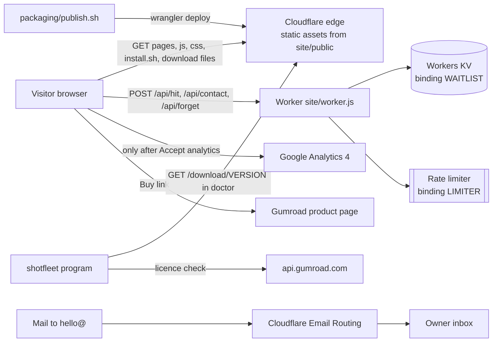
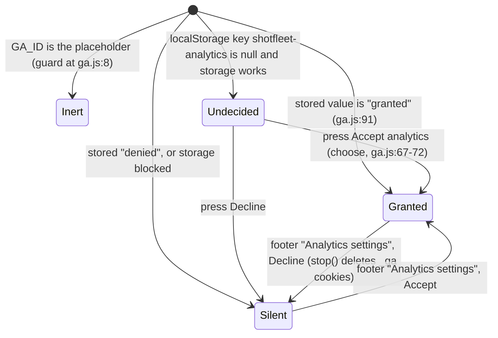
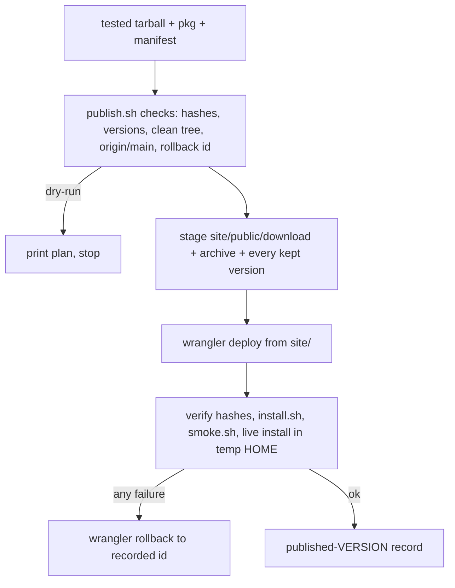

# 7. The website and backend (`site/`)

This chapter explains everything under `site/` and the scripts and tests around it: the static pages and scripts in `site/public/`, the one Cloudflare Worker (`site/worker.js`) behind `/api/*`, the install script, the response headers and CSP, the two kinds of analytics, the download endpoints, how the site is deployed, how the domain and the support mailbox hang together (concept only, no credentials), and how to change a page or a claim without breaking the tests. It is written against the repository at version 0.1.7 (`shotfleet.py:28`) on branch `claude/app-launch-readiness-d770fd`; the live site was serving 0.1.6 when I read `/download/VERSION` on 2026-10-08. Every line number below was checked against the current worktree. The older lead document `docs/architecture/08-website.md` was written at 0.1.6 and is partly stale; the last sections of this chapter list exactly where.

Sibling chapters: [01-runtime-architecture.md](01-runtime-architecture.md), [05-licence-and-money.md](05-licence-and-money.md) (Gumroad, keys, refunds), [06-packaging-and-release.md](06-packaging-and-release.md) (how the tarball and pkg are built and tested before `publish.sh` ships them), [08-testing.md](08-testing.md), [09-operations-and-support.md](09-operations-and-support.md), [10-contributing.md](10-contributing.md), [11-history-and-decisions.md](11-history-and-decisions.md), [README.md](README.md).

## 7.1 The system in one picture

There is no application server. A visitor gets static files from Cloudflare's asset store. Only paths under `/api/*` run code (the Worker). The Worker keeps three kinds of record in one Workers KV namespace and rate-limits through a Cloudflare binding. Money goes through Gumroad (a link, nothing more). Mail to `hello@shotfleet.com` is forwarded by Cloudflare Email Routing. Analytics are a first-party counter (always on, home page only) and Google Analytics 4 (only after the visitor presses "Accept analytics").



Facts behind the picture: `site/wrangler.toml:12-15` (assets directory `public`, `404-page`, `run_worker_first = ["/api/*"]`), `:17-19` (KV binding `WAITLIST`), `:21-25` (rate limiter `LIMITER`), `site/public/privacy.html` ("Mail to that address is forwarded by Cloudflare Email Routing"), `shotfleet.py:3864-3869` (`latest_release`, the only call the program makes to the site).

## 7.2 Folder map

| Path | What it is | Served? | Read or written by |
|---|---|---|---|
| `site/public/` | Everything the site serves: pages, scripts, CSS, fonts, images, demo clips, `install.sh`, `llms.txt`, `robots.txt`, `sitemap.xml`, `_headers`, `.well-known/security.txt`, `guides/` | yes (wrangler `[assets] directory`) | hand edits; `tools/build-guides.py` (guides, hub, feed, sitemap lines); `packaging/publish.sh` (adds `download/`) |
| `site/public/download/` | The release files (`shotfleet-macos-arm64.tar.gz`, `.sha256`, `.pkg`, `VERSION`, `<version>/...`). Not in git (`.gitignore:9`); absent in a fresh checkout | yes, once staged | only `packaging/publish.sh` |
| `site/draft/` | Material that must not be served: a superseded `alternatives.html` draft, `og.html` (1200x630 link-preview page), `docker-pending.txt` (held-back Linux/CI text), `guides/` (draft pages generated by `tools/build-guides.py`) | no (outside the assets directory; `tests/test_claims_site.py:326-335` pins that) | `build-guides.py` rewrites `draft/guides/` every run; tests scan the folder for em dashes (`tests/test_site.py:159`) |
| `site/worker.js` | The Worker: `/api/hit`, `/api/contact`, `/api/forget` | runs for `/api/*` only | `site/worker.test.mjs`, `tests/test_claims_site.py` |
| `site/worker.test.mjs` | The Worker's tests: real `worker.js` against an in-memory KV and a stub limiter. 37 `ok` lines on 2026-10-08 | no | `node site/worker.test.mjs`; `tools/check-claims.sh`; `tests/test_claims_site.py:236-292` looks checks up by name |
| `site/wrangler.toml` | Production config: worker name, assets, KV binding, rate limiter, routes, observability | n/a | `wrangler deploy` (via `publish.sh`); `tests/test_claims_site.py:295-340` |
| `site/wrangler.staging.toml` | Throwaway rehearsal worker `shotfleet-staging`: no routes, no bindings | n/a | `publish.sh --staging` (`packaging/publish.sh:73-92`); `tests/test_release_scripts.py:329-370` |
| `site/signups.sh` | Operator script that reads and purges KV records with `wrangler` (not served, not run by anything automatic) | no | the owner by hand; `tests/test_site.py:266-295` tests `--purge-waitlist` with a fake `npx` |
| `site/BYOC_DEVICE_PROVEN` | Empty flag file (0 bytes), added 2026-10-07 in `b8c9305`. Its presence means the bring-your-own-capture (XCUITest) path passed on a device | no | `tests/test_site.py:363-389` (`ByocPending`) |
| `site/DOCKER_PUBLISHED` | Flag file that does not exist yet. Its absence keeps the Linux image and GitHub Action text off the public site | no | `tests/test_site.py:338-361` (`DockerPending`) |
| `site/tools/og.swift` | Old renderer for the link-preview image. Its header says it writes `public/og.png`; the site serves `public/og.jpg`. How `og.jpg` is made today is not documented (see 7.20) | no | by hand on a Mac |

Outside `site/` but part of the website:

| Path | Role |
|---|---|
| `tools/build-guides.py` | Renders `marketing/articles/NN-*.md` into guide pages, the hub `guides.html`, the Atom feed, and sitemap lines (7.17) |
| `tools/golive/smoke.sh`, `tools/golive/storefront.sh` | Read-only live checks of the site and of the Gumroad product (7.11) |
| `packaging/publish.sh`, `packaging/go-live.sh`, `packaging/release.sh` | Deploy (7.11) and the one-time launch transform (7.12) |
| `tests/test_site.py`, `test_site_audit.py`, `test_consent.py`, `test_docs.py`, `test_claims_site.py`, `test_claims.py`, `test_golive.py`, `tests/browser_site.cjs`, `tests/claims.json` | The site's test net (7.16) |
| `research/ga-setup.md`, `research/ga4-investigation-2026-10-05.md`, `research/gumroad-setup.md`, `docs/refund-runbook.md` | Owner-facing notes about Google Analytics, Gumroad and refunds (7.6, 7.15) |

## 7.3 The pages and which scripts each one loads

All pages are hand-written HTML sharing one stylesheet (`site/public/site.css`, 395 lines) and the same head pattern (title, description, canonical, Open Graph, icons). No page uses an inline `<style>`, a `style=` attribute, an inline script (JSON-LD blocks are `type="application/ld+json"` data) or an `on...=` handler, because the CSP forbids them (7.8). `index.html`, `docs.html`, `alternatives.html`, `demo.html`, `whats-new.html`, `terms.html`, `privacy.html` and `404.html` are edited by hand. `guides.html`, `guides/<slug>.html` and `guides/feed.xml` are generated (7.17).

| Page (URL) | File | Scripts loaded (line) | GA4 + banner | First-party counter |
|---|---|---|---|---|
| `/` | `index.html` | `reveal.js` in head (91); then `forms.js` (476), `tabs.js` (477), `flow.js` (478), `analytics.js` (479), `ga.js` (480), `zoom.js` (481) | yes | yes (the only page) |
| `/docs` | `docs.html` | none | no | no |
| `/alternatives` | `alternatives.html` | `ga.js` (130) | yes | no |
| `/demo` | `demo.html` | `ga.js` (168) | yes | no |
| `/whats-new` | `whats-new.html` | `ga.js` (139) | yes | no |
| `/terms` | `terms.html` | `ga.js` (76) | yes | no |
| `/privacy` | `privacy.html` | `forms.js` (100), `ga.js` (101) | yes | no |
| `/guides`, `/guides/<slug>` | `guides.html`, `guides/*.html` | none | no | no |
| any unknown URL | `404.html` | none | no | no |

Script roles: `reveal.js` fades sections in (adds class `js-reveal`, skipped with reduced motion; nothing is hidden without JS). `tabs.js` is the ARIA tab switcher of the showcase gallery. `flow.js` turns the four "your flow says Next" boxes into a language picker. `zoom.js` opens a gallery image in a native `<dialog>`. `forms.js` wires the privacy page's two forms (7.7). `analytics.js` and `ga.js` are covered in 7.6.

Two consequences worth knowing. First, `docs.html`, the guides and the 404 never talk to Google, so a docs-only visit is invisible to GA4 and to the counter. Second, the privacy page says to use "Analytics settings in the footer of any page" to withdraw consent; the footer link (`id="analytics-settings"`) exists only on the pages that load `ga.js` (`tests/test_consent.py:107-116` pins "ga.js and the footer link come together"), which is also exactly the set of pages where consent can matter.

Other things in `site/public/`:

| File | Notes |
|---|---|
| `fonts/` | Geist Mono, Latin and Latin-ext woff2 plus its licence. `font-src` falls back to `default-src 'self'`, so fonts must stay local |
| `img/`, `img/full/`, `img/showcase/` | Gallery and showcase screenshots. `tests/test_site.py:120-122` fails on a `.jpg` in `img/` that no page uses (an orphan check) |
| `media/demo/` | Nine clips `c1`..`c9`: `.mp4`, poster `.webp`, English `.vtt`. `tests/test_site.py:131-138` requires `preload="none"`, `muted`, `playsinline`, a poster and an English captions track on every `<video>` |
| `og.jpg`, `favicon.svg/.ico`, `apple-touch-icon.png` | Link preview and icons. Dimensions of the icons are asserted (`tests/test_site_audit.py:442-452`); nothing asserts `og.jpg` exists (7.16) |
| `.well-known/security.txt` | RFC 9116 file, four fields only; `Expires: 2027-10-01`. The suite goes red when it expires or if it is set more than 366 days ahead (`tests/test_site.py:398-422`) |

## 7.4 How a request is served (assets first, Worker only for `/api/*`)

`site/wrangler.toml:12-15`:

```toml
[assets]
directory = "public"
not_found_handling = "404-page"   # serves public/404.html
run_worker_first = ["/api/*"]     # everything else is static and never reaches the Worker
```

- A path that matches a file in `public/` is served from the asset store. The Worker is not invoked. Cloudflare resolves clean URLs: `/terms` returns `terms.html`, `/` returns `index.html` (the test servers in `tests/test_golive.py:44-70` and `tests/browser_site.cjs:14-21` imitate that).
- A path that matches nothing gets `public/404.html` with status 404. The Worker's own 404 is JSON and is only ever seen for unknown `/api/...` paths (`site/worker.js:16`; `tests/test_claims_site.py:321-333` pins that the Worker never serves the HTML page).
- `/api/*` runs the Worker first. The Worker handles three POST routes (7.5). `robots.txt` has `Disallow: /api/`.
- Why the guides hub is `guides.html` and not `guides/index.html`: a directory index would make Cloudflare answer `/guides` with a redirect to `/guides/`. This was checked with `wrangler dev` on 2026-10-06 per `tools/build-guides.py:13-14`; I did not re-run it.
- `workers_dev = true` and `preview_urls = false` (`wrangler.toml:5-6`): the production Worker is also reachable on the account's `workers.dev` address, serving the same assets and using the same bindings. The canonical URL of every page is the bare `https://shotfleet.com/...`; `www.shotfleet.com` is a second custom domain for the same Worker (`wrangler.toml:8-9`) with no redirect configured in the repo.
- `compatibility_date = "2026-10-01"` (`wrangler.toml:3`). `[observability]` and `[observability.logs]` are enabled (`:27-31`), so Cloudflare keeps Worker logs; the Worker's own `console.log` lines carry only the event name (7.5).

## 7.5 The Worker (`site/worker.js`, 81 lines)

### Routes

| Method and path | Rate limited? | Body | What it does | Responses |
|---|---|---|---|---|
| `POST /api/hit` | no (decided before the limiter, so page views never use a visitor's budget: `worker.js:19`) | `{src, ev}`, only the first 200 characters of the body are parsed (`:20`); a body that is not JSON still counts as a `direct` `view` | Adds 1 to a daily total for (source, language, event) | always `200 {"ok":true}` |
| `POST /api/contact` | yes | `{message, email?, website}` | Stores one message record (below) | `200`, `400` (message under 2 or over 2,000 characters after trimming; reply address present but invalid), `413`, `429` |
| `POST /api/forget` | yes | `{email}` | Deletes the legacy record `email:<address>` and every `msg:` record whose metadata reply address matches; answers `200 {"ok":true}` whether or not anything existed | `200`, `400` (not an address), `413`, `429` |
| any other method on those paths | n/a | | | `405 {"error":"Use POST"}` (`:17`) |
| any other `/api/...` path | n/a | | | `404 {"error":"Not found"}` (`:16`) |

Common behaviour: every response is JSON with `cache-control: no-store` (`worker.js:80-81`); the body is limited to 4,096 bytes by the `content-length` header and again by the text length (`:41-44`, `MAX_BODY` at `:7`); an invalid body is `400 {"error":"Send JSON"}` (`:46`); the address check is the regex at `:6` plus a 254-character cap. The Worker never calls `/api/signup`: that route does not exist any more (7.14).

`/api/contact` detail (`worker.js:48-61`): a non-empty `website` field is a honeypot and returns `200` without storing anything; the message is trimmed; the reply address is lower-cased; the stored value is `{message, email|null, country|null}` where `country` is `request.cf.country`, and the reply address is also put in the KV **metadata** so `/api/forget` can find the record with a single `list` call (`:57-58`). The log line is `{"event":"contact"}`.

`/api/forget` detail (`worker.js:63-76`): validates the address, deletes `email:<address>`, lists keys with prefix `msg:` (first page only, up to 1,000 keys, flagged by a `ponytail:` comment at `:71`) and deletes the ones whose `metadata.email` equals the address. The log line is `{"event":"forget"}`.

`/api/hit` detail (`worker.js:19-35`): source is the lower-cased `src` reduced to `[a-z0-9.-]`, max 40 characters, default `direct`; language is the first token of `Accept-Language` split on `-`, `,` or `;`, max 3 characters, default `xx`; the event is one of `view`, `runs`, `pricing`, `cta`, anything else becomes `view`; the day is the UTC date. The key is `hit:<YYYY-MM-DD>|<source>|<language>|<event>`.

### KV: one namespace, three key families

The binding name is `WAITLIST` (a leftover from the waitlist era, still the only KV binding). Its namespace id is in `site/wrangler.toml` (line 19); it is not repeated here.

| Key | Value | Written by | Read or deleted by | Retention |
|---|---|---|---|---|
| `hit:<day>\|<source>\|<lang>\|<event>` | a decimal total, nothing else | `/api/hit` flush (`worker.js:30`) | `site/signups.sh --visits` (`signups.sh:31-35`); the owner | forever (no TTL: `tests/test_claims_site.py:289-293` asserts no `expirationTtl`) |
| `msg:<ISO time>-<8 hex>` | JSON `{message, email, country}`; metadata `{email}` | `/api/contact` (`:57`) | `signups.sh` (lists and prints them); `/api/forget` deletes by reply address; manual `wrangler kv key delete` (`LAUNCH.md` line 134) | until answered or deleted on request (privacy page) |
| `email:<address>` | legacy JSON from the pre-launch waitlist | nothing writes it since 2026-10-07 (`6443039`) | `/api/forget` deletes it; `signups.sh` lists it; `signups.sh --purge-waitlist` deletes all of them | the privacy page says any remaining address will be deleted; whether the purge has been run is not recorded in the repo (not verified) |

`site/worker.test.mjs:72` asserts that after the whole suite the only new key families are `msg:` and `hit:`.

### Counting visits without losing the KV write budget

KV's free tier allows 1,000 writes a day (`worker.js:26`), and messages share them. So `/api/hit` does not write per visit. Each isolate keeps a `pending` map (`:11`) and flushes it: when the sum of waiting counts reaches `HIT_BATCH` (default 20, `:33`), or 25 seconds after the first waiting count (`FLUSH_MS`, default 25000, scheduled with `ctx.waitUntil`, `:32`). A flush does read-then-write per key (`:30`). Consequences: counts are approximate (two isolates flushing the same key at once lose an update; the read-modify-write is not atomic), a visit is stored up to about 25 seconds late, and an isolate that is evicted early can drop a pending batch. Neither `HIT_BATCH` nor `FLUSH_MS` is set in `wrangler.toml`, so the defaults apply in production; the test file sets them to 3 and 5 (`worker.test.mjs:5`).

Anyone can POST `/api/hit` any number of times; there is no rate limit or origin check, by design (`:19`). The counter measures requests, not people, and cannot tell a script from a visitor (`research/ga4-investigation-2026-10-05.md` section 1, item 15 says the same).

### Rate limiting

`site/wrangler.toml:21-25` declares a `ratelimits` binding `LIMITER` with a numeric `namespace_id` and `simple = { limit = 5, period = 60 }`, commented "per client IP: 5 API calls a minute". The Worker calls `env.LIMITER.limit({ key: ip })` with `ip = cf-connecting-ip` (falling back to the literal `unknown`, so all requests without that header share one bucket) at `worker.js:37-39`. The limiter runs before the body is read, so every `contact` or `forget` request counts against the five, valid or not. The IP is the limiter's key only; it is never written to KV or logged (`worker.test.mjs:57-76` asserts this for keys, values, metadata and log lines).

### What the Worker can and cannot see

The Worker sees the visitor's IP (header), user agent, `Accept-Language` and `request.cf.country`. It stores only: language (3 characters), the traffic source string the page sent, the event name, the message and reply address the visitor typed, and the country for messages. Cloudflare itself processes the IP to serve the page and enforce the limit, which the privacy page says in those words (`tests/test_claims_site.py:316-319`). What Cloudflare's own Workers Logs keep per request when `[observability.logs]` is enabled is Cloudflare's behaviour and is not described in the repo (not verified).

### Running the Worker tests

```sh
node site/worker.test.mjs        # prints "ok   <name>" or "FAIL <name>", exits 1 on any failure
```

It needs only Node (no install step): the file imports `./worker.js` and replaces `WAITLIST` with a `Map`-backed fake that supports `get/put/delete/list` with metadata, and `LIMITER` with a stub (`worker.test.mjs:2-8`). Run on 2026-10-08 it printed 37 `ok` and 0 `FAIL`. `tests/test_claims_site.py` runs the same file (`:238-250`) and requires at least 35 `ok` lines plus a set of named checks, so renaming a check breaks a claim test on purpose.

## 7.6 Analytics: the cookie-free counter and Google Analytics 4

There are two independent mechanisms. The privacy page (`site/public/privacy.html`, lede and the "Analytics" section) describes both, and `tests/test_consent.py`, `tests/test_claims_site.py:343-368` and `tests/test_site.py:297-306` pin the wording against the code.

### First-party counter (`site/public/analytics.js`, 26 lines)

- Loaded on `index.html` only (`index.html:479`; `tests/test_claims_site.py:366-367` fails if any other page loads it).
- On load it computes `src` from `utm_source` or, failing that, the referrer's host when it differs from the site's own (`analytics.js:6-9`), then `POST /api/hit` with `{src, ev}` and `keepalive` (`:10-12`).
- Events: `view` at load (`:13`); `pricing` when `#price` is 25 percent visible, once (`:15-20`); `runs` when `#run` is 25 percent visible, once; `cta` on a click on `a.btn` or `button.btn` (`:22-25`).
- Sends nothing else: no cookie, no `localStorage`, no user agent, no identifier. The test greps the code (comments stripped) for `cookie`, `localStorage`, `sessionStorage`, `userAgent`, `navigator.` and asserts the only payload literal is `{ src: src, ev: ev }` (`tests/test_claims_site.py:357-368`).
- It ignores the consent choice: it counts every visit, which the privacy page says ("counts every visit because it records nothing about you").
- Server side it becomes one total per day, source, language and event (7.5). Read it with `site/signups.sh --visits`.

### Google Analytics 4 (`site/public/ga.js`, 96 lines)

State machine, all in `ga.js`:



- The Measurement ID is a single constant at `ga.js:5`. A guard (`:8`) makes the whole file do nothing if the constant is not a valid ID or is the placeholder `G-XXXXXXXXXX`. `tests/test_consent.py:25-38` pins that the ID appears once in `ga.js` and in no HTML page, and pins the exact current value, so changing the property means editing that test too.
- Nothing contacts Google until `start()` runs, and `start()` has exactly two call sites, both behind `"granted"` (`ga.js:19-31`; `tests/test_consent.py:40-56`). The only script ever injected is `https://www.googletagmanager.com/gtag/js?id=...` (`:26-29`).
- `start()` sets Consent Mode v2 defaults to denied for `ad_storage`, `ad_user_data`, `ad_personalization` and `analytics_storage`, then updates `analytics_storage` to granted, then `config` with `allow_google_signals: false`, `allow_ad_personalization_signals: false`, cookie flags `SameSite=Lax;Secure` and `cookie_expires: 34128000` seconds (395 days, the "13 months" on the privacy page) (`:22-25`). GA4 sends `page_view` on config; there is no manual page view.
- The banner is built with DOM calls, never `innerHTML` (`:75-87`), with two buttons made by one helper (equal weight, no default, no Escape handling). It is inserted as the first child of `<body>`. The text is fixed in `ga.js:82`.
- `stop()` (`:34-41`) sets `analytics_storage` denied and deletes `_ga` and `_ga_<id>` cookies on the host and the parent domain, also when localStorage was cleared by hand.
- Event mapping to the first-party counter: `pricing_view` and `runs_view` use the same two element ids (`#price`, `#run`) and thresholds; `cta_click` uses the same selector `a.btn, button.btn` but skips buttons inside `#forget` and `#contact` and sends the first 40 characters of the label as `cta_text` (`:44-58`). `ga.js:57` also listens for a DOM event `shotfleet:signup` that nothing fires any more (7.14).

What the GA4 side needs (outside the repo): `research/ga-setup.md` lists the admin settings the privacy page depends on (Google signals off, no product links, event retention, enhanced measurement choices, internal-traffic filter, key events `cta_click`, `pricing_view`, `signup`). Read it with the corrections listed in 7.19: it still talks about `polar.sh` (Polar was replaced by Gumroad) and it expects a working `signup` event.

What `research/ga4-investigation-2026-10-05.md` established, on 2026-10-05: a clean browser that accepted the banner delivered a `page_view` to `region1.google-analytics.com` and Realtime showed it; the owner's own Chrome blocked Google's measurement hosts (a tracker blocker or privacy extension, not named), so the owner's visits never reach GA4; the GA4 stream matched the code; the Internal Traffic filter was in "Testing" state; and the counter had only 44 views in three days, all `direct`. Its conclusion was that nothing was broken and that GA4 will always show only the consenting, unblocked slice. The same note reports GA4 event-data retention set to 2 months on that day while `ga-setup.md` recommends 14 and the privacy page says "up to 14 months" (still true, since 2 is within "up to 14"). I did not look at the GA admin now (not verified).

### CSP consequences (why Google is allowed at all)

The CSP in `_headers:2` allows exactly: scripts from `'self'` and `https://www.googletagmanager.com`; connect and image requests to `'self'`, `https://*.google-analytics.com` and `https://*.googletagmanager.com`, and (connect only) `https://*.analytics.google.com`. `tests/test_consent.py:79-94` pins that list, rejects any other host, and rejects `unsafe-inline` and `unsafe-eval`. The investigation notes that Google's own CSP guide would also list `https://*.google.com`; not adding it was a deliberate "do not widen" decision. Do not widen it to fix a blocked region; the `region1` hosts are already covered.

## 7.7 Forms and `forms.js` (83 lines)

`forms.js` wires forms by markup contract: `form#<id>` containing `input[type=email]`, `button[type=submit]`, `p.form-error`, and a sibling element `#<id>-done` shown on success (`forms.js:1-2`, `wire()` at `:11-35`). It validates in the page, POSTs JSON, and shows the server's error text or a generic one.

Live today, both on `privacy.html`:

| Form | Endpoint | Sends | Success text |
|---|---|---|---|
| `#forget` | `/api/forget` | `{email}` | "Done. If that address was on the list, it's gone." |
| `#contact` | `/api/contact` | `{message, email, website}`; `website` is the hidden honeypot `input.trap` | "Sent. If you left an email, I'll reply there." |

Both forms have `method="post"` and an `action` under `/api/`, so without JavaScript a submit does not turn into a `GET /?email=...` (`tests/test_site_audit.py:253-265`). Every field has a `<label for>`; error paragraphs carry `role="alert"` and an id wired through `aria-describedby` (`:267-276`). `form-action 'self'` in the CSP matches.

Dead code in the same file: lines 49-69 (the signup forms `#signup-top` and `#signup`, the optional "what do you build with" follow-up, referrer/utm collection). No page contains those forms, so `wire()` returns at once for them. `index.html` still loads `forms.js` (`index.html:476`) and two tests insist on it (`tests/test_site.py:238` for the post-go-live page, `tests/test_consent.py:77` pins the `shotfleet:signup` event string in the file). See 7.14.

## 7.8 Response headers and CSP (`site/public/_headers`)

Cloudflare reads `_headers` for static asset responses. The block for `/*` (`_headers:1-7`):

| Header | Value | Pinned by |
|---|---|---|
| `Content-Security-Policy` | `default-src 'self'`; `img-src 'self'` plus the two GA wildcards; `style-src 'self'`; `script-src 'self' https://www.googletagmanager.com`; `connect-src` as in 7.6; `base-uri 'none'`; `form-action 'self'`; `frame-ancestors 'none'` | `tests/test_site.py:245-257`, `tests/test_consent.py:79-94`, `tests/test_site_audit.py:498-510` |
| `X-Content-Type-Options` | `nosniff` | `test_site_audit.py:512-516` |
| `Cross-Origin-Opener-Policy` | `same-origin` | same |
| `Referrer-Policy` | `strict-origin-when-cross-origin` | same |
| `Permissions-Policy` | `camera=(), microphone=(), geolocation=(), interest-cohort=()` | same |
| `Strict-Transport-Security` | `max-age=15552000` (six months; no `includeSubDomains`, no `preload`) | `test_site.py:425-430` |

Not set: `font-src`, `media-src`, `object-src` (all fall back to `default-src 'self'`), `upgrade-insecure-requests`. Because `style-src` is `'self'` only, no page may carry a `<style>` element or `style=` attribute, and no script may set styles through `cssText`; `test_site_audit.py:502-510` greps for all of it, including in every `*.js`. This also constrains what you can do in a banner or a widget: put the rule in `site.css`.

Per-path rules (`_headers:9-45`):

| Path | Rule | Reason |
|---|---|---|
| `/fonts/*` | `Cache-Control: public, max-age=31536000, immutable` | fonts never change under the same name |
| `/img/*`, `/media/*` | `public, max-age=604800` | one week |
| `/download/:file` | `no-cache` | the "latest" files (tarball, pkg, `.sha256`, `VERSION`) |
| `/download/:version/*` | `public, max-age=31536000, immutable` | versioned files never change |
| `/download/:version/*.sha256` | `Content-Type: text/plain; charset=utf-8` | the versioned checksum files had no content type live |
| `/guides/feed.xml` | `application/atom+xml; charset=utf-8`, `max-age=3600` | `tests/test_docs.py:345-348` |
| `/install.sh` | `text/plain; charset=utf-8`, `no-cache` | so a browser shows the script instead of downloading it, and updates are immediate |
| `/.well-known/security.txt`, `/download/VERSION`, `/llms.txt`, `/robots.txt` | `text/plain; charset=utf-8` | `tests/test_site.py:432-447` |

Rules merge by header name, which is why `/download/VERSION` matches both `/download/:file` (cache) and its own rule (content type) and the test checks that the second rule adds no second `Cache-Control` (`test_site.py:445-447`).

The Worker's JSON responses are not given these headers: `worker.js:80-81` sets only `content-type` and `cache-control`, and the live `GET /api/signup` response I read on 2026-10-08 had no `content-security-policy` header. That is acceptable for JSON, and it means a header change for the API belongs in `worker.js`.

Adding a third-party host, an inline script or an inline style needs: a CSP change in `_headers`, an update to the exact-list tests above, a privacy page change (the tests list what the page says), and a claims row. The default answer is "no".

## 7.9 `install.sh`, line by line (`site/public/install.sh`, 28 lines)

It is served at `https://shotfleet.com/install.sh` as `text/plain` with `no-cache`, and the program itself recommends it as the update path (`shotfleet.py:4185-4188`, `update_command`). Usage: `curl -fsSL https://shotfleet.com/install.sh | sh`.

| Line | What it does |
|---|---|
| 2-3 | Shebang `#!/bin/sh`, `set -eu`: any failing command or unset variable stops the script |
| 4 | `BASE` defaults to `https://shotfleet.com/download`; `SHOTFLEET_BASE` overrides it (tests, `publish.sh` and `smoke.sh` point it at other servers) |
| 5 | Refuses anything but `Darwin`: prints "shotfleet runs on macOS only" to stderr, exit 1 |
| 6 | Refuses anything but `arm64`: "shotfleet needs an Apple silicon Mac (M1 or newer)", exit 1. There is no macOS version check (no `sw_vers`): a Mac below the build's minimum (13.0) would install and then fail to run (not verified on macOS 12) |
| 7 | `TMP=$(mktemp -d)` and a `trap` that removes it on exit |
| 8 | Downloads `$BASE/shotfleet-macos-arm64.tar.gz` (always the latest release; there is no version argument). `curl -fsSL`: fail on HTTP errors, follow redirects |
| 9 | Downloads `$BASE/shotfleet-macos-arm64.tar.gz.sha256` from the same origin |
| 10-11 | Computes `shasum -a 256` of the archive and compares it with the first field of the checksum file. A mismatch prints "download is corrupt (checksum mismatch); try again" and exits 1 before anything is extracted or installed. The checksum proves the download was not corrupted or truncated; because it comes from the same origin as the archive it does not prove authenticity (the security review's S6 in `docs/architecture/11-security-and-privacy.md`; the signed, notarized `.pkg` is the route with a real signature) |
| 12 | `tar -xzf` into the temp directory; the archive's top-level folder must be `shotfleet/` containing the `shotfleet` executable (`smoke.sh:81-82` relies on that) |
| 13-14 | `APP="$HOME/Library/Application Support/shotfleet/app"`; `rm -rf "$APP"`, creates the parent, moves the new folder into place. An update therefore replaces the program folder wholesale and leaves siblings such as `licence.json` alone (`shotfleet.py:5283` puts the licence at `~/Library/Application Support/shotfleet/licence.json`) |
| 15-24 | Chooses where the `shotfleet` link goes. If `SHOTFLEET_BIN_DIR` is set, that folder (created if needed). Otherwise the first writable existing folder among `/opt/homebrew/bin`, `/usr/local/bin`, `$HOME/.local/bin`; `~/.local/bin` is created if none of the first two is writable. A folder outside `$HOME` is skipped when `$HOME` is not the real account home (`REAL_HOME` from `id -un`, line 17), so a test install with a temporary `HOME` can never touch the real Homebrew link. That rule was added after a temp-HOME install overwrote `/opt/homebrew/bin/shotfleet` for the real user on 2026-10-06 (`tests/test_golive.py:263-277`) |
| 25 | `ln -sf "$APP/shotfleet" "$DIR/shotfleet"`: replaces whatever is at that path, including a Homebrew-cask link or an unrelated file. `docs.html` tells Homebrew users to remove their link before running the installer for this reason |
| 26 | Runs `"$DIR/shotfleet" --version` and prints "installed shotfleet X.Y.Z to DIR". This is the first launch of the binary |
| 27 | If `$DIR` is not on `$PATH`, prints the `export PATH=...` line to put in `~/.zshrc`. It does not edit any shell file |
| 28 | Prints the next steps: `shotfleet doctor` (`--fix` fetches Maestro and Java), `shotfleet init`, `shotfleet activate <key>` |

What it does not do: no `sudo`, no root, no `.pkg`; no `xattr` or quarantine handling (a file fetched with `curl` carries no quarantine flag; `docs.html` notes that a browser-downloaded copy may show "Apple could not verify" and offers the `.pkg` instead; `packaging/README.md` step 3 and `tools/verify-release.sh` check the build under quarantine); no Gatekeeper/`spctl` or `codesign` verification of the archive; no installation of Maestro, Java, Xcode or the Android SDK (that is `doctor --fix`); no uninstall; no shell profile edits; no telemetry.

Tests: `tests/test_claims_site.py:37-56` (refuses Linux and Intel before any download; lets Apple silicon reach `curl`), `tests/test_golive.py:241-287` (wrong checksum installs nothing; Intel and Linux refused; temp-HOME links stay inside the temp HOME; `SHOTFLEET_BIN_DIR`; `smoke.sh` depends on the `tar -xzf` line staying at the start of a line). `tools/golive/smoke.sh:69-77` runs `install.sh` unchanged up to its `tar -xzf` line against the live site with a fake `uname`. After each deploy `publish.sh` runs the real install into a temporary `HOME` with the link folder forced to `~/.local/bin` (`publish.sh:310-315`).

## 7.10 Download endpoints and checksums

| URL | Meaning | Cache | Who uses it |
|---|---|---|---|
| `/download/VERSION` | one line, the latest released version (for example `0.1.6`) | `no-cache` | `shotfleet doctor` (`shotfleet.py:3864-3869`, 5 second timeout, offline is silent), `publish.sh` verification, `smoke.sh` |
| `/download/shotfleet-macos-arm64.tar.gz` | latest tarball | `no-cache` | `install.sh` line 8 |
| `/download/shotfleet-macos-arm64.tar.gz.sha256` | `<sha256>  shotfleet-macos-arm64.tar.gz` | `no-cache` | `install.sh` line 9, Homebrew bump |
| `/download/shotfleet-macos-arm64.pkg` | latest signed, notarized installer package. Installs into `/usr/local/lib/shotfleet`, links into `/usr/local/bin` (per `docs.html`). There is no `.sha256` for the flat pkg | `no-cache` | people who cannot use the curl line |
| `/download/<version>/shotfleet-macos-arm64.tar.gz`, its `.sha256`, `.pkg` | permanent copy of that release | `immutable`, one year | `shotfleet.py:5360` error text, `tools/bump-homebrew.sh`, rollback of a bad release |

How these files get there (`packaging/publish.sh`, 7.11): it copies the tested tarball and pkg into `site/public/download/` under the fixed names above, writes the `.sha256` for the tarball (`publish.sh:254`) and `VERSION`, and stages `download/<version>/` for the release being published and for every earlier release kept in `$SHOTFLEET_RELEASE_DIR/archive/<version>/` (`:267-274`). A Cloudflare deploy replaces **all** static assets, so a version survives only if it is staged again on every deploy; each archived file is checked against its `SHA256SUMS` and kept manifest first, and one mismatch refuses the whole publish (`:175-192`). Because `site/public/download/` is git-ignored, a deploy from a tree that lacks it removes every download. `packaging/README.md` step 8 says it plainly: only ever deploy through `publish.sh`.

Checksum chain: build -> manifest (`publish.sh --make-manifest`, sizes and sha256 of exactly two files, `:33-40`) -> `publish.sh` refuses any file that differs (`:123-132`) -> after the deploy it downloads each served file again and compares hashes (`:289-304`) -> `install.sh` compares the tarball with its `.sha256` on the user's machine. Building and testing those files is chapter [06-packaging-and-release.md](06-packaging-and-release.md).

## 7.11 Deploy: how the site goes live (described, not run)

The site is never deployed on its own. It ships with a release (or a re-run of the same version) through `packaging/publish.sh`. Rules in the header (`publish.sh:2-25`):

1. It builds nothing. It publishes files that were already built, tested and recorded in a manifest.
2. It refuses to run unless: the manifest lists exactly the tarball and pkg for one `X.Y.Z` version (digits only); both files match the manifest's size and sha256; `shotfleet.py`'s `VERSION`, the top `CHANGELOG.md` heading and the docs page's "Last checked against version X" line all equal the manifest version (`:135-142`); neither `site/public/whats-new.html` nor the top CHANGELOG heading still contains `<!-- RELEASE_DATE -->` (`:143-144`); there is no `RESUME.md` in the tree (`:145`); the git tree is clean and `HEAD` equals `origin/main` (unless `PUBLISH_ALLOW_BRANCH=1`) (`:146-152`); `SHOTFLEET_RELEASE_DIR` is set, absolute and not under a temporary directory (`:154-167`); the live Cloudflare version id can be read (the rollback target) (`:204-210`).
3. `--dry-run` runs all those checks and prints the plan (`:216-233`); it stages, archives, deploys and rolls back nothing.
4. The real run: stage files into `site/public/download` -> archive the shipped bytes plus what was live before (`:259-265`) -> stage `download/<version>/` for every kept version -> write the rollback id to `$SHOTFLEET_RELEASE_DIR/state/rollback-<version>-<time>.txt` (`:276-277`) -> `wrangler deploy` in `site/` (`:279-283`) -> verify the live site: `VERSION`, tarball, `.sha256` and pkg hashes, every versioned file, `install.sh` is 200, `tools/golive/smoke.sh`, and a real install into a temporary `HOME` (`:285-316`) -> write a `published-...` record (`:319`). On any failure, on Ctrl-C, or if the script dies after the deploy, it rolls back to the recorded version id (`:238-247`). The deploy is `npx --yes wrangler@latest` unless `WRANGLER` is set (`:64`); wrangler is not version-pinned.



### Staging rehearsals

`site/wrangler.staging.toml` defines the worker `shotfleet-staging`: same assets directory and `run_worker_first`, but no routes, no custom domains, no bindings (`wrangler.staging.toml:1-14`). `publish.sh --staging` requires `PUBLISH_BASE=https://shotfleet-staging.<account>.workers.dev` (no default, so it can never fall back to production), passes `--config wrangler.staging.toml --name shotfleet-staging` to every wrangler call, keeps state under `$SHOTFLEET_RELEASE_DIR/staging`, and refuses to run if that file names the production worker, contains a route, custom domain, zone, env or the string `shotfleet.com`, has any table other than `[assets]`, or if the base URL is not the staging address (`publish.sh:73-110`). `tests/test_release_scripts.py:329-370` exercises these refusals with a fake wrangler. The first production publish (0.1.2, 2026-10-05) was rehearsed on this worker (`docs/handoff.md` line 182). Caveat: because the staging file keeps `main = "worker.js"` and `run_worker_first`, `/api/*` on staging would throw (no `LIMITER`, no `WAITLIST`); rehearsals only fetch static files (`docs/architecture/13-mismatches.md` row 11; I confirmed the config by reading, I did not call it).

### Rolling back

`cd site && npx wrangler@latest rollback <id from state/rollback-*.txt> -y`, then `curl https://shotfleet.com/download/VERSION` (`packaging/README.md` step 8). Rollback restores the previous Worker version including its assets. No GitHub Action deploys the site; `.github/workflows/ci.yml` is manual-only and only runs tests.

### The live check scripts

- `tools/golive/smoke.sh <base> [<checkout link>]` (`smoke.sh`, 106 lines): read-only. Fetches `/` and refuses leftover waitlist markers (`WAITLIST`, `SALE`, `@CHECKOUT@`, `data-signup`, "Join the list", "Early access"), requires the checkout link in at least three places when given, "Buy shotfleet", the static text "first 100 buyers", no "N of 100 left" counter, and a CSP header with `default-src 'self'` and `script-src 'self'` (`:22-42`); `install.sh` is a script, not HTML, and still contains `arm64` and `shasum -a 256` (`:44-48`); `VERSION` is a version number; the archive is non-empty and matches its `.sha256` (`:49-67`); `install.sh`'s checksum logic accepts the served archive (`:69-77`); the unpacked program reports the announced version (Apple silicon only, `:79-84`); `robots.txt` names the sitemap; `sitemap.xml` is a urlset; `/alternatives`, `/terms`, `/privacy` are 200; plain HTTP redirects to HTTPS (skipped for `workers.dev` via `SMOKE_SKIP_REDIRECT`) (`:86-103`). Run `env -i sh tools/golive/smoke.sh https://shotfleet.com` for a clean environment.
- `tools/golive/storefront.sh <Gumroad URL> <product ID> [price]`: reads the Gumroad product page and fails on the three silent ways to lose a sale (unpublished product, licence keys off, no refund policy or one that is not 14 days), checks the product id is on the page, the list price, and that `licenses/verify` rejects a made-up key. It changes nothing at Gumroad. Chapter [05-licence-and-money.md](05-licence-and-money.md) covers the money side.

## 7.12 The go-live transform, `site/draft`, and why many tests skip

**History.** The site first served a waitlist page. `packaging/go-live.sh <Gumroad URL> <product ID>` (run once, 2026-10-05, commits `5fa4f7c` and `5bbec86` per `LAUNCH.md` line 3) did, in order: stamp `GUMROAD_PRODUCT_ID` into `shotfleet.py` (`go-live.sh:85-86`), call `packaging/release.sh` (build and deploy, `:87`), run the page transform, `wrangler deploy` (`:90`), commit "Site: sale open" and `git push` (`:91`), and print the waitlist emails through `site/signups.sh` (`:92`). The page transform (`go-live.sh:69-80`, a Python heredoc) edits `index.html`, `alternatives.html` and `terms.html`: it deletes every block between `<!-- WAITLIST -->` and `<!-- /WAITLIST -->`, replaces each `<!-- SALE ... SALE -->` comment block with its content (substituting `@CHECKOUT@` with the Gumroad URL), and renames "Early access" to "Buy shotfleet". `--dry-run` runs the same code on a temporary copy and checks the result (`:26-66`, `:96-143`).

**Now.** The transform has been applied and committed; none of the markers exist in `site/public/`. Do not run `go-live.sh` again: it would rewrite `GUMROAD_PRODUCT_ID`, build, deploy and push. Later releases use `publish.sh` (7.11). `LAUNCH.md` sections 4 to 6 are kept as a record and a template.

**`site/draft/` is not what the transform reads.** It never was a source for `public/`. Today it holds: the guide drafts that `tools/build-guides.py` writes (every run), an older `alternatives.html` that differs from the published one in about 220 lines (a test requires them to differ: `tests/test_claims_site.py:337-340`), `og.html`, and `docker-pending.txt`. Because the assets directory is `site/public`, nothing in `draft/` is deployed. `docs/handoff.md` line 158 says the same.

**Tests that still carry go-live logic.** Each of `tests/test_site.py`, `test_site_audit.py`, `test_claims.py` and `test_golive.py` computes `LIVE = "<!-- WAITLIST -->" not in index.html`. With `LIVE` true (today):

- `tests/test_site.py:222-243` (`GoLive`), `tests/test_site_audit.py:280`, `:331-360` (`GoLivePages`), `:366-380` (waitlist JSON-LD tests) and `tests/test_golive.py:103-160` (`DryRun`) are skipped (this is the "skipped=3", "skipped=7" in a run: `test_site.py` 42 tests, 3 skipped; `test_site_audit.py` 55 tests, 7 skipped, on 2026-10-08).
- `tests/test_claims.py:45` stops checking that quotes whose only file is `index.html` still appear in it. A claims row that quotes only the home page is therefore not guarded today. Put a second `where` file on the row, or accept the gap.
- `tests/browser_site.cjs:56-81` runs the counter checks only on a page that still has the waitlist markers, and `tests/test_claims_site.py:386` skips the matching Python test when `LIVE`. So today no test exercises `analytics.js` in a browser; the static checks (`test_claims_site.py:357-368`) and the Worker checks do.

If the product ever needs another page-variant switch of this kind, build it as a tested flag (as `ByocPending` and `DockerPending` do, 7.13) rather than another one-shot sed.

## 7.13 Flag files and held-back text

Some sentences must not appear until a real thing exists. Pattern: the text is parked, a test fails if it appears early, and a flag file releases it.

| Flag | State on 2026-10-08 | What it guards | Test |
|---|---|---|---|
| `site/DOCKER_PUBLISHED` | absent | The Linux `check` Docker image (`ghcr.io/noloman/shotfleet-check`) and the GitHub Action. The held-back blocks for `docs.html` and `llms.txt` are saved in `site/draft/docker-pending.txt`; the README keeps its blocks inside `<!-- DOCKER-PENDING ... DOCKER-PENDING -->` markers. Release step: `packaging/README.md` step 9 | `tests/test_site.py:338-361`: without the flag, no uncommented mention of the image in any public `.html`, `.txt`, `.xml`, `.js`; marker counts balanced; with the flag, no marker may remain |
| `site/BYOC_DEVICE_PROVEN` | present (empty file) since 2026-10-07 | Bring-your-own-capture (`[capture]`, your own XCUITest tests). While absent, every line that offers it must contain "its device test hasn't passed yet"; since it exists, no public line may say the test hasn't passed | `tests/test_site.py:363-389` |
| `<!-- RELEASE_DATE -->` in `whats-new.html` and the top CHANGELOG heading | not present | A release not yet dated. `publish.sh` refuses it (`:143-144`) | `tests/test_site.py:309-335` (the newest `whats-new` date equals the dated CHANGELOG heading; every dated release on the page has a CHANGELOG heading) |
| the activation caveat | permanent | Five places must say "The spare activations work from 0.1.6; 0.1.5 and older stop at 3." | `tests/test_site.py:392-395` |

To release a flag: remove the parked text's markers (or add the text back from `draft/docker-pending.txt`), create the flag file, run the suite. Creating the flag without doing the real thing is the failure these tests exist to prevent.

## 7.14 Dead and legacy surfaces

| Surface | State | Evidence |
|---|---|---|
| `POST /api/signup` | **Removed.** The Worker has no such route; on 2026-10-08 `GET https://shotfleet.com/api/signup` answered `404 {"error":"Not found"}` (a Worker that still had the route would have answered 405 for a GET) | `site/worker.js:8` (`ROUTES`), `worker.test.mjs:43`, `tests/test_claims_site.py:264-266`. Removed in `6443039` on 2026-10-07, together with the signup alert email and the `[[send_email]]` binding in `wrangler.toml` |
| Signup alert email (`ALERT_TO` secret, `send_email`) | Removed from code and config. A secret named `ALERT_TO` may still exist in the Cloudflare dashboard; secrets are not visible from the repo (not verified) | `git log -S"ALERT_TO"`: added `247b0ef` (2026-10-03), removed `6443039` |
| `POST /api/forget` | **Live**, linked from the privacy page; it is how a person on the old waitlist removes their address, and it also deletes their contact messages | `worker.js:69-76`, `privacy.html` form `#forget` |
| `email:<address>` KV records | Not written by anything now. May still exist from the pre-launch waitlist | `worker.js:70` only deletes; `site/signups.sh:20,7-15` lists and purges |
| `site/signups.sh` | **Live operator tool**, still useful for messages and visit totals. Its header text still says "Waitlist signups" and "each signup's platform / country / source" (`signups.sh:2,4`), which no longer exist. It writes a listing of keys, including any email addresses, to the fixed file `/tmp/shotfleet_keys.txt` (`:23-24`); delete that file after use on a shared Mac. It uses `npx -y wrangler@latest`, unpinned | `site/signups.sh:1-35` |
| `forms.js` signup wiring (`forms.js:49-69`), the `shotfleet:signup` event, `ga.js:57` listener | **Dead code.** No page has a signup form; `/api/signup` would now 404. The event never fires, so the `signup` GA4 event and any "key event" built on it never register | `forms.js`, `ga.js`, `tests/test_consent.py:76-77` (keeps the strings alive) |
| `index.html` loading `forms.js` | Dead weight (about 4.6 KB) on the home page, kept alive by `tests/test_site.py:238` | `index.html:476` |
| Waitlist copy in `privacy.html` | Intentional history: the page says what was stored before the sale opened and that the server once sent the owner a notice email (never containing the address) | `privacy.html` sections "If you joined the list before the sale opened" and "What I use it for" |
| `LAUNCH.md` section 8 ("purge the waitlist 30 days after the launch email") | History. The privacy page says no waitlist email was ever sent; the purge is a manual step with no date | `LAUNCH.md` line 126, `signups.sh --purge-waitlist` |

If you add a feature that stores personal data, add the KV key family to the table in 7.5, the privacy page's list, `worker.test.mjs`'s "only msg: and hit:" check, and a claims row, in the same change.

## 7.15 Domain, DNS and Email Routing (concept only)

The repository holds no DNS records, no registrar details and no Cloudflare credentials, and none belong in it. What it does state:

- `shotfleet.com` and `www.shotfleet.com` are **custom domains of the Worker** (`site/wrangler.toml:7-10`, `custom_domain = true`). `LAUNCH.md` line 46 says "nothing to buy or point" and line 62 says `cd site && npx wrangler whoami` shows the Cloudflare account that owns the domain. Who the registrar is, and which DNS records exist besides what Cloudflare creates for a custom domain, are not recorded (not verified).
- `https://shotfleet.com/` is the canonical host in every page; the Google Analytics stream is for `https://shotfleet.com` only and `research/ga-setup.md` says not to add the `workers.dev` address.
- **Email.** `hello@shotfleet.com` is a forwarding address handled by **Cloudflare Email Routing**, delivering to the owner's own inbox (`privacy.html`, section "Questions"). `STATUS.md` row 13 records that forwarding was verified (commit `d1ec2a9`) and "not re-tested", and recommends the owner send himself a test mail monthly. The address is used by `.well-known/security.txt` (`Contact`), the Gumroad refund fine print (`research/gumroad-setup.md` step 3), the program's error texts (for example `shotfleet.py:5466`), the terms and README. `docs/refund-runbook.md` line 12 flags as unverified that Gumroad's support email setting is this address. Whether replies are sent from the forwarded address or from the owner's own mailbox is not recorded (not verified). The Worker no longer sends any email.
- **Money** is not on this site. The "Buy shotfleet" buttons are links to the Gumroad product page (5 places in `index.html`: lines 75, 84, 100, 110, 450; 2 in `alternatives.html`: lines 80, 120). The site makes no call to Gumroad; the program does (chapter [05-licence-and-money.md](05-licence-and-money.md)). To change the checkout URL, change those links and run the suite (`tests/test_golive.py`, `test_site.py` and `test_site_audit.py` hold the expected link shape), then deploy through `publish.sh`.
- **Cloudflare dashboard features that could add tracking without a deploy** (Web Analytics, Bot Fight Mode) must stay off: `research/ga-setup.md` section 8 says so, and the privacy page promises no cookie by default. Their current state is not visible from the repo (not verified).

## 7.16 Tests that guard the site, and how to run them

Everything runs locally; nothing needs the network except where stated. The combined gate is `tools/check-claims.sh` (runs every `tests/test_*.py` module in its own process in parallel, then `node site/worker.test.mjs`, prints one summary line). It is the pre-commit hook (`.githooks/pre-commit`; enable once per clone with `git config core.hooksPath .githooks`). GitHub Actions only run by hand (`.github/workflows/ci.yml:3-4`). To run the site pieces alone:

```sh
python3 -m unittest discover -s tests -p test_site.py          # structure, offer, privacy, security.txt, flags
python3 -m unittest discover -s tests -p test_site_audit.py    # accessibility, SEO, metadata, headers
python3 -m unittest discover -s tests -p test_consent.py       # GA consent and CSP
python3 -m unittest discover -s tests -p test_docs.py          # docs page vs the program, guides generator
python3 -m unittest discover -s tests -p test_claims.py        # claims register itself
python3 -m unittest discover -s tests -p test_claims_site.py   # worker checks by name, wrangler config, counter, price
python3 -m unittest discover -s tests -p test_golive.py        # smoke.sh, storefront.sh, install.sh against a fake server
node site/worker.test.mjs
```

Results I got on 2026-10-08 on this Mac: `test_site` 42 tests OK (3 skipped), `test_site_audit` 55 OK (7 skipped), `test_consent` 10 OK, `test_docs` 28 OK, `test_claims` 7 OK, `worker.test.mjs` 37 ok / 0 FAIL. `test_claims_site.py`'s `BrowserBehaviour` class was skipped here ("Playwright or Chromium is not installed"); `tests/browser_site.cjs` exits 77 in that case (`:6-8`) and also falls back to the Linux path `/opt/node22/lib/node_modules`. I did not run `test_golive.py` or `tools/check-claims.sh`.

What each module pins:

| Module | Pins |
|---|---|
| `tests/test_site.py` | Every local link, image and anchor resolves (`:100-104`); alt text; exactly one `<h1>` per page; no orphan `.jpg`; gallery tab defaults; demo video attributes; no resource from another server on any page (`:140-141`); no stray unknown HTML tags such as an unescaped `<App>` in prose, including in `guides/` (`:144-155`); **no em dash in any public text file, the draft folder, README, DISTRIBUTION, LAUNCH or `marketing/launch-*.md`** (`:158-165`; note `PUB.glob("*")` is not recursive, so `guides/*.html` are covered by `test_docs.py` instead); the **banned phrase list** `BANNED` (`:25-28`: "tested on sample projects", "tested with sample files", "works with every", "works with any app", "ai-powered", "ai powered", "guarantee", "first 100 on the list", "first 100 people", "before anyone else", "permission dialogs are translated", "permission prompts are translated", "two-line fix", "universal binary", "brew install noloman/shotfleet", "the thing every listing has to get right", "630 lines") checked over the top-level pages, README and launch email (`:167-172`), plus `BANNED_IN_POSTS` (`:30`) for the launch posts; one price ($29 and $49), "first 100 buyers", a 14-day refund, the free-tier wording equal to `sf.FREE_LANGUAGES`, activation counts equal to `sf.MAX_MACS`, the offline days (`:175-219`); CSP shape and no inline script or handler (`:245-263`); `signups.sh --purge-waitlist` behaviour with a fake `npx` (`:266-294`); the privacy page's required sentences (`:297-306`); `whats-new` (`:309-335`); flags (7.13); `security.txt`; HSTS; UTF-8 text content types |
| `tests/test_site_audit.py` | WCAG contrast of the CSS tokens in light and dark (`:101-133`); 44 px touch targets and minimum text size (`:135-170`); table captions and scroll regions (`:172-195`); landmarks, skip link, heading order, unique ids, `lang` on non-Latin text, image dimensions (`:197-251`); form labels and error wiring (`:253-276`); first-screen copy (`:279-319`, partly skipped when LIVE); JSON-LD parses and uses schema.org, FAQ markup equals the visible FAQ and its date equals the docs "Last checked" date (`:362-406`); title (15 to 65 chars) and description (50 to 160) lengths and uniqueness, self-canonical, social tags, noindex 404, icons (`:408-452`); robots, sitemap exactly equals the set of indexable pages and guides with a `lastmod` between 2026-10-01 and today, `llms.txt` links resolve, footers link docs and privacy (`:454-496`); CSP has no `unsafe-inline` and no page uses `style` (`:498-516`); print and reduced-motion CSS (`:518-536`) |
| `tests/test_consent.py` | GA ID constant, placeholder guard, no `gtag` before consent, Consent Mode v2 order and values, funnel event names, exact CSP hosts, privacy page text, footer link and `ga.js` together, equal banner buttons, no inline script (`:24-139`) |
| `tests/test_docs.py` | The docs page: head pattern, unique ids, a table of contents entry for every section, "Last checked against version X" equals `sf.VERSION` (`:90-94`), every `shotfleet ...` command in a code block or inline `<code>` parses with the program's real parser (`:107-117`), the config-key table lists exactly real keys per platform and every TOML example is accepted by the real validator (`:119-142`), hooks and exit codes match the code (`:144-149`), no price on the docs page (`:151-153`). The guides generator: Markdown renderer, verified/unverified gating, the 160-character description cap, feed, sitemap lines, drafts are well formed pages (`:156-386`) |
| `tests/test_claims.py` + `tests/claims.json` | The claims register (7.18) |
| `tests/test_claims_site.py` | Apple silicon wording everywhere, prerequisites identical across README, JSON-LD and `llms.txt` (`:37-92`); one price in every place (`:95-168`); every address in the launch texts resolves to a published file and anchor (`:170-234`); the Worker's named checks (`:236-292`); `wrangler.toml` values (`:295-340`); the privacy page lists each thing the Worker stores (`:343-368`); browser forms and counter (skipped without Playwright) (`:372-398`); the comparison table's claims are real commands (`:401-451`) |
| `tests/test_golive.py` | `smoke.sh` passes a good fake site and fails on a bad checksum, missing CSP, leftover waitlist markers, wrong checkout link, a counter number, a missing release, a program that disagrees with `VERSION`; `storefront.sh` against a fake Gumroad page; `install.sh` refusals and link placement |
| `tests/test_release_scripts.py` | `publish.sh` against a fake wrangler and a local server, including `--staging` refusals (chapter 06) |
| `tests/test_release_consistency.py` | `shotfleet.py`, the top CHANGELOG heading and the docs "Last checked" line name the same version |

Known gaps in this net (observed, not fixed):

1. `tests/test_site.py:106-108` (`test_social_image_exists`) searches for an `og:image` on the old `workers.dev` host. The page now uses `https://shotfleet.com/og.jpg`, so the regex finds nothing and the loop never runs. Nothing else asserts `site/public/og.jpg` exists.
2. The browser-level counter checks no longer run when `LIVE` (7.12).
3. `tests/test_claims.py:45` does not verify index-only quotes while `LIVE` (7.12).
4. `BANNED` and the em-dash scan cover the top-level pages; `public/guides/*.html` and `llms.txt` are not in the banned-phrase loop (`test_site.py:167-172`). I grepped them on 2026-10-08 and found no banned phrase and no em dash, so this is a coverage gap, not a current violation.
5. `sitemap.xml` `lastmod` dates are checked for form and range, not for whether the page changed since (`docs.html` was edited after its `2026-10-06` entry).
6. The "no `<!--` comment in public pages" rule is only tested for `docs.html` (`test_docs.py:101`). A grep on 2026-10-08 found no comment in any public HTML page.

## 7.17 Maintaining `docs.html`, the guides and the other text files

**`docs.html` is hand-written, not generated.** It is kept true by tests that read the program: `test_docs.py` parses every command and config key against `shotfleet.py`. The one-line stamp "Last checked against version X on YYYY-MM-DD." (`docs.html:151`) must equal `VERSION` (tests and `publish.sh` both enforce it) and its date is reused as `dateModified` in the page's JSON-LD (`test_site_audit.py:392-400`). When you change the program's commands, flags, config keys, hooks or exit codes, edit `docs.html` in the same change, bump the stamp at release time, and let `test_docs.py` tell you what drifted. The FAQ section is mirrored in JSON-LD `FAQPage` markup: question and answer text must match the visible `<h3>`/`<p>` exactly (`test_site_audit.py:392-400`).

**Guides (`tools/build-guides.py`).** Source: `marketing/articles/NN-*.md`. Each article has a header table with `Title (H1)`, optional `Title tag`, `Meta description (under 160 chars)` and `Slug`, a `---` line, then the body in a small Markdown subset (headings, paragraphs, lists, fenced code, inline code, links, images, bold/emphasis, tables; HTML is escaped and only `http(s)`, `/`, `#` and `mailto:` links are produced: `build-guides.py:43-96`). A file without a `Slug` row (`04-ideas.md`) is skipped (`:105-106`). The header part ends with a `TO VERIFY BEFORE PUBLISHING` list; an item counts as ticked when the last mark in it is `TICKED` (not `PARTLY TICKED`) or it starts with `[x]`; a list with no items counts as one open item; an article with no such section at all counts as verified (`:111-119`; `test_docs.py:261-268`).

| Command | Effect |
|---|---|
| `python3 tools/build-guides.py` | Writes draft pages and a hub into `site/draft/guides/` (never served), with `BUILD_DATE` as a placeholder date and relative asset paths |
| `... --publish` | Also publishes the verified articles to `site/public/guides/<slug>.html`, rewrites the hub `site/public/guides.html`, appends missing `/guides` and `/guides/<slug>` entries to `sitemap.xml` with `lastmod` = today (`:186-192`), and writes `guides/feed.xml` (`:195-227`). Refuses (exit 1) an article with open items or a meta description over 160 characters |
| `... --publish-unverified` | The same for every article; the owner's decision, still refuses over-long descriptions |
| `... --feed` | Only rewrites `guides/feed.xml` from the guides already in `public/guides/` |

State on 2026-10-08: `marketing/articles/` holds five articles with slugs; two are published (`fastlane-snapshot-screenshots-all-english`, `maestro-one-flow-every-language`), three have open items (`the-button-nobody-could-reach` 4, `check-localized-screenshots` 5, `flutter-react-native-localized-screenshots` 5; I ran the parser read-only). `tests/test_docs.py:357-361` fails if an article with open items appears in `public/`, and `tests/test_claims_site.py:326-335` keeps the unpublished slugs out of `public/`.

Gotchas I found by reading the generator (not run against the real tree): `--publish` rewrites **every** verified article with `datePublished` set to the day it runs (`build-guides.py:247-248`), so publishing a third guide later re-dates the first two in their JSON-LD and in the feed (`write_feed` reads the date back from the rewritten page, `:225`). If that matters, set the date back by hand or change the generator. The hub is regenerated each time, so never hand-edit `guides.html`. Generated pages carry no `ga.js` and no analytics footer link, by design of the `page()` template (`:122-166`).

**`llms.txt`** (`site/public/llms.txt`, 59 lines): a plain-text summary for language models, with the price and licence paragraph, requirements, install lines and links. `tests/test_site.py` and `test_docs.py` require `/docs` and `/whats-new` to be linked exactly once, `test_site_audit.py:476-479` requires every link to resolve, and several sentence-level tests (`ActivationCaveat`, `ByocPending`, prerequisites, price) read it. When you change a number, price or limit on the home page, change it here too. **`sitemap.xml`**: must list exactly the indexable pages and guides (`test_site_audit.py:465-474`); add a line for a new page by hand with today's date. **`robots.txt`**: allow all, `Disallow: /api/`, sitemap line. **`404.html`**: `noindex`, no canonical, links home, docs and alternatives.

**Terms and privacy** are ordinary pages with unusually heavy tests because they carry legal-looking promises: `terms.html` is read by `Offer`, `ActivationCaveat` and the price tests (refund window 14 days, "A key can be activated 5 times: 3 Macs and 2 spare for reinstalls", the offline period, "about once a week", "The renewal isn't on sale yet, so for now email", spare activations from 0.1.6); `privacy.html` by `PrivacyPage`, `test_consent.py:96-105` and `test_claims_site.py:343-368` (each stored field named, the counter described as the code does it, the GA cookies and their durations, the legal basis and processor sentences, the "no cookies by default" claim). A change to what the Worker stores or what a script sends is not finished until the privacy page and its tests say the same.

## 7.18 The claims register and how to change a promise safely

`tests/claims.json` is a list of 273 rows (ids `C001` to `C280` with gaps) on 2026-10-08: 120 `proven`, 103 `evidence`, 22 `fixed`, 20 `partial`, 3 `removed`, 3 `policy`, 2 `unverifiable`; 40 rows have `layer: site`. Schema (`tests/test_claims.py:12-15`, `:27-37`): `id` (`C\d{3}`), `claim`, `where` (list of files), `where_text` (the **exact words** quoted from those files), `status`, `proof`, `layer` (`unit`, `site`, `fixture`, `device`, `legal`), `assertion`, `fix`; rows that were wrong and corrected or removed also carry `fixed_by` (`code`, `wording` or `removed`), `fixed` (at least 20 characters saying what and why) and, for a code fix, `test`. Rules the suite enforces (`:39-80`): every `where` file exists and every quote is still in it (except index-only quotes while `LIVE`, 7.12); a `removed` claim's words must not return; a `proven` claim names `Class.test_name` in `proof` or `test` and that test must exist in `tests/test_*.py`; no status `false`; counts add up. The detailed status meanings and the other layers are in [08-testing.md](08-testing.md).

Recipes (all changes to `site/public/` ship only with a release or a `publish.sh` re-run, 7.11):

1. **Change a sentence on a page.** Search `tests/claims.json` for the old words (`grep -n "old words" tests/claims.json`). If a row quotes them, update `where_text` and re-check the `proof` still supports the new words. Run `test_site.py`, `test_site_audit.py`, `test_claims.py`, `test_docs.py`. Keep the rules: no em dash, no emoji, no phrase from `BANNED`, plain precise English.
2. **Add a promise (a number, a capability, a date).** Add a row with `where_text` copied verbatim, a status that is honest (`partial` or `evidence` with the real run named is better than `proven` without a test), and if `proven`, the test name. Add the test first. If the promise is about a device run, link the dated evidence in `proof`.
3. **Change a price, refund window or activation count.** These appear on the home page, `terms.html`, README, `llms.txt`, the launch email, JSON-LD and the Gumroad product; `PriceAgreement` and `Offer` tests fail until they agree, and `tools/golive/storefront.sh` checks the live Gumroad product's price and 14-day refund. Changing the Gumroad product itself is the owner's step.
4. **Add a page.** Copy the head and footer pattern from an existing page (title 15 to 65 characters, description 50 to 160, self-canonical, Open Graph and Twitter tags, icon links, one `<h1>`, `lang` on non-Latin text, skip link, nav, footer with a "What's new" link, images with `alt` and dimensions). Add it to `sitemap.xml`, link it where users find it, add it to `llms.txt` if it should be cited, decide whether it loads `ga.js` (then it also needs the `Analytics settings` footer link, in that order, `test_consent.py:107-116`). Do not add inline `<style>`, `style=`, `<script>` bodies or handlers.
5. **Add an API route.** Add it to `ROUTES` (`worker.js:8`) and handle it (a route in `ROUTES` with no matching branch makes the handler return no `Response`, which is a Worker error); decide rate limiting; add `worker.test.mjs` checks with distinctive names; list any new stored field on the privacy page; update `test_claims_site.py`'s named lookups if you rename a check; update the "only `msg:` and `hit:`" check if you add a key family.
6. **Change the CSP or a header.** Edit `_headers`, then the pinned tests in 7.8, then the privacy page if a new party receives data. Test it in a browser: a blocked request names the directive in the console.
7. **Change the GA Measurement ID.** Edit `ga.js:5` and the pinned literal in `tests/test_consent.py:30`; nothing else may contain the ID.
8. **Publish a guide.** Tick the article's TO VERIFY items with a dated `TICKED` and a real run; run `build-guides.py --publish`; review the diff, including `datePublished` of older guides (7.17); the sitemap, hub and feed are updated by the script; run the suite.
9. **Bump `security.txt`.** Move `Expires` to a date less than 366 days ahead before 2027-10-01.
10. **Release-day site edits.** Bump the docs "Last checked" stamp, add the `whats-new.html` heading with the real date (a `<!-- RELEASE_DATE -->` placeholder blocks `publish.sh`), keep the CHANGELOG heading and `shotfleet.py` `VERSION` equal. Chapter [06-packaging-and-release.md](06-packaging-and-release.md) has the full order.

Never do these: run `go-live.sh`; run `wrangler deploy` by hand from a checkout (the `download/` folder is not in git and a deploy replaces all assets); put a secret, a licence key or buyer data in the repository or in a page; post or publish anything outward on your own. Outward actions (deploys, Gumroad or Cloudflare dashboard changes, emails, posts) need the owner's explicit yes each time; see [10-contributing.md](10-contributing.md) and [09-operations-and-support.md](09-operations-and-support.md).

## 7.19 Differences from `docs/architecture/08-website.md` and other existing docs

Verified on 2026-10-08 against the current worktree (`7e5176c`) unless noted.

**`docs/architecture/08-website.md` (written at 0.1.6)**

| Where | It says | The code says |
|---|---|---|
| Lines 18, 38 (route table) | `worker.js` serves `POST /api/signup` (waitlist record with platform, stack, country, language, referrer) | No such route: `worker.js:8` lists three routes; the file header (`:1-5`) says "There is no signup route"; live GET answers 404; `worker.test.mjs:43` asserts a 404 and no write. Removed in `6443039` (2026-10-07) |
| Lines 43-45 | New signups email the owner through a `send_email` binding to the `ALERT_TO` secret; "the route still exists (and the `forms.js` markup contract), which is a mismatch" | The email code, the route and the `[[send_email]]` binding are all gone (`git show 6443039 -- site/wrangler.toml`). Only dead signup wiring remains in `forms.js:49-69` and `ga.js:57` |
| Line 20 | `wrangler.toml` holds "assets, KV, rate limiter, email, routes" | No email binding; it has assets, one KV namespace, the limiter, two custom-domain routes, observability (`wrangler.toml:1-31`) |
| Line 16 | `forms.js`: "email forms (waitlist and 'delete my email')" | Live forms are "delete my email" and the contact form (both on `privacy.html`); the waitlist forms do not exist on any page |
| Line 22 | `signups.sh`: "read signups, messages and visit counts" | It still reads `email:` records (legacy) as "signups", plus `msg:` and, with `--visits`, `hit:` totals; its header still describes signup details that are no longer stored |
| Lines 70-76 | Register: 250 rows, ids `C001` to `C257`; counts 98 proven, 95 evidence, 22 fixed, 23 partial, 3 removed, 2 policy, 2 unverifiable, 2 untested | 273 rows, ids `C001` to `C280`; 120 proven, 103 evidence, 22 fixed, 20 partial, 3 removed, 3 policy, 2 unverifiable, 0 untested |
| Line 91 | Browser tests check "form and counter behaviour in Chromium" | The counter checks in `browser_site.cjs:56-81` run only while the waitlist markers exist, so they do not run on the live page; the form checks (privacy page) do run when Playwright is installed, and the whole class is skipped on this Mac |
| Line 97 | "no `<!--` comments in public pages except the parked ones" is a test | Only `docs.html` is tested (`test_docs.py:101`); and no public page currently contains a comment |
| Line 108 | `<!-- DOCKER-PENDING ... -->` blocks sit in `docs.html` and `llms.txt` | Those blocks were removed from the public files; the text is in `site/draft/docker-pending.txt`. Only `README.md` still has markers (`tests/test_site.py:354-360`) |
| Line 112 | `CLIP` marker lines in `demo.html` for clips not added yet, with steps in a top comment | No `CLIP` marker and no comment in `demo.html`; nine clips are in place |
| Lines 10-14 file list | Omits `guides/feed.xml` and `.well-known/security.txt` | Both exist and have header rules and tests |
| Lines 5-24, "no build step" | No build step | True for pages; `tools/build-guides.py` is a generator for the guides, hub, feed and sitemap lines (the lead does describe it in 8.6) |
| Line 60-62 (analytics) | Correct on consent, ID location and cookies; does not say which pages load `ga.js` | Not on `docs.html`, `guides*`, `404.html` (7.3) |

**`docs/architecture/13-mismatches.md`**: row 10 ("`worker.js` still serves `POST /api/signup`") is stale since `6443039`; the rest of the row (dead `forms.js` code, `signups.sh`) is still true. Row 4 quotes "59 worker checks"; the Worker suite has 37 `ok` lines now. Row 11 (staging worker would throw on `/api/*`) is still true by reading the files.

**`docs/architecture/11-security-and-privacy.md`**: the website row and "the worker stores no raw IP and echoes no input" are correct. Its `latest_release` reference `(:3603)` has drifted to `shotfleet.py:3864`; `gumroad_verify` and other cited line numbers were not re-checked here.

**`research/ga-setup.md`**: line 44 and line 53 name `polar.sh` for the checkout (outbound click setting, unwanted-referral list) and line 79 says "the Polar checkout link"; checkout is Gumroad (`gumroad.com`), and Polar was removed. The `signup` event (lines 70, 77 and section 6) cannot fire any more. Line 27 recommends 14-month event retention; the 2026-10-05 investigation found 2 months set (item 14).

**`packaging/README.md`** (staging paragraph): "no bindings (no KV, rate limiter or email)": correct, though no email binding exists in production any more either.

**`site/signups.sh`** header (lines 2 and 4), **`site/public/forms.js`** header (line 1) and **`site/tools/og.swift`** header (line 1, writes `og.png`; the site serves `og.jpg`): comments describe features that no longer exist.

**`tests/test_site.py:106-108`**: `test_social_image_exists` looks for the old `workers.dev` image URL and never asserts anything (7.16, gap 1).

**`docs/handoff.md` line 158** ("59 worker checks") and **`STATUS.md` row 14** ("worker tests 28 ok") are dated snapshots; the current count is 37.

## 7.20 Not verified

- Whether `www.shotfleet.com` redirects to the bare domain or serves the page directly: the repo configures it as a second custom domain only (`wrangler.toml:9`); I did not request it.
- Registrar, DNS records other than what Cloudflare creates for custom domains, the destination mailbox for Email Routing, and whether the `ALERT_TO` secret is still set in the dashboard: dashboard-only facts. Email forwarding was last recorded as verified in `STATUS.md` row 13 with "not re-tested".
- Current GA4 admin state (retention, Internal Traffic filter, key events, data sharing) and whether Cloudflare Web Analytics or Bot Fight Mode are off: the last record is `research/ga4-investigation-2026-10-05.md`.
- What Cloudflare's Workers Logs retain per request with `[observability.logs]` enabled.
- Whether Cloudflare applies `_headers` rules to Worker responses (the one live API response I read had none) and the exact redirect behaviour for `.html` URLs and trailing slashes; the `/guides` redirect finding is quoted from `tools/build-guides.py:13-14`.
- `install.sh` on macOS older than 13 (no version check exists; behaviour not tried), under Rosetta shells (`uname -m` result not tried), and the interaction with a pre-existing Homebrew link (only the documented and tested paths were read).
- The browser tests (`tests/browser_site.cjs`) did not run here (no Playwright); `tests/test_golive.py` and `tools/check-claims.sh` were not run (coordinator runs the combined gate).
- How `site/public/og.jpg` is produced today (`site/tools/og.swift` writes `og.png`; `site/draft/og.html` looks like the newer source); whether the owner's purge of `email:` records has been run.
- The `build-guides.py --publish` re-dating behaviour (7.17) is from reading the code, not from running it on the real tree.
- Whether the live Worker's code is byte-identical to `site/worker.js`: only `GET /api/signup` (404) and the static files `install.sh`, `forms.js`, `analytics.js`, `ga.js` (identical to the repo) and the live response headers (identical to `_headers`) were compared.
