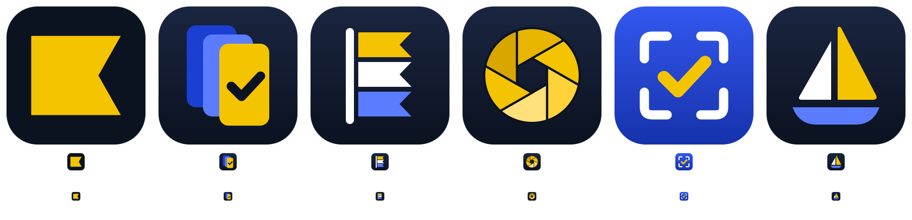

# shotfleet logo



`concepts-sheet.png`: the five directions explored on 2026-10-06 (current flag first, then fleet of screens, signal flags, aperture, viewfinder check, sail), each at full size, 32 px and 16 px. `iterations-sheet.png`: three takes on the chosen one (cascade, fan, stack). The fan won.

## The mark

Three phones fanned like a hand of cards, the front one yellow with a check: one flow, many devices, every screenshot checked. Colours are the `site.css` tokens: ink `#0b1220`, yellow `#f5c400`, blue `#1b3fd1`, plus a lighter blue `#5b7cff` for the second card.

| File | Use |
|---|---|
| `shotfleet-icon.svg` | Master app icon: gradient tile, soft shadows. Gumroad icon, store listings, large sizes. Its cards, without the tile, are the mark on the Gumroad thumbnail and covers. |
| `shotfleet-glyph.svg` | One colour (`currentColor`), back cards at 45%, the check cut out. Inlined in every page's header. |
| `site/public/favicon.svg` | Flat version: no filters or gradients, an ink gap between the cards instead of a shadow, a heavier check. Stays crisp at 16 px. |

## Rebuild

```sh
python3 marketing/logo/build.py                 # icon, glyph, favicon.svg/.ico, apple-touch-icon, Gumroad icon set
python3 marketing/gumroad/images/src/build.py   # Gumroad thumbnail and covers
```

The header glyph is inlined in `site/public/*.html`, `site/draft/*.html` and `tools/build-guides.py`; if the glyph changes, replace the `<svg viewBox="46 46 420 420" ...>` there too.

`site/public/og.jpg` was patched in place (only the mark, at 72,66, 32 x 32, `#1e48c9`) because `site/draft/og.html` no longer matches the live site's fonts. `marketing/gumroad/video` still shows the old flag until it is re-rendered (`marketing/gumroad/video/src/build.py` reads `site/public/favicon.svg`).
